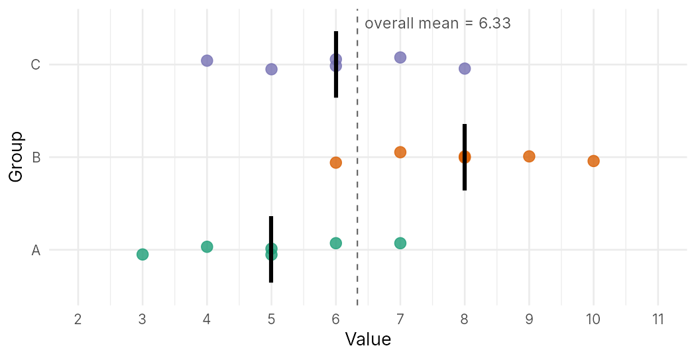
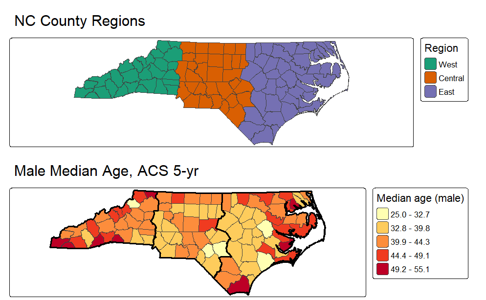
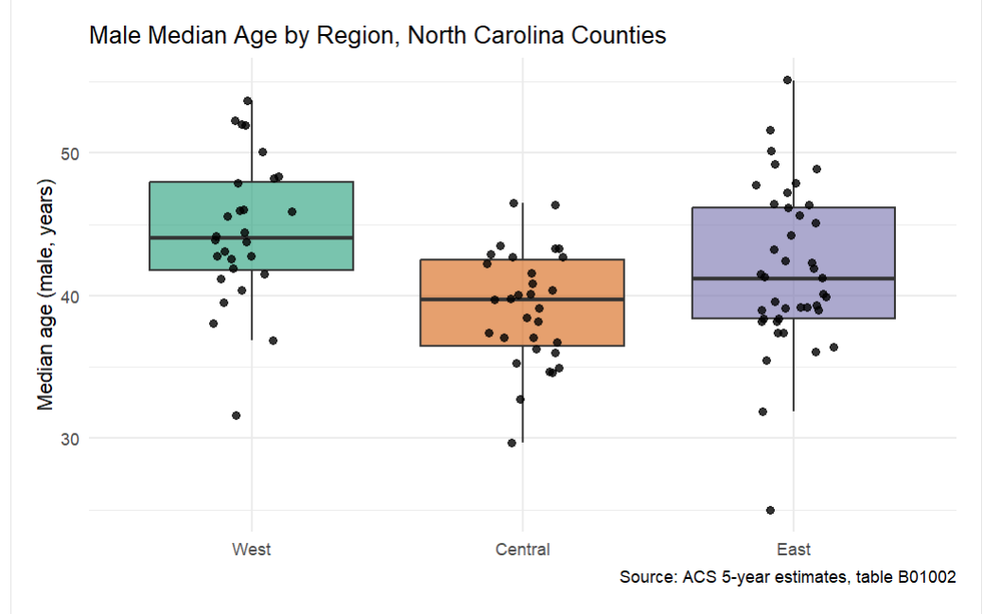
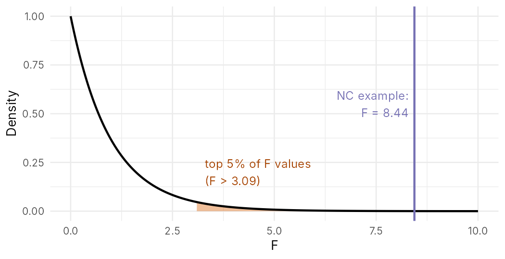

```{r}
#| label: setup-webex
#| include: false
library(webexercises)
```

::: {.callout-note appearance="simple"}
## Learning objectives

By the end of this chapter you should be able to:

1.  Place statistical testing in the cycle of data analysis.
2.  Explain what a statistic, a null hypothesis, and a p-value are, and read a test result in three steps.
3.  Describe how p-values are misused, and what to report alongside them.
4.  Explain how ANOVA compares variation between groups with variation within groups, using the F statistic.
5.  Run and interpret an ANOVA in R with `aov()`, and follow it with Tukey's HSD.
6.  Explain why observations of neighboring places make ANOVA's p-values less trustworthy.
:::

Western North Carolina's mountain counties are known as a retirement destination. The Piedmont has the big cities, universities, and their young workers. So do men in the west really tend to be older than men in the Piedmont? Or could the difference we see in the numbers be due to chance?

That is the question behind this chapter: **do groups of places really differ, or could the difference be chance?** We'll build up the tools in order. First, what data analysis is, and what a statistic and a p-value are. Then variance, the measure of spread that the method is built on. Then **analysis of variance (ANOVA)**, applied to median male age in North Carolina's 100 counties. We finish with what changes when the observations are places on a map.

## What is data analysis? {#sec-data-analysis}

Data analysis turns raw observations into evidence. We summarize what the data show, and we test whether the patterns are real or could be due to chance. It is a cycle, not a single test:

| Step | What you do |
|:-----|:------------|
| 1. Ask | Pose a question the data can answer. |
| 2. Collect | Gather, clean, and organize the observations. |
| 3. Describe | Summarize center, spread, and shape. |
| 4. Test | Check whether a pattern could be due to chance. |
| 5. Communicate | Report findings, maps, and their uncertainty. |

: The cycle of data analysis. {#tbl-analysis-cycle}

Chapter 16 covered step 3, describing data. This chapter is about step 4, testing, and about the measure of spread, variance, that connects the two.

## Statistics and p-values {#sec-p-values}

A **statistic** is a number calculated from a sample that summarizes the data. There are two broad kinds:

- **Descriptive statistics** summarize: the mean, the median, the standard deviation.
- **Test statistics** weigh evidence: *t*, *F*, chi-square.

Because a statistic comes from a sample, it estimates a value for the whole population, and it would change if you drew a different sample. A test asks whether the pattern in *this* sample is bigger than that sample-to-sample wobble would produce by chance.

Every test starts from a **null hypothesis**, written H₀: the boring claim that there is no difference, no relationship, nothing going on. The **alternative hypothesis**, H₁, is that there is something. The test then works out how surprising your data would be *if the null hypothesis were true*.

### Reading a test result

Read the output of any statistical test in three steps:

1.  **The test statistic.** How large the pattern is compared with random variation, for example *F*.
2.  **The p-value.** The probability of a result at least this extreme *if the null hypothesis were true*, that is, if the groups truly did not differ.
3.  **The decision.** By convention, if *p* < 0.05, reject the null hypothesis: the result is called **statistically significant**. If *p* ≥ 0.05, you have no evidence of a difference. That is not the same as evidence of *no* difference.

Suppose an ANOVA gives *p* = 0.03. That means: if the groups truly didn't differ, a result this extreme would happen about 3% of the time. It does *not* mean there is a 3% chance the null hypothesis is true, or that the difference between the groups is large.

::: {.callout-warning appearance="simple"}
## Significant is not the same as important

A tiny difference can be statistically significant if you have lots of data, and a large one can miss *p* < 0.05 if you have little. A p-value says nothing about the size of a difference. Always report the size of the difference too.
:::

### p-values and the replication crisis

p-values matter because they are the shared test of "could this be chance?", and for decades journals have used *p* < 0.05 as the bar for publication. That bar created bad incentives:

- **p-hacking:** re-running an analysis in different ways until something crosses 0.05.
- **The file drawer:** results that don't reach 0.05 go unpublished, so the published record overstates how often effects are found.
- **The bright line:** treating 0.049 as "real" and 0.051 as "nothing", as if they were different worlds.

| Year | Event |
|:-----|:------|
| 1925 | R. A. Fisher suggests *p* < 0.05 as a convenient guide, not a fixed rule. |
| 1933 | Jerzy Neyman and Egon Pearson add fixed error rates. Textbooks later blend the two ideas. |
| 2005 | John Ioannidis argues that most published research findings are false. |
| 2015 | The Open Science Collaboration repeats 100 psychology studies: 97% of the originals had reported *p* < 0.05, but only 36% of the repeats did. |
| 2016 | The American Statistical Association warns that p-values are widely misread. |
| 2019 | More than 800 scientists sign a call to retire "statistical significance". |

: A century of the p-value. Sources: Ioannidis (2005), *PLOS Medicine*; Open Science Collaboration (2015), *Science*; Wasserstein and Lazar (2016), *The American Statistician*; Amrhein, Greenland, and McShane (2019), *Nature*. {#tbl-p-timeline}

The failure of so many published findings to hold up when other researchers repeated them is called the **replication crisis**. The lesson for your own work: report the p-value *with* the size of the effect and a confidence interval, never on its own. And treat *p* = 0.051 and *p* = 0.049 as what they are: almost exactly the same amount of evidence.

## Variance: measuring spread {#sec-variance}

ANOVA is built on **variance**, which you met in Chapter 16. Variance is the average squared distance of each value from the mean:

$$
s^2 = \frac{\sum (x_i - \bar{x})^2}{n - 1}
$$

For a sample we divide by *n* − 1 rather than *n*. Small variance means values cluster near the mean; large variance means they spread widely. The **standard deviation**, *s*, is the square root of the variance, back in the data's own units.

```{webr-r}
a <- c(3, 4, 5, 5, 6, 7)

sum((a - mean(a))^2) / (length(a) - 1)   # variance by hand
var(a)                                   # the same, with var()
sd(a)                                    # standard deviation = sqrt(variance)
```

### Two kinds of variation

Now suppose we have three groups, A, B, and C, of six values each (@fig-within-between). There are two kinds of variation:

- **Within-group variation:** the spread of the values around their *own* group's mean.
- **Between-group variation:** how far the group means sit from the overall mean.

{#fig-within-between fig-alt="Dot plot with three rows, A, B, and C. Group A's six green dots run from 3 to 7 around a black bar at 5. Group B's orange dots run from 6 to 10 around a bar at 8. Group C's purple dots run from 4 to 8 around a bar at 6. A dashed vertical line at 6.33 marks the overall mean."}

ANOVA compares the two:

$$
F = \frac{\text{between-group variance}}{\text{within-group variance}}
$$

If the group means sit far apart *relative to* the noise inside each group, *F* is large, and the groups differ more than chance alone would produce. If the groups are really just random draws from one population, *F* hovers around 1.

## ANOVA: are the group means different? {#sec-anova}

**Analysis of variance**, or **ANOVA**, tests whether the means of three or more groups differ. (With only two groups, you would use a *t*-test. ANOVA extends the idea to more groups without the extra false positives you'd get from running many *t*-tests.)

The two hypotheses are:

- H₀: μ₁ = μ₂ = μ₃. All the group means are equal.
- H₁: At least one group mean differs.

ANOVA builds *F* from **sums of squares** (SS), the summed squared distances from the means, each divided by its **degrees of freedom** (df) to give a **mean square** (MS). With *k* groups and *N* observations in all:

| Source | df | Mean square (MS) |
|:-------|:---|:-----------------|
| Between groups | *k* − 1 | SS between ÷ (*k* − 1) |
| Within groups (residuals) | *N* − *k* | SS within ÷ (*N* − *k*) |
| *F* statistic | | MS between ÷ MS within |

: How ANOVA builds the F statistic. {#tbl-anova-table}

For the three groups in @fig-within-between, *k* = 3 and *N* = 18. The overall mean is 6.33. Work it through:

- **SS between** = 6 × (5 − 6.33)² + 6 × (8 − 6.33)² + 6 × (6 − 6.33)² = 28. With 3 − 1 = 2 df, MS between = 14.
- **SS within**: each group's values are spread around its own mean with a variance of 2, so its squared distances add up to 5 × 2 = 10. Three groups give 30. With 18 − 3 = 15 df, MS within = 2.
- ***F*** = 14 ÷ 2 = **7**.

`aov()` fits the model, and `summary()` prints the ANOVA table. The formula `value ~ group` reads "value, by group":

```{webr-r}
d <- data.frame(
  group = rep(c("A", "B", "C"), each = 6),
  value = c(3, 4, 5, 5, 6, 7,  6, 7, 8, 8, 9, 10,  4, 5, 6, 6, 7, 8)
)

fit <- aov(value ~ group, data = d)
summary(fit)
```

*F* = 7, with 2 and 15 degrees of freedom, and *p* = 0.0071. If all three groups came from one population, an *F* this large would turn up less than 1% of the time, so we reject H₀: at least one group mean differs.

Where does the p-value come from? If H₀ is true, *F* follows a known shape, the ***F* distribution**, which depends on the two degrees of freedom. The p-value is the share of that distribution beyond your *F*. In R, `pf()` gives it directly:

```{webr-r}
pf(7, df1 = 2, df2 = 15, lower.tail = FALSE)
```

## Example: median male age by North Carolina region {#sec-nc-age}

Back to the question we started with: **is the median age of males different between western, central, and eastern North Carolina?**

- **Data:** American Community Survey 5-year estimates of median age for males (table B01002) for all 100 North Carolina counties, downloaded with tidycensus (Chapter 13).
- **Groups:** the west (the mountains), the center (the Piedmont), and the east (the coastal plain). Each county belongs to one region (@fig-nc-regions).
- **Unit of analysis:** the county, not the person or the census tract.

{#fig-nc-regions fig-alt="Two maps of North Carolina's counties. The top map, NC County Regions, colors the western counties green, a central band orange, and the eastern counties purple. The bottom map, Male Median Age, ACS 5-yr, shades counties from pale yellow (25 to 32.7 years) to dark red (49.2 to 55.1 years). Dark red counties cluster in the far west and along parts of the coast; the Piedmont is mostly pale."}

Before testing anything, look at the data. Each dot in @fig-age-boxplot is one county, and each box holds the middle half of the counties in its region:

```r
nc_df <- st_drop_geometry(nc)

ggplot(nc_df, aes(region, estimate, fill = region)) +
  geom_boxplot(alpha = 0.6, outlier.shape = NA) +
  geom_jitter(width = 0.15, size = 1.8, alpha = 0.8) +
  scale_fill_manual(values = c("#1b9e77", "#d95f02", "#7570b3")) +
  labs(title = "Male Median Age by Region, North Carolina Counties",
       x = NULL, y = "Median age (male, years)",
       caption = "Source: ACS 5-year estimates, table B01002") +
  theme_minimal() +
  theme(legend.position = "none")
```

{#fig-age-boxplot fig-alt="Box plots of median male age for three regions, with each county drawn as a dot. West, in green, has a box from about 42 to 47 years and a median near 44. Central, in orange, is lowest, with a box from about 37 to 42 and a median near 40. East, in purple, has a box from about 38 to 46 and a median near 41, and the widest spread, from about 25 to 55."}

The table puts numbers on the picture:

```r
nc_df |>
  group_by(region) |>
  summarize(n = n(),
            mean   = mean(estimate, na.rm = TRUE),
            sd     = sd(estimate, na.rm = TRUE),
            median = median(estimate, na.rm = TRUE))
```

| Region | Counties | Mean | SD | Median |
|:-------|---------:|-----:|---:|-------:|
| West | 28 | 44.5 | 5.0 | 44.1 |
| Central | 31 | 39.2 | 3.9 | 39.7 |
| East | 41 | 41.8 | 5.6 | 41.2 |

: Median male age, in years, by region. {#tbl-age-summary}

The West is oldest, with a mean of 44.5 years, and the Piedmont youngest, at 39.2. The East sits between, at 41.8, with the widest spread. But the boxes overlap a lot. Is the gap between the regional means large compared with the spread inside each region? That is exactly what ANOVA tests.

### The ANOVA

One line fits the model: `estimate` is the variable we compare, and `region` defines the groups.

```r
fit <- aov(estimate ~ region, data = nc_df)
summary(fit)
```

```
            Df Sum Sq Mean Sq F value   Pr(>F)
region       2  420.8  210.41   8.439 0.000418 ***
Residuals   97 2418.5   24.93
---
Signif. codes:  0 '***' 0.001 '**' 0.01 '*' 0.05 '.' 0.1 ' ' 1
```

Read it in three steps:

1.  **Test statistic.** *F* = 210.41 ÷ 24.93 = 8.44. The variation between regions is about eight times the variation within them. With *k* = 3 regions and *N* = 100 counties, the degrees of freedom are 2 and 97.
2.  **p-value.** 0.000418, far below 0.05. If the three regions really had the same mean, an *F* this large would almost never happen (@fig-f-dist).
3.  **Decision.** Reject the null hypothesis. At least two of the regions differ in median male age.

{#fig-f-dist fig-alt="A curve that starts high at F = 0 and falls quickly toward zero by F = 4. A small orange area under the curve beyond F = 3.09 is labeled top 5% of F values. A purple vertical line at F = 8.44, labeled NC example, is far to the right, where the curve is almost flat on the axis."}

Notice what the result does *not* say. It doesn't say all three regions differ, only that some do. And it doesn't say *why*: region doesn't cause age. Retirement migration, college towns, and military bases are all possible explanations that the test can't tell apart.

::: {.callout-tip appearance="simple"}
## Think about it

Before you saw the data, which region would you have guessed has the oldest men? What features of a county (a university, a military base, a retirement community) would pull its median age down or up?
:::

## After ANOVA: which groups differ? {#sec-after-anova}

ANOVA tells us that at least two groups differ, not which ones. To find out, run a **post-hoc test**. **Tukey's honestly significant difference (HSD)** test compares every pair of groups and adjusts the p-values, so that making three comparisons doesn't inflate the chance of a false positive:

```{webr-r}
d <- data.frame(
  group = rep(c("A", "B", "C"), each = 6),
  value = c(3, 4, 5, 5, 6, 7,  6, 7, 8, 8, 9, 10,  4, 5, 6, 6, 7, 8)
)
fit <- aov(value ~ group, data = d)

TukeyHSD(fit)
```

For the three groups, only B and A differ significantly: B's mean is 3 higher, with an adjusted p-value of 0.006. C and A (*p* = 0.46) and C and B (*p* = 0.066) do not. In the North Carolina example, `TukeyHSD(fit)` on the regional model shows which pairs of regions differ; try it in Exercise 2.

### Check the assumptions

ANOVA's p-value is only trustworthy if three assumptions hold:

1.  **Independence:** each observation tells you nothing about the others.
2.  **Normality:** the values in each group, or more exactly the model's residuals, are roughly normal.
3.  **Equal variances:** the groups have similar spreads.

The **Shapiro-Wilk test** checks normality. Its null hypothesis is that the residuals *are* normal, so a large p-value is good news. For the North Carolina model, `shapiro.test(residuals(fit))` gives *W* = 0.98 and *p* = 0.18: no evidence that the residuals aren't normal.

If the assumptions fail, there are standard fallbacks:

- **Welch's ANOVA**, `oneway.test()`, does not assume equal variances.
- The **Kruskal-Wallis test**, `kruskal.test()`, compares the groups by rank, so it does not need normal data.

```{webr-r}
d <- data.frame(
  group = rep(c("A", "B", "C"), each = 6),
  value = c(3, 4, 5, 5, 6, 7,  6, 7, 8, 8, 9, 10,  4, 5, 6, 6, 7, 8)
)

shapiro.test(residuals(aov(value ~ group, data = d)))
oneway.test(value ~ group, data = d)
kruskal.test(value ~ group, data = d)
```

All three tests agree here: the groups differ (*p* < 0.05).

## What makes it spatial data science? {#sec-anova-spatial}

The first assumption, independence, is where spatial data cause trouble. The observations in our example are places, and places are connected.

- **Nearby places are alike.** By the **first law of geography**, near things are more related than distant things. Neighboring counties share age profiles, so the 100 counties are not 100 independent pieces of evidence. Treating them as independent tends to make ANOVA's p-value look smaller than it should.
- **Boundaries shape the answer.** Drawing the three regions differently, or analyzing census tracts instead of counties, could change the result. That is the **modifiable areal unit problem**.
- **Spatial tools account for neighbors.** Moran's I (Chapter 22) tests whether a model's residuals cluster on the map, and spatial regression and permutation tests build neighbors into the model to give more honest p-values.

The bottom line: before you trust a p-value from map data, map the residuals and check them for spatial autocorrelation. Our ANOVA says median male age differs across North Carolina's regions (*F* = 8.44, *p* < 0.001), with the West oldest. Because the counties are neighbors on a map, treat that p-value with some caution.

## Check your understanding

1.  An ANOVA gives *p* = 0.03. This means: `r mcq(c(answer = "If the groups truly didn't differ, a result this extreme would happen about 3% of the time", "There is a 3% chance the null hypothesis is true", "The difference between the groups is large", "97% of the data support the hypothesis"))`

2.  The null hypothesis of an ANOVA is that: `r mcq(c(answer = "All the group means are equal", "All the group means are different", "At least one group mean differs", "The groups have different variances"))`

3.  A statistically significant result is always a large or important one. `r torf(FALSE)`

4.  The F statistic is between-group variance divided by: `r mcq(c(answer = "Within-group variance", "The overall mean", "The number of groups", "The p-value"))`

5.  An ANOVA compares 4 groups with 40 observations in all. How many degrees of freedom does the between-groups row have? `r fitb("3")`

6.  ANOVA gives *F* = 8.44 and *p* = 0.0004 for three regions. What can you conclude? `r mcq(c("All three regions differ from each other", "The West is older than the East", "Region causes differences in age", answer = "At least two regions differ in median male age"))`

7.  Which test compares every pair of groups after an ANOVA? `r mcq(c("Shapiro-Wilk", answer = "Tukey's HSD", "Kruskal-Wallis", "Moran's I"))`

8.  Neighboring counties being alike breaks ANOVA's assumption of: `r mcq(c("Normality", "Equal variances", answer = "Independence", "Large samples"))`

## Summary

- Data analysis is a cycle: ask, collect, describe, **test**, and communicate.
- A **statistic** summarizes a sample. A test starts from a **null hypothesis** of no difference, and the **p-value** is the chance of a result at least this extreme if the null hypothesis were true. By convention, *p* < 0.05 is **statistically significant**.
- p-values are easy to misuse. Report them with the size of the effect and a confidence interval, and don't treat 0.05 as a bright line.
- **Variance** is the average squared distance from the mean. **ANOVA** compares between-group with within-group variance: *F* = MS between ÷ MS within. A large *F* and small *p* mean at least one group mean differs.
- In R: `fit <- aov(value ~ group, data = d)`, then `summary(fit)`. Follow it with `TukeyHSD(fit)` to find which groups differ. Use `oneway.test()` or `kruskal.test()` if the assumptions fail.
- In North Carolina, median male age differs by region (*F* = 8.44, *p* = 0.0004), with the West oldest. Because neighboring counties are alike, check spatial data for spatial autocorrelation before trusting a p-value.

## Exercises

1.  **By hand.** Three groups have the values (2, 4, 6), (5, 7, 9), and (8, 10, 12). Calculate the group means, SS between, SS within, and *F* by hand, then check your answer with `aov()`.
2.  **Which regions?** Run `TukeyHSD()` on the North Carolina regional model. Which pairs of regions differ significantly? Does that match what you see in @fig-age-boxplot?
3.  **Female age.** Download the median age for females (variable `B01002_003`) for North Carolina's counties with tidycensus, assign each county to the same regions, and run an ANOVA. Do the regions differ for women too?
4.  **Draw the lines differently.** Move the boundary between the central and eastern regions one tier of counties east or west, and rerun the ANOVA. How much does *F* change? What does that tell you about the modifiable areal unit problem?
5.  **Births.** Using the `nc` data from the sf package (Chapter 16), make a variable for births per square kilometer, group the counties into three regions by the longitude of their centroids, and test whether births per square kilometer differ by region. Check the assumptions, and use `kruskal.test()` if they fail.

## Further reading

- Wasserstein, R. L., and Lazar, N. A. (2016). "The ASA Statement on p-Values: Context, Process, and Purpose." *The American Statistician* 70(2): 129–133. Six short principles for using p-values well.
- Amrhein, V., Greenland, S., and McShane, B. (2019). "Scientists Rise Up Against Statistical Significance." *Nature* 567: 305–307.
- Open Science Collaboration (2015). "Estimating the Reproducibility of Psychological Science." *Science* 349(6251): aac4716.
- *OpenIntro Statistics* (4th ed.), by David Diez, Mine Çetinkaya-Rundel, and Christopher Barr, free at <https://www.openintro.org/book/os/>. Chapter 7 covers ANOVA.
