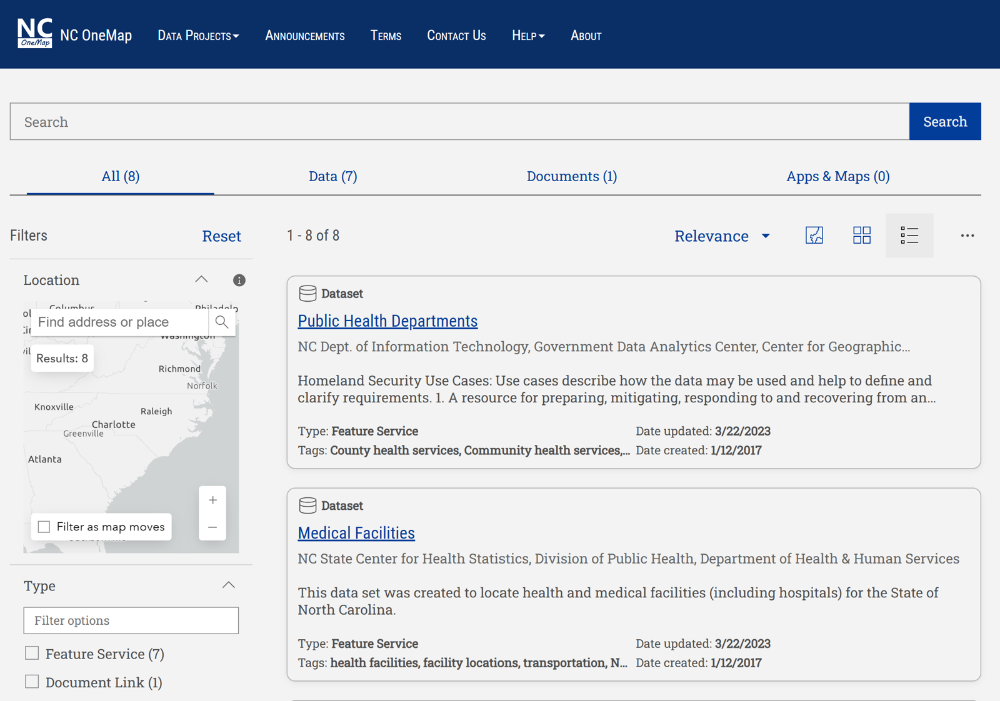
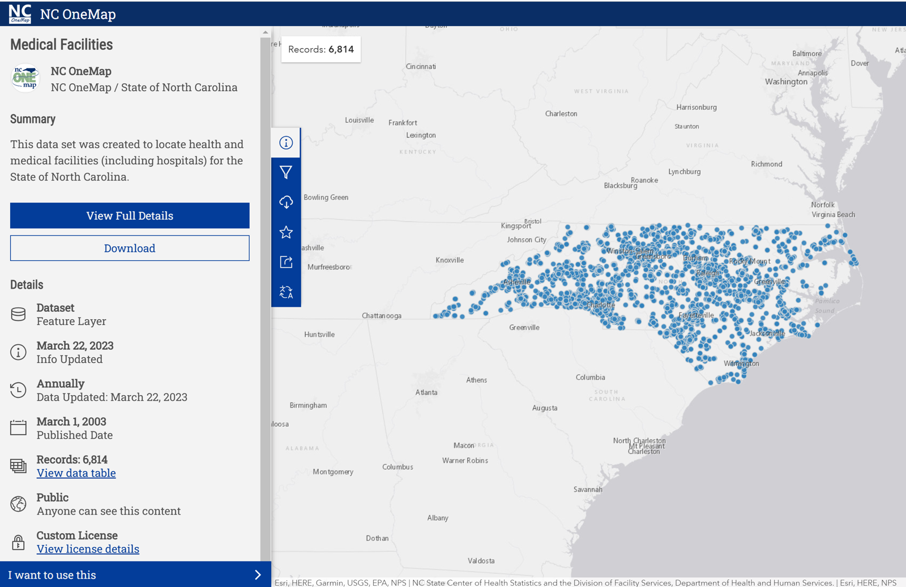
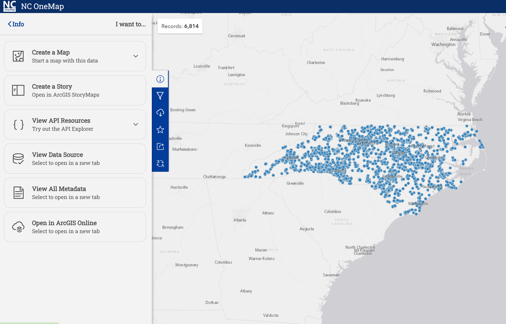
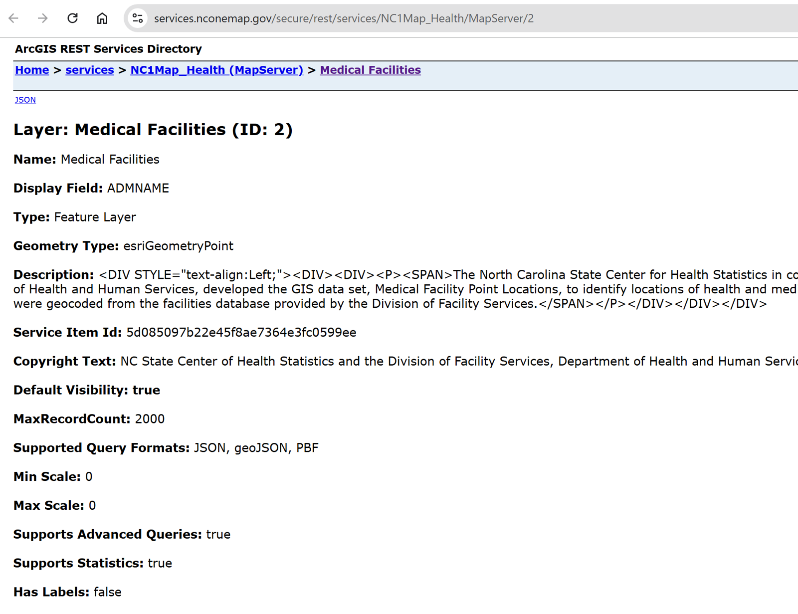
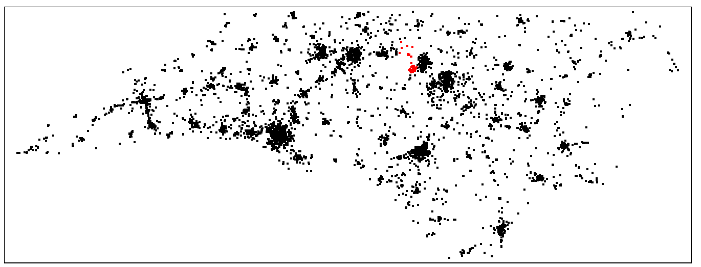

```{r}
#| label: setup-webex
#| include: false
library(webexercises)
```

::: {.callout-note appearance="simple"}
## Learning objectives

By the end of this chapter you should be able to:

1.  Explain how agencies publish GIS layers on ArcGIS portals such as NC OneMap.
2.  Tell a feature service from other kinds of items, and find a layer's REST endpoint URL.
3.  Read the useful details on a layer's REST Services Directory page.
4.  Download a layer into R as an sf object with `get_spatial_layer()` from the **arcpullr** package.
5.  Filter a layer on the server with a `where` clause, and explain why that is better than filtering after you download.
:::

Chapter 16 showed how an **API** lets your code ask another program's server for data, using the Census Bureau's API and the tidycensus package. This chapter uses the same idea for a different, and very common, source of GIS data: layers published with Esri's ArcGIS software. By the end of it you'll load a layer from North Carolina's statewide GIS portal, NC OneMap, straight into R and map it.

## Recap: APIs {#sec-api-recap}

An API is a set of rules that lets your code request data from another program's server. The pattern is always the same: **request, then response**. Your code sends an **endpoint** URL, often with **parameters** that say what you want, and the server sends data back, usually as JSON.

Why bother, when you could click a Download button? Two reasons from Chapter 16 still apply:

- **Reproducibility.** Your script is the record of exactly where the data came from and how you got them. Anyone can rerun it.
- **Efficiency.** You download only the data you need, not a whole statewide file.

tidycensus is a wrapper package for the Census API. Today's wrapper package is **arcpullr**, for ArcGIS servers.

## ArcGIS portals and feature services {#sec-arcgis-portals}

Thousands of government agencies, universities, and companies publish their GIS data online through **ArcGIS Online** or ArcGIS Enterprise, Esri's systems for sharing maps and data on the web. Many run a public **portal**: a website where you can search, preview, and download their layers. North Carolina's is **NC OneMap**, <https://www.nconemap.gov/>, which gathers layers from state agencies, counties, and cities: roads, parcels, schools, hospitals, flood zones, and much more.

Behind the website, each published layer lives on an ArcGIS server. A layer published as a **feature service** (or as one layer of a map service) has its own **REST endpoint**: a URL that returns the layer's features and attributes when your code asks for them. arcpullr is an R package that sends a request to that endpoint and returns the layer as an **sf** object, ready for the dplyr, sf, and tmap tools you already know.

When you search a portal, look at the type of each result. "Feature Service" or "Feature Layer" marks a layer arcpullr can read (@fig-onemap-search). Other items, such as documents, web maps, and apps, are not.

{#fig-onemap-search fig-alt="Screenshot of NC OneMap search results. A filter panel on the left has a small map of North Carolina and a Type filter. On the right are two results, Public Health Departments and Medical Facilities, each with a short description and a line reading Type: Feature Service."}

## Finding a layer's REST URL {#sec-find-rest-url}

arcpullr needs one thing from you: the layer's REST URL. Here is how to find it on NC OneMap, using the Medical Facilities layer. The same steps work on most ArcGIS Online and ArcGIS Enterprise portals.

1.  **Search** NC OneMap for a dataset, such as "medical facilities".
2.  **Open its item page.** Check that the details panel on the left says it is a feature layer.
3.  **Click "I want to use this"** at the bottom of the details panel (@fig-onemap-item).
4.  **Choose "View Data Source"** from the list that opens (@fig-onemap-want). It opens the layer's REST service page in a new tab.
5.  **Copy that page's URL** from the address bar. That URL is what arcpullr needs.

{#fig-onemap-item fig-alt="Screenshot of the NC OneMap page for Medical Facilities. On the left, a details panel gives a summary, View Full Details and Download buttons, and details including Feature Layer, the date updated, and a record count. On the right, a gray map of the southeastern United States has blue dots across North Carolina, one for each facility."}

{#fig-onemap-want fig-alt="Screenshot of NC OneMap with the I want to menu open on the left. It lists Create a Map, Create a Story, View API Resources, View Data Source, View All Metadata, and Open in ArcGIS Online. The map on the right shows Records: 6,814 and blue dots across North Carolina."}

### Reading the REST Services Directory page

The page that opens is the layer's page in the **ArcGIS REST Services Directory** (@fig-rest-page). It is plain, but it holds everything you need to know before you write any code:

{#fig-rest-page fig-alt="Screenshot of a web page titled ArcGIS REST Services Directory. The address bar reads services.nconemap.gov/secure/rest/services/NC1Map_Health/MapServer/2. The page shows Layer: Medical Facilities (ID: 2), Display Field ADMNAME, Type Feature Layer, Geometry Type esriGeometryPoint, a description, copyright text, MaxRecordCount 2000, and Supported Query Formats JSON, geoJSON, PBF."}

- **The URL.** `https://services.nconemap.gov/secure/rest/services/NC1Map_Health/MapServer/2`. The number at the end, `2`, is the **layer ID**: this service holds several layers, and Medical Facilities is number 2. If you copy a URL without the number, you have the whole service, not one layer.
- **Geometry Type.** `esriGeometryPoint`, so each feature is a point. Others are polylines and polygons.
- **MaxRecordCount.** 2,000: the most features the server returns for one request.
- **Fields.** Further down the page, a list of the attribute columns and their types. You need these names to filter the layer.

The item page reports 6,814 records, more than the 2,000 the server returns at once. You don't need to worry about that: arcpullr asks for the features in batches and puts them back together. Still, check that the number of rows you get matches what the portal reports.

## Anatomy of an arcpullr request {#sec-arcpullr-request}

Install arcpullr once, in the Console, with `install.packages("arcpullr")`. Then:

```r
library(arcpullr)
library(sf)
library(tmap)

url <- "https://services.nconemap.gov/secure/rest/services/NC1Map_Health/MapServer/2"
medical.centers <- get_spatial_layer(url, where = "fcounty = 'Orange'")
```

Line by line:

- `url` stores the REST endpoint you copied from the service page.
- `get_spatial_layer()` sends the request and returns the layer as an sf object.
- `where =` is a filter, written in **SQL**, that runs on the server. Here `fcounty = 'Orange'` returns only the facilities in Orange County. Without a `where` argument, you get every feature in the layer.

### Writing a where clause

The `where` argument is a small piece of SQL, the language of databases, that the server applies before it sends anything back. It uses the field names from the REST page, not the ones you might rename later in R. A few rules cover most needs:

| You want | `where =` |
|:---------|:----------|
| Text equal to a value | `"fcounty = 'Orange'"` |
| One of several values | `"fcounty IN ('Orange', 'Durham', 'Wake')"` |
| A number above a value | `"beds > 100"` |
| Two conditions | `"fcounty = 'Orange' AND beds > 100"` |
| Text that starts with something | `"fcounty LIKE 'Ch%'"` |

: Common `where` clauses. The field names are examples; use the fields listed on your layer's REST page. {#tbl-where}

Note the quotes: the whole clause is an R string in double quotes, and text values inside it go in single quotes. SQL uses `=`, not `==`, and `AND` and `OR`, not `&` and `|`.

Why filter on the server instead of downloading everything and using `filter()` in R? For a statewide layer of a few thousand points, either works. But many layers are far bigger: every parcel or building in the state. Filtering on the server means less data crosses the internet, the request is faster, and you never hit the server's limits. It also makes your script say exactly which part of the data you used.

::: {.callout-tip appearance="simple"}
## Think about it

The REST page says the Medical Facilities layer was "geocoded from the facilities database". What could go wrong with locations made that way (Chapter 16)? How might you check a few of them?
:::

## Two requests, one map {#sec-two-requests}

Here are two requests to the same layer: one for every medical facility, and one for Orange County only. tmap draws all of them in black, then the Orange County facilities in red on top (@fig-medical-map):

```r
url <- "https://services.nconemap.gov/secure/rest/services/NC1Map_Health/MapServer/2"
all.medical.centers    <- get_spatial_layer(url)
orange.medical.centers <- get_spatial_layer(url, where = "fcounty = 'Orange'")

tm_shape(all.medical.centers) +
  tm_dots() +
  tm_shape(orange.medical.centers) +
  tm_dots(fill = "red")
```

{#fig-medical-map fig-alt="Map of North Carolina drawn only with black dots, one per medical facility, with no boundaries. The dots outline the state, with dense clusters around Charlotte, the Triad, the Triangle, Asheville, Fayetteville, and Wilmington. A small group of red dots sits in Orange County, just west of the Triangle."}

The dots alone trace the shape of the state, with dense clusters around Charlotte, the Triad (Greensboro, Winston-Salem, and High Point), and the Triangle (Raleigh, Durham, and Chapel Hill), where most people live.

### Before you analyze

The result is an ordinary sf object, so everything from earlier chapters applies:

- **Check it.** `nrow()`, `names()`, and `glimpse()` show how many features came back and what the columns are called.
- **Check the coordinate system.** Run `st_crs()` on the result. Before measuring distances or areas, project it to North Carolina State Plane with `st_transform(32119)` (Chapter 11).
- **Note the date.** Portal layers are **dynamic**: agencies update them, sometimes daily. Rerunning your script next month may give different data. Record the date you downloaded it, and save a copy with `st_write()` if your results must be exactly reproducible.

### More arcpullr functions

`get_spatial_layer()` is the one you'll use most. arcpullr has others for other jobs:

- `get_table_layer()` downloads a table that has no geometry.
- `get_layer_by_poly()` downloads only the features that fall inside a polygon you give it, such as one county's boundary. Like `where`, it filters on the server, but by location instead of by attribute.
- `get_image_layer()` and `get_map_layer()` download raster images and map services.

## Try it {#sec-try-arcpullr}

1.  Go to <https://www.nconemap.gov/> and browse the data by theme, or search for a topic you care about.
2.  Find a dataset that is a feature service.
3.  Track down its REST URL: "I want to use this", then "View Data Source".
4.  Paste the URL into `get_spatial_layer()` and map the result with tmap.
5.  Bonus: add a `where` filter for your own county. Which field holds the county name in your layer?

## Check your understanding

1.  arcpullr returns a layer as: `r mcq(c("A CSV file", answer = "An sf object", "A web map", "A raster"))`

2.  On NC OneMap, which menu item opens a layer's REST service page? `r mcq(c("Create a Map", "View API Resources", answer = "View Data Source", "Open in ArcGIS Online"))`

3.  In `.../NC1Map_Health/MapServer/2`, what is the `2`? `r mcq(c("The version of the service", answer = "The layer ID", "The number of fields", "The page of results"))`

4.  What is the name of the arcpullr function that downloads a feature layer? `r fitb(c("get_spatial_layer", "get_spatial_layer()"))`

5.  A `where` clause is applied by the server, before any data are sent to R. `r torf(TRUE)`

6.  Which `where` clause returns only facilities in Durham County? `r mcq(c("\"fcounty == Durham\"", answer = "\"fcounty = 'Durham'\"", "fcounty = Durham", "\"fcounty & 'Durham'\""))`

7.  MaxRecordCount tells you: `r mcq(c("How many layers the service has", answer = "The most features the server returns for one request", "How many fields the layer has", "How many people have downloaded the layer"))`

8.  Data downloaded from a portal today will always be identical to data downloaded next year. `r torf(FALSE)`

## Summary

- Agencies publish GIS layers on **ArcGIS Online** and ArcGIS Enterprise **portals**. **NC OneMap** is North Carolina's.
- Each published layer has a **REST endpoint** URL. On NC OneMap, find it with "I want to use this" and then "View Data Source".
- The **REST Services Directory** page shows the **layer ID** (the number at the end of the URL), the geometry type, the **MaxRecordCount**, and the field names.
- **arcpullr**'s `get_spatial_layer(url)` downloads a layer as an sf object.
- A `where` clause, written in **SQL**, filters the layer on the server: `where = "fcounty = 'Orange'"`. Filtering on the server is faster and sends less data.
- Portal layers change over time. Check what you got, project it before measuring, and record the download date.

## Exercises

1.  **Your county.** Download the NC OneMap Medical Facilities layer for your home county (or Orange County) with a `where` clause. How many facilities are there? Compare your count with the full layer filtered in R with `filter()`.
2.  **Two counties.** Use `IN` to download the facilities for Orange and Durham counties in one request. Map them, colored by county.
3.  **A new layer.** Find a different feature service on NC OneMap, such as schools, parks, or fire stations. Record its REST URL, geometry type, MaxRecordCount, and three of its field names, then download and map it.
4.  **Polygons.** Find a polygon layer on NC OneMap. Download it, project it with `st_transform(32119)`, and calculate the area of each feature with `st_area()`.
5.  **Join it up.** Count the medical facilities in each county, then join the counts to a county boundary layer (Chapter 12) and make a choropleth map of facilities per 10,000 people, using county populations from tidycensus (Chapter 16).

## Further reading

- The arcpullr page on CRAN, <https://cran.r-project.org/package=arcpullr>, links to the package manual and vignettes, which list every function with examples.
- NC OneMap, <https://www.nconemap.gov/>, North Carolina's portal for state and local GIS data.
- Esri's *ArcGIS REST APIs* documentation, <https://developers.arcgis.com/rest/>, explains what a feature service is and every parameter a query can use, including `where`.
