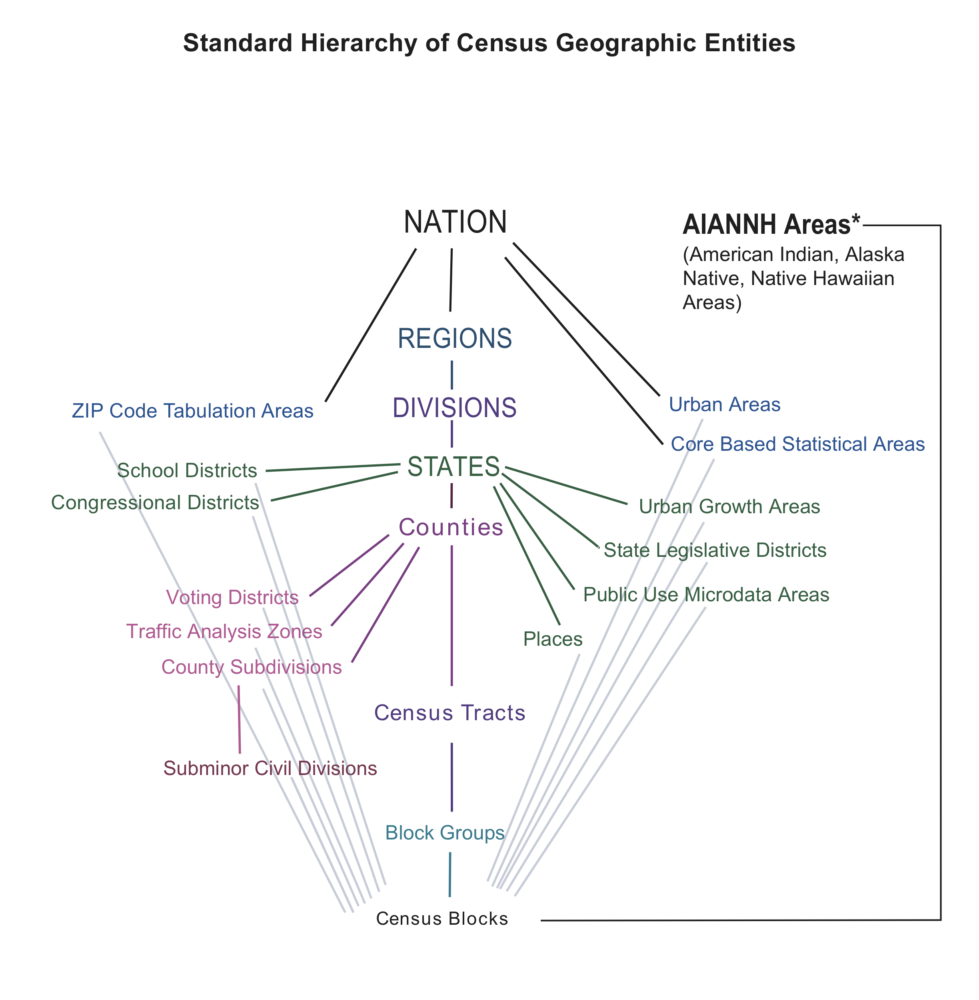

::: {.callout-note appearance="simple"}
## Learning objectives

By the end of this chapter you should be able to:

1.  Explain where US Census data come from, and how the decennial census differs from the American Community Survey (ACS).
2.  Describe the Census geographic hierarchy and read a GEOID.
3.  Choose an appropriate geography, survey, and variable for a research question.
4.  Explain what an API is and build a Census API request by hand.
5.  Download Census data with boundaries attached using **tidycensus**, and map it.
6.  Work responsibly with margins of error, percentages, and comparisons across years.
:::

Most of the spatial data science you will do about people in the United States starts with Census data. Population, income, housing, commuting, education: if a question involves who lives where, the Census Bureau has probably measured it, for small areas, across the whole country, for free.

This chapter has two halves. The first covers *what* the data are: where they come from, how Census geography is organized, and which variables you will use most. The second covers *how* to get them: what an API is, how to make a request by hand, and how the **tidycensus** package turns that request into one line of R that returns a map-ready data frame.

## A brief history of the US Census {#sec-census-history}

Article I of the Constitution requires a count of the population every ten years so that seats in the House of Representatives can be apportioned among the states. The first census, in 1790, was carried out by U.S. marshals on horseback and counted 3.9 million people. The count has run every decade since.

The Census Bureau has repeatedly pushed new technology into being because the job of counting a growing country kept outgrowing the old tools (@tbl-census-timeline). Herman Hollerith's punch-card tabulating machines, built for the 1890 census, led to the company that became IBM. A century later, the 1990 census introduced TIGER, one of the first national digital map databases. The boundary files you will download later in this chapter descend directly from it.

| Year | Milestone | What changed |
|:-----------------------|:-----------------------|:-----------------------|
| 1790 | First census | U.S. marshals count 3.9 million people, as the Constitution requires |
| 1890 | Punch cards | Herman Hollerith's machines speed up tabulation |
| 1902 | Permanent bureau | Congress makes the Census Office permanent |
| 1940 | Sampling begins | Some questions go to a 5% sample of households |
| 1990 | TIGER | Digital street and boundary files for the whole country |
| 2005 | ACS launches | A yearly survey replaces the decennial "long form" |
| 2020 | Online response | First census answered online; differential privacy added |

: Milestones in the history of the US Census.

For our purposes the most important change is the one from 2005. Before then, detailed social and economic questions (income, education, commuting) were asked on a "long form" sent to a sample of households once a decade. Since 2005 those questions have moved to the **American Community Survey**, which samples households every year. That gives two distinct sources of Census data, and you will choose between them constantly:

- The **decennial census** is a full count of everyone, every ten years. It asks only a few questions (age, sex, race, Hispanic origin, household relationship, housing tenure), but it covers every person.
- The **American Community Survey (ACS)** is a continuous sample survey. It asks many more questions, but every number it publishes is an *estimate*, with a margin of error (@sec-moe).

### The moving center of population


Each census, the Bureau calculates the **mean center of population**: the point where a flat map of the United States would balance if every resident weighed the same. In 1790 it sat in Kent County, Maryland, on the Eastern Shore. By 2020 it had moved about 884 miles, in a straight line, to Wright County, Missouri (@fig-pop-center) [@census_centers].


::: {.cell}

```{.r .cell-code}
lower48 <- states(cb = TRUE, resolution = "20m", year = 2020) |>
  filter(!STUSPS %in% c("AK", "HI", "PR")) |>
  st_transform(5070)

# Draw each series as its own path, plus a dashed link between the two 1950 points
paths <- centers |>
  group_by(extent) |>
  summarize(do_union = FALSE) |>
  st_cast("LINESTRING")

link_1950 <- centers |>
  filter(year == 1950) |>
  summarize(do_union = FALSE) |>
  st_cast("LINESTRING")

labeled <- centers |>
  filter(year %in% c(1790, 1850, 1900, 1950, 2020), extent == "Lower 48" | year == 2020)

# Zoom to the eastern two-thirds of the country, where the path lies
zoom <- st_bbox(st_buffer(centers, 600000))

ggplot() +
  geom_sf(data = lower48, fill = "#f6efe0", color = "#b9ad97", linewidth = 0.3) +
  geom_sf(data = link_1950, color = "#3b5b7a", linetype = "dashed", linewidth = 0.5) +
  geom_sf(data = paths, color = "#3b5b7a", linewidth = 0.7) +
  geom_sf(data = centers, aes(fill = year), shape = 21, size = 2.6, color = "white", stroke = 0.4) +
  geom_sf_label(
    data = labeled, aes(label = year), nudge_y = 75000,
    size = 3.2, label.size = 0, fill = alpha("white", 0.8)
  ) +
  scale_fill_gradient(low = "#9fb7cc", high = "#1d3550", name = "Census year") +
  coord_sf(xlim = zoom[c("xmin", "xmax")], ylim = zoom[c("ymin", "ymax")], expand = FALSE) +
  theme_void() +
  theme(legend.position = "bottom", legend.key.width = unit(2, "cm"))
```

::: {.cell-output-display}
{#fig-pop-center fig-alt='Map of the lower 48 states with a line of 25 dots tracing the mean center of population. It starts on the Eastern Shore of Maryland in 1790, runs almost due west through West Virginia, Ohio, and Indiana through 1940, then bends southwest across Illinois into Missouri, ending in Wright County, Missouri, in 2020.' width=864}
:::
:::


The path tells the story of American settlement. Through the 1800s the center moved almost straight west as settlement pushed across the continent, fastest before 1900. After 1950 it bent southwest as the Sun Belt grew, and it has been in Missouri since 1980.

::: {.callout-tip appearance="simple"}
## Think about it

Which direction do you expect the center of population to move by 2030? What trends in migration, birth rates, or immigration would push it further west, further south, or back east?
:::

## Census geography {#sec-census-geography}

Census data are always published for *areas*, never for individual people or addresses. Understanding how those areas are defined, and how they fit together, is the first step in using the data well.

{#fig-census-hierarchy fig-alt="Diagram of Census geographies. A vertical spine runs from Nation through Regions, Divisions, States, Counties, Census Tracts, and Block Groups to Census Blocks. Other geographies branch off the spine, including ZIP Code Tabulation Areas, school districts, congressional districts, places, urban areas, core based statistical areas, and American Indian, Alaska Native, and Native Hawaiian areas, with thin lines showing that each is built from census blocks."}

@fig-census-hierarchy shows the standard hierarchy. The central spine runs from the nation to regions, divisions, states, counties, census tracts, block groups, and finally blocks. Every unit on the spine **nests** perfectly: each block lies inside exactly one block group, which lies inside exactly one tract, one county, and one state. That nesting is what makes the spine so useful. You can add blocks up to block groups, block groups to tracts, and so on, and never double-count anyone.

The geographies that branch off the spine, such as ZIP Code Tabulation Areas, places (cities and towns), and congressional districts, are built from blocks too, but they do not nest neatly inside counties or tracts. A ZIP code can cross county lines, and a city can include parts of several tracts. When you have a choice, work on the spine.

The three smallest units on the spine are the ones you will use most for local analysis. @fig-orange-geographies shows all three for Orange County, North Carolina.


::: {.cell}

```{.r .cell-code}
orange_tracts <- tracts("NC", "Orange", year = 2020)
orange_bgs    <- block_groups("NC", "Orange", year = 2020)
orange_blocks <- blocks("NC", "Orange", year = 2020)

geo_levels <- bind_rows(
  orange_tracts |> transmute(level = "Tracts"),
  orange_bgs    |> transmute(level = "Block groups"),
  orange_blocks |> transmute(level = "Blocks")
) |>
  mutate(level = fct_inorder(level))

ggplot(geo_levels) +
  geom_sf(fill = "#f6efe0", color = "#3b5b7a", linewidth = 0.1) +
  facet_wrap(~level) +
  theme_void()
```

::: {.cell-output-display}
{#fig-orange-geographies fig-alt='Three maps of Orange County, North Carolina, side by side. The first shows about 40 census tracts, the second several times as many block groups, and the third thousands of small census blocks, densest around Hillsborough in the center of the county and Chapel Hill and Carrboro in the south.' width=960}
:::
:::


**Census blocks** are the smallest unit. A block is often a single city block bounded by streets, but blocks are bounded by any visible feature (railroads, streams, shorelines) and in rural areas can be large. Only the decennial census is published for blocks, and in 2020 block-level data carry the most differential-privacy noise (@sec-decennial), so use them with care.

**Block groups** combine several blocks and usually hold 600 to 3,000 people. They are the smallest geography for which ACS 5-year estimates are published, which makes them the finest level available for most social and economic variables. That detail comes at a cost: block group estimates have large margins of error.

**Census tracts** combine block groups and typically hold 1,200 to 8,000 people, about 4,000 on average. They are drawn to be fairly similar in population and stable over time, which makes them the workhorse unit for neighborhood analysis. Their boundaries are still revised each decade, though, so comparisons across censuses take care (@sec-comparing-years).

### FIPS codes and GEOIDs

Every Census area has a unique identifier called a **GEOID**, built by stringing together **FIPS codes** (Federal Information Processing Standards codes) for each level of the hierarchy. FIPS codes are standard numeric IDs for states and counties: North Carolina is 37 and Orange County is 135.

| Part        | Example               | Digits | GEOID so far                  |
|:------------|:----------------------|:------:|:------------------------------|
| State       | `37` (North Carolina) |   2    | `37`                          |
| County      | `135` (Orange)        |   3    | `37135`                       |
| Tract       | `011600`              |   6    | `37135011600` (11 digits)     |
| Block group | `2`                   |   1    | `371350116002` (12 digits)    |
| Block       | `2004`                |   4    | `371350116002004` (15 digits) |

: Reading a GEOID, using a tract in Orange County, NC. The tract number is illustrative. A block GEOID appends a four-digit block number to the *tract* GEOID, and the first digit of that block number is the block group.

Read @tbl-geoid from the top down. Because the parts always have the same number of digits, you can recover the state, county, and tract of any block just by slicing its GEOID, for example with `str_sub(GEOID, 1, 5)` for the county.

::: {.callout-warning appearance="simple"}
## Keep GEOIDs as text

GEOIDs look like numbers, but treat them as text. Alabama's state FIPS code is `01`. Read it as a number and it becomes `1`, every Alabama GEOID loses a digit, and your joins quietly fail. When you read a CSV, set the column type explicitly, for example `read_csv(file, col_types = cols(GEOID = col_character()))`.
:::

The GEOID is also the key you will join on. Census tables and Census boundary files both carry a `GEOID` column, so attaching data to shapes is a single `left_join()` on that field.

### What data are available at each level

Not every table is published for every geography. As areas get smaller, the Bureau publishes fewer tables and adds more noise to protect privacy. @tbl-availability summarizes the 2020 decennial products.

| Geographic level | Redistricting (PL 94-171) | Demographic and Housing Characteristics (DHC) | Notes |
|:-----------------|:-----------------|:-----------------|:-----------------|
| Nation, state, county | All basic counts and race/voting-age splits | All (2,400+ variables) | Full data availability |
| Place, MCD, metro area | All basic counts | Most DHC tables | Standard demographic and housing tables |
| Census tract | All basic counts | Extensive, including single-year age | Good balance of detail and privacy noise |
| Block group | All basic counts | Subset of DHC tables | Detailed race and age cross-tabs omitted or generalized |
| Block | Basic population, race, voting-age, and housing counts | Core counts only (P1, H1, basic tables) | Most affected by differential privacy; detailed cross-tabs absent |

: Variables available in the 2020 Census redistricting (PL 94-171) and DHC products, by geographic level.

### ACS 1-year and 5-year estimates

The ACS publishes estimates for different periods (@tbl-acs-periods). **1-year** estimates are the most current but are only published for areas of 65,000 people or more: large counties, cities, and metro areas. **5-year** estimates pool 60 months of responses. They are the most reliable and the only ACS product published for tracts and block groups. In tidycensus you choose between them with the `survey` argument: `"acs1"` or `"acs5"` (the default).

|   | 1-year | 1-year supplemental | 3-year\* | 5-year |
|:--------------|:--------------|:--------------|:--------------|:--------------|
| Collection period | 12 months (e.g., 2023) | 12 months (e.g., 2023) | 36 months (e.g., 2011–2013) | 60 months (e.g., 2019–2023) |
| Areas covered | Populations of 65,000+ | Populations of 20,000+ | Populations of 20,000+ | All areas |
| Sample size | Smallest | Smallest | Larger than 1-year | Largest |
| Reliability | Lowest | Lower than 5-year | Middle | Highest |
| Currency | Most current | Most current | Middle | Least current |
| Released | Annually since 2005 | Annually since 2014 | 2007–2013 | Annually since 2009 |

: ACS period estimates. \*The 3-year product was discontinued after the 2011–2013 release. Source: U.S. Census Bureau, American Community Survey.

A 5-year estimate labeled 2022 describes the whole period 2018–2022, not the year 2022. Keep that in mind when you write about the results.

## Commonly used variables {#sec-variables}

Census variables have codes rather than names. An ACS code such as `B19013_001` has two parts: the **table** (`B19013`, median household income) and the **line** within it (`001`). Line `_001` is usually the table total. In raw API output, ACS codes end in `E` for the estimate or `M` for the margin of error (`B19013_001E`, `B19013_001M`). tidycensus adds these suffixes for you, so the tables below omit them. Decennial codes look different (`P1_001N`).

The tables below list the variables that come up most often in student projects. To find others, see @sec-load-variables.

| Variable | Code | Source | Smallest geography |
|:-----------------|:-----------------|:-----------------|:-----------------|
| Total population | `B01003_001` | ACS 5-year | Block group |
| Total population (full count) | `P1_001N` | 2020 Census (PL) | Block |
| Race: White, Black, Asian alone | `B02001_002`, `_003`, `_005` | ACS 5-year | Block group |
| Hispanic or Latino (any race) | `B03002_012` | ACS 5-year | Block group |
| Non-Hispanic White alone | `B03002_003` | ACS 5-year | Block group |

: Population and race/ethnicity variables.

Race and Hispanic origin are separate questions in the Census: a person can be Hispanic and of any race. If you add up the race groups in `B02001`, Hispanic residents are spread across them. When you want mutually exclusive groups that sum to the total (Hispanic, non-Hispanic White, non-Hispanic Black, and so on), use table `B03002`.

| Variable | Code | Source | Smallest geography |
|:-----------------|:-----------------|:-----------------|:-----------------|
| Median age | `B01002_001` | ACS 5-year | Block group |
| Population by sex and age group | `B01001_002` to `_049` | ACS 5-year | Block group |
| Total households | `B11001_001` | ACS 5-year | Block group |
| Average household size | `B25010_001` | ACS 5-year | Block group |
| Housing units (full count) | `H1_001N` | 2020 Census (PL) | Block |

: Age and household variables.

Table `B01001` splits the population by sex and by age group, so many common measures require adding several lines together. The population under 5, for example, is males under 5 (`B01001_003`) plus females under 5 (`B01001_027`). You will do exactly this in @sec-worked-example.

| Variable | Code | Source | Smallest geography |
|:-----------------|:-----------------|:-----------------|:-----------------|
| Median household income | `B19013_001` | ACS 5-year | Block group |
| Per capita income | `B19301_001` | ACS 5-year | Block group |
| Income below poverty level | `C17002_002` + `_003` | ACS 5-year | Block group |
| Individuals below poverty level | `B17001_002` | ACS 5-year | Tract |
| Gini index of income inequality | `B19083_001` | ACS 5-year | Tract |

: Income and poverty variables. For poverty at the block group level, sum `C17002_002` and `_003` (income under 100% of the poverty line). `B17001` and `B19083` are published for tracts and larger.

::: {.callout-warning appearance="simple"}
## Medians don't add up

You can add counts across areas, but not medians. The median income of two tracts combined is not the sum, or even the average, of their two medians. If you need a median for a larger area, download it for that area directly.
:::

| Variable | Code | Source | Smallest geography |
|:-----------------|:-----------------|:-----------------|:-----------------|
| Bachelor's degree, age 25+ | `B15003_022` | ACS 5-year | Block group |
| Unemployed, civilian labor force | `B23025_005` | ACS 5-year | Block group |
| Renter-occupied housing units | `B25003_003` | ACS 5-year | Block group |
| Median home value | `B25077_001` | ACS 5-year | Block group |
| Median gross rent | `B25064_001` | ACS 5-year | Block group |
| No vehicle available | `B25044_003` + `_010` | ACS 5-year | Block group |

: Education, work, and housing variables. "No vehicle" combines owner (`_003`) and renter (`_010`) households.

Most of these are counts. To compare places of different sizes, divide by the right denominator, which is usually the `_001` total of the same table: bachelor's degree holders over the population aged 25 and older (`B15003_001`), or unemployed people over the civilian labor force (`B23025_003`). @sec-percentages shows how to do this in one step.

::: {.callout-tip appearance="simple"}
## Think about it

Write down one question about your own community that Census data could help answer. Which variable would you need, at what geography, and from which survey?
:::

## What is an API? {#sec-apis}

You could get any of the variables above by clicking through [data.census.gov](https://data.census.gov) and downloading a CSV. For a one-off table that works. For anything you want to repeat, share, or scale up, it is far better to ask for the data from code, through an API.

An **API** (Application Programming Interface) is a set of rules for how one program asks another for data or services. Your R script is one program; the Census Bureau's server is the other. Your script sends a **request**, and the server sends back **data** (@fig-api).

```{mermaid}
%%| label: fig-api
%%| fig-cap: "An API sits between your code and someone else's server. Your code sends a request in an agreed format, and the server returns data."
flowchart LR
  A["Your code<br/>(R script)"] -- "request" --> B{{"API"}}
  B -- "request" --> C["Their server<br/>(Census Bureau)"]
  C -- "data" --> B
  B -- "data" --> A
```

A restaurant menu is a useful analogy. The menu lists what you can order and how to ask for it. You never see the kitchen, and you get back exactly what you ordered, as long as you ordered something on the menu.

### Web APIs: URLs in, JSON out

Most data APIs on the web follow a style called **REST**. Three ideas cover almost everything you need:

- **Every dataset or service has its own web address**, called an **endpoint**. The 2022 ACS 5-year data live at `https://api.census.gov/data/2022/acs/acs5`.
- **Requests are ordinary HTTP requests**, the same thing your browser sends when it loads a page. A `GET` request reads data; a `POST` request sends data. Data APIs mostly use `GET`.
- **Responses usually come back as JSON** (JavaScript Object Notation), structured text that R can turn into lists or data frames.

### Anatomy of a request

A REST request is just a URL with two parts: the endpoint, which says which service to call, and the **parameters**, which say what you want from it. A `?` separates the two, each parameter is written `name=value`, and an `&` separates parameters.

Here is a request to Esri's geocoding service that looks up one address:

```         
https://geocode.arcgis.com/arcgis/rest/services/World/GeocodeServer/findAddressCandidates?singleLine=380%20new%20york%20st%20redlands%20ca&f=pjson
```

Everything before the `?` is the endpoint. `singleLine` is the address to look up (`%20` is how a space is written inside a URL), and `f=pjson` asks for pretty-printed JSON. Paste that URL into a browser and you will see the JSON response.

Here is a Census API request with the same structure. It asks for median household income for every county in North Carolina:

```         
https://api.census.gov/data/2022/acs/acs5?get=NAME,B19013_001E&for=county:*&in=state:37
```

`get` lists the variables, `for` picks the geography (`county:*` means every county), and `in` limits the request to state 37, North Carolina.

### Why use an API?

APIs take a little more setup than a download button. They pay that back in four ways:

- **Reproducible.** Your script is an exact record of what you downloaded, so you, a classmate, or a reviewer can rerun it and get the same data.
- **Targeted.** Parameters return only the variables and places you need.
- **Current.** You pull fresh data each time you run the script, instead of keeping stale files around.
- **Scalable.** One loop can request every state, or every year.

These benefits might not seem like much the first time you download a table. They matter the second time you need the same data, or when someone asks exactly how you got it.

## Calling an API from R {#sec-api-in-r}

There are two ways to call an API from R: build the request yourself, or use a package that wraps the API for you. It is worth seeing both, because a wrapper package won't always exist.

### Step 0: get and store a key

The Census API asks you to identify yourself with a free key. Request one at <https://api.census.gov/data/key_signup.html>; it arrives by email within a few minutes. Then store it once:


::: {.cell}

```{.r .cell-code}
tidycensus::census_api_key("YOUR KEY HERE", install = TRUE)
```
:::


`install = TRUE` writes the key to your `.Renviron` file as `CENSUS_API_KEY`, so R loads it at the start of every session. Restart R after you run this. From then on, your code reads the key with `Sys.getenv("CENSUS_API_KEY")`.

::: {.callout-warning appearance="simple"}
## Keep keys out of your scripts

Never paste an API key directly into a script or Quarto document you might share or push to GitHub. Anyone who has your key can use it as you. Store it in `.Renviron`, which stays on your computer.
:::

### By hand, with httr2

Every manual API call follows the same steps, whatever the service (@tbl-api-steps).

| Step | Task | R functions | What happens |
|:----------------:|:-----------------|:-----------------|:-----------------|
| 0 | Get a key | `Sys.setenv()` or `.Renviron` | Sign up once; keep the key out of your script |
| 1 | Build the request | `request()`, `req_url_query()` | Endpoint URL plus parameters |
| 2 | Send it | `req_perform()` | R sends an HTTP `GET` and waits for the reply |
| 3 | Parse the response | `resp_body_json()` | Turn JSON text into a list or matrix |
| 4 | Analyze | dplyr, sf, tmap | Clean, join to geometry, and map |

: The steps of a manual API call.

Here are steps 1 to 3 for the North Carolina income request, using **httr2**:


::: {.cell}

```{.r .cell-code}
library(httr2)

resp <- request("https://api.census.gov/data/2022/acs/acs5") |>
  req_url_query(
    get   = "NAME,B19013_001E",
    `for` = "county:*",
    `in`  = "state:37",
    key   = Sys.getenv("CENSUS_API_KEY")
  ) |>
  req_perform()

nc_raw <- resp_body_json(resp, simplifyVector = TRUE)
head(nc_raw)
```
:::


`for` and `in` are reserved words in R, so they need backticks when used as argument names. Look at what comes back: a matrix of text, with the column names in the first row and every value, including income, stored as a string. Step 4 starts with cleaning it:


::: {.cell}

```{.r .cell-code}
colnames(nc_raw) <- nc_raw[1, ]

nc_manual <- as_tibble(nc_raw[-1, ]) |>
  transmute(
    GEOID  = paste0(state, county),
    NAME,
    income = as.numeric(B19013_001E)
  )

nc_manual
```
:::


### With a package: tidycensus

**tidycensus** [@tidycensus] does steps 1 through 3, and most of step 4, for you. This single call builds the same URL behind the scenes, sends it, and returns a tidy data frame:


::: {.cell}

```{.r .cell-code}
nc_income <- get_acs(
  geography = "county",
  variables = "B19013_001",
  state     = "NC",
  year      = 2022
)

nc_income
```
:::


The result has one row per county with `GEOID`, `NAME`, `variable`, `estimate`, and `moe` (margin of error) columns. The rest of this chapter uses tidycensus. Similar wrapper packages exist for other services: **tigris** for Census boundary files and **arcpullr** for Esri REST services, for example. When there is no package for the API you need, the httr2 pattern above will always work.

## Worked example: mapping young children in North Carolina {#sec-worked-example}

This section puts the pieces together. The goal is to map the share of each North Carolina census tract's population that is under 5 years old.

### Find the variables {#sec-load-variables}

`load_variables()` downloads the full list of variables for a dataset and year:


::: {.cell}

```{.r .cell-code}
vars_acs5 <- load_variables(2022, "acs5", cache = TRUE)

vars_acs5 |>
  filter(str_detect(name, "^B01001_")) |>
  head(5)
```
:::


The result has a `name` column (the code), a `label` describing the line, a `concept` naming the table, and the smallest `geography` it is published for. In RStudio, `View(vars_acs5)` opens it in a searchable viewer. You can also filter it in code, for example `filter(vars_acs5, str_detect(concept, "SEX BY AGE"))`. `cache = TRUE` saves the list so it loads instantly next time.

Searching the labels shows that table `B01001`, *Sex by Age*, has what we need: the total (`_001`), males under 5 (`_003`), and females under 5 (`_027`).

::: {.callout-warning appearance="simple"}
## Check the concept, not just the label

Many ACS tables come in lettered versions for single race groups. `B01001A` is *Sex by Age (White Alone)* and `B01001B` is *Sex by Age (Black or African American Alone)*. Their lines have the same labels as `B01001`, so it is easy to grab the wrong one. Always check the `concept` column.
:::

### Download data with geometry

`get_acs()` with `geometry = TRUE` downloads the tract boundaries along with the data and joins them on `GEOID`, so the result is an `sf` object, ready to map:


::: {.cell}

```{.r .cell-code}
nc_tracts <- get_acs(
  geography = "tract",
  variables = c(total    = "B01001_001",
                male_u5  = "B01001_003",
                female_u5 = "B01001_027"),
  state     = "NC",
  year      = 2022,
  output    = "wide",
  geometry  = TRUE
)

nc_tracts
```
:::


Naming the variables (`total = "B01001_001"`) gives the output columns readable names. `output = "wide"` puts each variable in its own pair of columns: `totalE` and `totalM` for the estimate and margin of error, and so on.

### Calculate and map

Now add the two under-5 counts, divide by the total, and map the result. `moe_sum()` and `moe_prop()` carry the margins of error through the calculation (@sec-moe):


::: {.cell}

```{.r .cell-code}
nc_under5 <- nc_tracts |>
  mutate(
    under5E   = male_u5E + female_u5E,
    under5M   = map2_dbl(male_u5M, female_u5M, \(a, b) moe_sum(c(a, b))),
    pct_u5    = under5E / totalE * 100,
    pct_u5_moe = moe_prop(under5E, totalE, under5M, totalM) * 100
  )

tm_shape(nc_under5) +
  tm_polygons(
    fill       = "pct_u5",
    fill.scale = tm_scale_intervals(style = "jenks"),
    fill.legend = tm_legend(title = "% under 5"),
    lwd        = 0.2
  )
```
:::


A handful of tracts have no value. These are tracts where no one lives, such as national forests, military training areas, or open water, so the percentage would mean dividing by zero. Before you interpret the map, remember that each tract's value is an estimate. Small tracts can have margins of error nearly as large as the estimate itself, so a single dark tract may reflect sampling noise as much as a real pattern.

::: {.callout-note appearance="simple"}
## Try it

Change the code above to map the share of each county's population that is 65 or older. You will need several lines of `B01001` for each sex. Use `load_variables()` to find them.
:::

## Going further with tidycensus {#sec-going-further}

The worked example covers the most common case. This section covers what you need to know once you are past your first download.

### Margins of error {#sec-moe}

Every ACS value is an estimate from a sample, and tidycensus returns a margin of error (`moe`) alongside each `estimate`. ACS margins of error use a 90% confidence level: there is a 90% chance that the true value lies within `estimate ± moe`.

The smaller the area, the smaller the sample behind it, and the larger the margin of error relative to the estimate. A useful way to judge reliability is the **coefficient of variation (CV)**: the standard error as a percentage of the estimate. Divide the MOE by 1.645 to get the standard error, then divide by the estimate:

$$
CV = \frac{MOE / 1.645}{\text{estimate}} \times 100
$$


::: {.cell}

```{.r .cell-code}
nc_income |>
  mutate(cv = (moe / 1.645) / estimate * 100) |>
  arrange(desc(cv)) |>
  head()
```
:::


There is no single official cutoff, but a common rule of thumb treats estimates with a CV above about 30% as unreliable: report them with caution, or combine areas or years to get a larger sample [@acs_handbook2020].

When you combine estimates you must also combine their margins of error, and you can't just add them. tidycensus provides functions for the standard formulas: `moe_sum()` for sums, `moe_prop()` for proportions, `moe_ratio()` for ratios, and `moe_product()` for products.

### Calculating percentages {#sec-percentages}

Raw counts mostly tell you where people live. A map of the number of renters looks a lot like a map of population. To compare places, convert counts to shares.

The `summary_var` argument adds a second variable, usually the table total, to every row as `summary_est` and `summary_moe`. That puts the numerator and denominator side by side, so the share is a single division:


::: {.cell}

```{.r .cell-code}
nc_white <- get_acs(
  geography   = "county",
  variables   = "B02001_002",
  summary_var = "B02001_001",
  state       = "NC",
  year        = 2022
) |>
  mutate(
    pct     = estimate / summary_est * 100,
    pct_moe = moe_prop(estimate, summary_est, moe, summary_moe) * 100
  )

nc_white |> select(NAME, estimate, summary_est, pct, pct_moe)
```
:::


### Decennial Census data {#sec-decennial}

`get_decennial()` works like `get_acs()` but pulls from the full-count decennial census. Because these are counts rather than sample estimates, there is no `moe` column. For 2020, choose the summary file with `sumfile`: `"pl"` for the redistricting counts (available down to blocks) or `"dhc"` for more detailed age, sex, household, and housing tables.


::: {.cell}

```{.r .cell-code}
nc_pop <- get_decennial(
  geography = "tract",
  variables = "P1_001N",
  state     = "NC",
  year      = 2020,
  sumfile   = "dhc"
)

nc_pop
```
:::


"Full count" does not mean "exact." To protect respondents' privacy, the 2020 census applied **differential privacy**: carefully calibrated statistical noise added to published tables. The noise is negligible for states and counties but can be substantial for blocks, especially for small population groups. Treat individual block counts with caution, and aggregate blocks where you can.

### Comparing across years {#sec-comparing-years}

Change over time is one of the most interesting things to measure with Census data, and one of the easiest to get wrong. Four traps to watch for:

1.  **Boundaries change.** Tract and block group boundaries are redrawn every ten years. A GEOID from 2010 and the same GEOID in 2020 may not describe the same place. ACS releases from 2020 on use 2020 boundaries.
2.  **5-year periods overlap.** The 2017–2021 and 2018–2022 estimates share four years of responses, so differences between them are muted. Compare non-overlapping periods, such as 2013–2017 and 2018–2022.
3.  **Dollars are nominal.** Income, rent, and home values are reported in dollars of their own period. Adjust for inflation before comparing.
4.  **Codes change.** Tables and lines are occasionally renumbered or redefined. Check `load_variables()` for every year you use.

`get_acs()` returns one year per call. To pull several, loop over the years with **purrr** and stack the results:


::: {.cell}

```{.r .cell-code}
years <- c(2012, 2017, 2022)  # non-overlapping 5-year periods

nc_income_years <- map(years, \(y) {
  get_acs(
    geography = "county",
    variables = "B19013_001",
    state     = "NC",
    year      = y
  ) |>
    mutate(year = y)
}) |>
  list_rbind()

nc_income_years |> filter(NAME == "Orange County, North Carolina")
```
:::


The 2012, 2017, and 2022 releases cover 2008–2012, 2013–2017, and 2018–2022, so they do not overlap. The income values are still in nominal dollars.

### More tidycensus functions

tidycensus can do much more than `get_acs()` and `get_decennial()`. @tbl-more-tidycensus lists some of the most useful extras.

| Function or argument | What it returns | Example use |
|:-----------------------|:-----------------------|:-----------------------|
| `get_estimates()` | Annual population estimates and components of change | County population growth since 2020 |
| `get_pums()` | Individual and household ACS microdata | Custom tabulations not in published tables |
| `get_flows()` | County-to-county migration flows | Where people moving into a county came from |
| `table = "B19001"` | Every variable in one ACS table | Full household income distribution in one call |
| `survey = "acs1"` | 1-year ACS estimates | Recent data for large counties and metros |
| `tigris::erase_water()` | Geometry with water areas removed | Cleaner maps along coasts and lakes |

: Other tidycensus functions and arguments.

## Summary

- US Census data come from two main sources: the **decennial census**, a full count every ten years with few questions, and the **American Community Survey**, a continuous sample with many questions and a margin of error on every estimate.
- Census geography nests from the nation down to **tracts**, **block groups**, and **blocks**. Every area has a **GEOID** built from FIPS codes. Keep GEOIDs as text and join on them.
- Smaller areas mean more detail but fewer published tables, more privacy noise, and larger margins of error. ACS 5-year estimates are the only ACS product for tracts and block groups.
- An **API** lets your code request data from a server. A REST request is an endpoint URL plus parameters, and the response is usually JSON.
- **tidycensus** wraps the Census API: `get_acs()` and `get_decennial()` return tidy data frames, and `geometry = TRUE` makes them map-ready.
- Convert counts to shares with `summary_var`, carry margins of error through calculations with the `moe_*()` functions, and compare across years only with non-overlapping periods, consistent boundaries, and inflation-adjusted dollars.

## Exercises

1.  **Reading GEOIDs.** The GEOID `370630020271003` identifies a Census block. Which state, county, tract, and block group does it belong to? How many digits does each part have?
2.  **Choosing a source.** For each question, name the survey (decennial, ACS 1-year, or ACS 5-year) and the smallest geography you could use. (a) How many housing units are in each block in Durham? (b) What was median household income in Wake County last year? (c) What share of residents in each Chapel Hill neighborhood rent their home?
3.  **Build a URL.** Write by hand the Census API URL that requests total population (`B01003_001E`) for every county in Virginia (state FIPS `51`) from the 2022 ACS 5-year data. Paste it into a browser to check it. Then reproduce the same request with httr2.
4.  **Reliability.** Download median household income for every block group in Orange County, NC. What share of block groups have a CV above 30%? Repeat for tracts and compare.
5.  **A rate map.** Map the share of households with no vehicle available for tracts in your home county, or in Mecklenburg County, NC. Use `B25044` and include the margin of error of the share.
6.  **Change over time.** Compare median gross rent (`B25064_001`) for North Carolina counties in the 2013–2017 and 2018–2022 ACS. Which counties saw the largest increase? Explain why you should adjust for inflation, and what else could make your comparison misleading.
7.  **Your own question.** Return to the question you wrote down in @sec-variables. Download the data you need, make a map, and write one paragraph interpreting it, including what the margins of error tell you about your confidence.

## Further reading

- Kyle Walker, the author of tidycensus, has written a free online book, *Analyzing US Census Data: Methods, Maps, and Models in R* [@walker2023]. It covers everything in this chapter in more depth and is the best next step for any project that uses Census data.
- The tidycensus documentation, at <https://walker-data.com/tidycensus>, has vignettes on spatial data, margins of error, and microdata.
- The Census Bureau's ACS handbooks explain how the survey works and how to handle margins of error [@acs_handbook2020].
- To browse tables without code, use [data.census.gov](https://data.census.gov), then bring the variable codes you find back to `load_variables()` and tidycensus.

