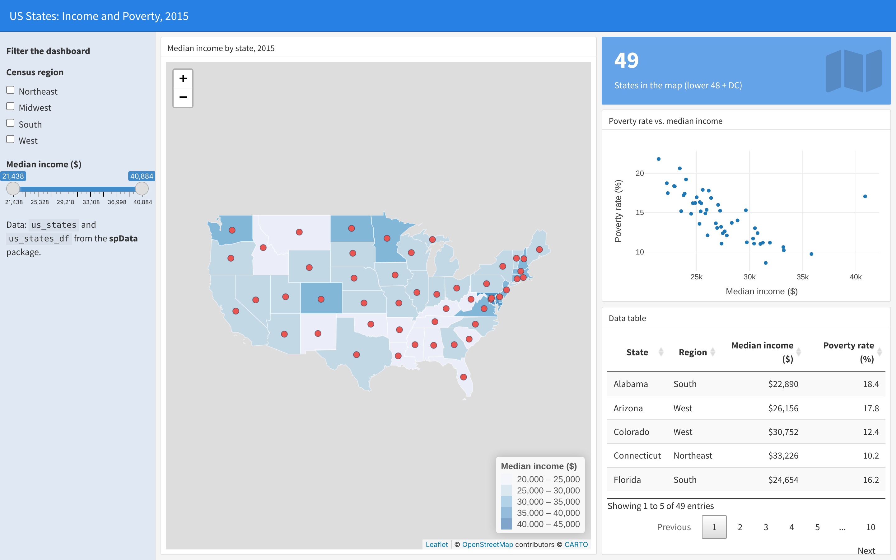
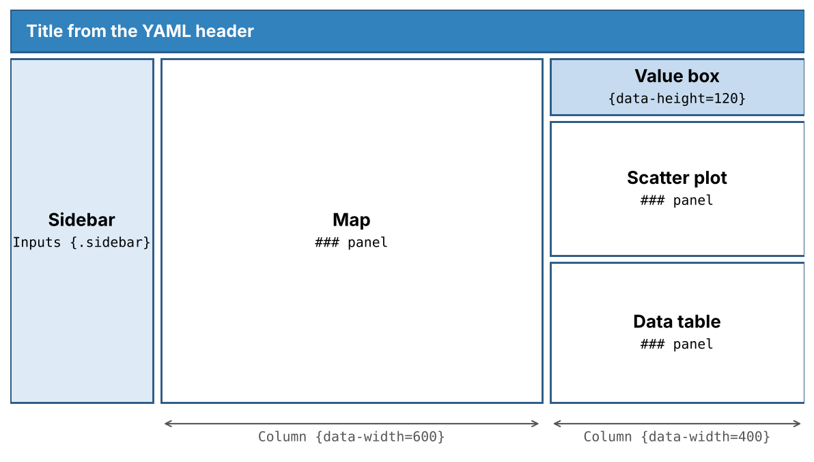
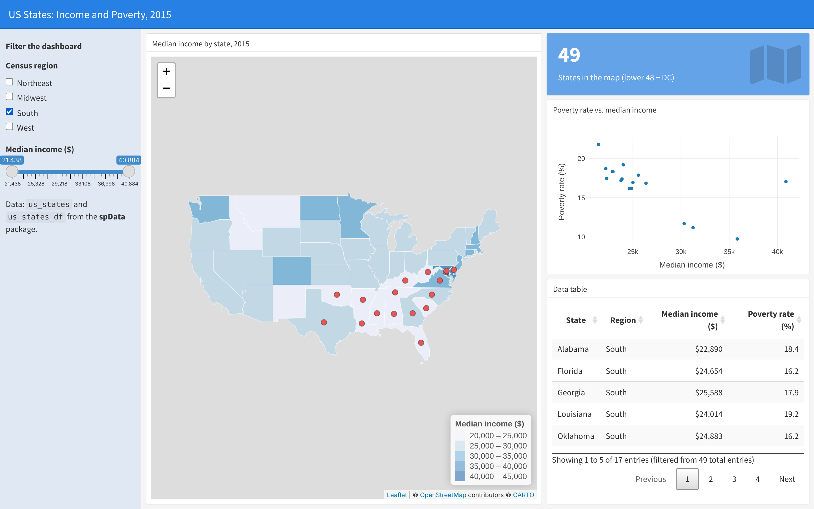
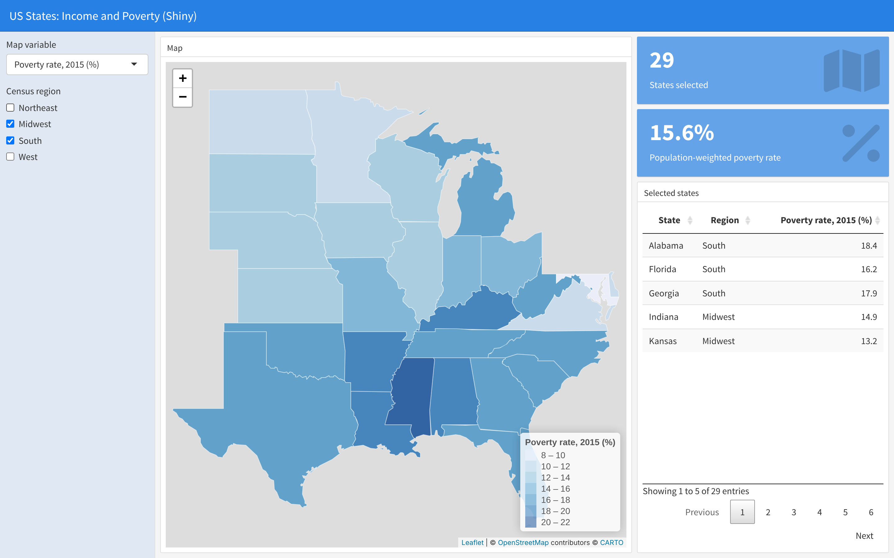

::: {.callout-note appearance="simple"}
## Learning objectives

By the end of this chapter you should be able to:

1.  Explain what a dashboard is, how it differs from a report, and what makes a good one.
2.  Make an interactive choropleth map with leaflet, with a palette function, legend, labels, and popups, or with tmap in view mode.
3.  Lay out a dashboard with flexdashboard: a sidebar, columns, and panels holding a map, a value box, a chart, and a table.
4.  Link the views with crosstalk, and work around its limits on polygons.
5.  Add Shiny inputs, reactive expressions, and render functions so a dashboard recalculates.
6.  Choose between a static and a Shiny dashboard, and share each one.
:::

All semester you have made maps and analyses and written them up as R Markdown reports. This chapter turns that work into an interactive **dashboard**: a single web page where a reader can explore a map, a chart, and a table that respond to each other. We build one example dashboard step by step, first from interactive widgets that run in any browser, and then with Shiny. Everything is still an R Markdown file, so it fits the workflow you already know.

::: {.callout-important appearance="simple"}
## This chapter's code runs in RStudio, not in the book

leaflet, flexdashboard, crosstalk, and Shiny build web pages, so they can't run in the live code cells of this book. The code here is shown as plain blocks, with screenshots of the results. Copy it into RStudio to try it. Install the packages once with:

``` r
install.packages(c("flexdashboard", "leaflet", "DT", "plotly", "crosstalk", "shiny"))
```
:::

## What is a dashboard? {#sec-what-is-dashboard}

A **dashboard** shows key information on one screen so people can monitor and explore it. It usually has several **linked views**, such as a map, charts, a table, and a few headline numbers, and it is interactive: readers can zoom, hover, filter, and select. You have certainly used one. During COVID-19, case dashboards from universities and state health departments were checked daily by millions of people, and most were built around a map. Air quality, weather, and traffic dashboards, and city and state open data portals, work the same way. A map is often the anchor, because readers first ask "where?"

### Reports and dashboards do different jobs

| | R Markdown report | Dashboard |
|:--|:------------------|:----------|
| Order | Tells a story in a fixed order | Reader explores in any order |
| Maps and charts | Static | Interactive and linked |
| Text | Explains every result | Short labels; the visuals carry the message |
| Best for | An argument or analysis write-up | Monitoring and exploring data |

: Reports and dashboards. {#tbl-report-dashboard}

Your assignments have been reports: you guide the reader through an analysis step by step. A dashboard hands control to the reader. That means less text and more careful design, because the visuals have to explain themselves. A good project often has both: a report that explains the analysis (Chapter 20) and a dashboard that lets people explore the data.

### What makes a good dashboard

- **Answer a few clear questions,** and leave out everything else. Write down two or three questions before you start, and cut anything that doesn't help answer them.
- **Put the most important view, often the map, largest and first.**
- **Use the map design rules you already know** (Chapter 10): sensible classification, a clear legend with units, and a data source.
- **Link the views,** so a filter or selection updates them together.
- **Design for everyone.** Never use color alone to carry meaning; add labels and a table. A table beside the map gives screen reader users and colorblind readers the same information. Check color contrast, and test with a keyboard and on a phone.

::: {.callout-tip appearance="simple"}
## Think about it

Think of a dashboard you have used: for weather, sports, a class, or public health. What two or three questions does it answer? What would you cut, and what is missing?
:::

## The R dashboard toolkit {#sec-toolkit}

| Package | What it does |
|:--------|:-------------|
| flexdashboard | Lays out an R Markdown file as a dashboard |
| leaflet | Interactive web maps (tmap makes them too, with `tmap_mode("view")`) |
| DT | Searchable, sortable data tables |
| plotly | Interactive charts |
| crosstalk | Links widgets, so a filter updates them all |
| shiny | Runs R code in response to what the reader does |

: Packages for dashboards in R. {#tbl-dashboard-packages}

leaflet, DT, and plotly are all **htmlwidgets**: R functions that produce JavaScript, which runs in the browser with no R needed.

### Two kinds of interactivity

The most important design decision is which of two kinds of dashboard to build:

| | htmlwidgets + crosstalk | Shiny |
|:--|:------------------------|:------|
| How it works | Knit once to a single HTML file; interactivity runs in the browser | R runs on a server while people use it |
| What readers can do | Show and hide the data that was knitted in | Trigger any R code: recalculate statistics, rebuild maps, query APIs |
| Sharing | No R needed; share it like any file | Needs a server |

: Static and Shiny dashboards. {#tbl-two-kinds}

A static dashboard can be emailed, uploaded to Canvas, or hosted on GitHub Pages, and it works with no R installed. But it can only show and hide the data that was baked in when you knitted it. Shiny can do anything R can do in response to a click, like recalculating a weighted average or refitting a model, but it needs a running R process. Start static, and move to Shiny only when you need it.

### Our example: income and poverty by state

@fig-dash-static shows where we are headed. A sidebar holds filters. The large map shows median income by state. On the right are a value box, a scatter plot of poverty rate against median income, and a table.

{#fig-dash-static fig-alt="A dashboard titled US States: Income and Poverty, 2015. A left sidebar has Census region checkboxes and a median income slider. The center shows a choropleth map of the lower 48 states in shades of blue, with a red point on each state. On the right are a value box reading 49 States in the map, a scatter plot of poverty rate against median income, and a data table of states."}

The data are `us_states` and `us_states_df` from the spData package, the same data you joined in Chapter 15, so everything loads with `library()` and nothing needs downloading. Preparing the data looks just like the joins chapter:

``` r
library(sf)
library(tidyverse)
library(spData)

states <- us_states |>
  left_join(us_states_df, by = c("NAME" = "state")) |>
  mutate(
    REGION = fct_recode(REGION, Northeast = "Norteast"),  # fix a typo in spData
    poverty_rate_15 = poverty_level_15 / total_pop_15 * 100
  ) |>
  st_transform(4326)  # leaflet expects WGS84 longitude and latitude
```

Three details. spData spells the Northeast region "Norteast", so `fct_recode()` from forcats fixes the label. `poverty_level_15` is a count of people, so dividing by population gives a rate. And leaflet works in longitude and latitude on WGS84, EPSG:4326 (Chapter 12), so we transform the data. Doing the data preparation once, at the top of the file, keeps the rest of the dashboard simple.

## Interactive maps with leaflet {#sec-leaflet}

The map is the heart of the dashboard.

### Your first leaflet map

``` r
library(leaflet)

leaflet(states) |>
  addProviderTiles(providers$CartoDB.Positron) |>
  addPolygons(color = "white", weight = 1,
              fillColor = "steelblue", fillOpacity = 0.6)
```

A leaflet map is built in layers, like tmap and ggplot2, but the layers are joined with the pipe instead of `+`. `leaflet()` creates an empty map from the data. `addProviderTiles()` adds **basemap tiles**; CartoDB Positron is a light gray basemap that works well under choropleth colors. `addPolygons()` draws the states. Run this in RStudio and the map appears in the Viewer pane, where you can already zoom and pan.

### Coloring a choropleth

Unlike tmap, leaflet doesn't classify data for you. First you build a **palette function**: a function that takes data values and returns colors.

``` r
pal <- colorBin("Blues", domain = states$median_income_15, bins = 5)

leaflet(states) |>
  addProviderTiles(providers$CartoDB.Positron) |>
  addPolygons(fillColor = ~pal(median_income_15),
              fillOpacity = 0.8, color = "white", weight = 1) |>
  addLegend(pal = pal, values = ~median_income_15,
            title = "Median income ($)")
```

`colorBin()` takes a ColorBrewer scheme, here Blues, and the range of the data, and returns a function that turns values into colors. The tilde in `~pal(median_income_15)` tells leaflet to look up the column in the data. Use the same palette in `addLegend()` so the legend matches the map. The other palette functions are `colorNumeric()` for a continuous ramp, `colorQuantile()` for quantile classes, and `colorFactor()` for categories.

### Labels, popups, and highlighting

Interactivity is what makes a web map worth the effort:

``` r
addPolygons(
  fillColor = ~pal(median_income_15), fillOpacity = 0.8,
  color = "white", weight = 1,
  label = ~NAME,                                     # shows on hover
  popup = ~paste0("<b>", NAME, "</b><br>Poverty rate: ",
                  round(poverty_rate_15, 1), "%"),   # shows on click
  highlightOptions = highlightOptions(
    weight = 3, color = "#13294B", bringToFront = TRUE)
)
```

A **label** appears when the reader hovers over a state, and a **popup** when they click. Popups accept simple HTML, so the state name can be bold, with a line break after it. `highlightOptions()` outlines the state under the mouse, so readers know exactly which polygon they are on. Labels also help accessibility, because readers don't have to match a color to the legend.

### A shortcut: tmap in view mode

If you prefer tmap, you don't have to learn leaflet first. Chapter 10 showed that `tmap_mode("view")` turns tmap code into an interactive map, and that map *is* a leaflet map:

``` r
library(tmap)
tmap_mode("view")   # interactive; tmap_mode("plot") for static

tm_shape(states) +
  tm_polygons(
    fill = "median_income_15",
    fill.scale = tm_scale_intervals(n = 5, style = "jenks",
                                    values = "brewer.blues"),
    fill.legend = tm_legend(title = "Median income ($)"),
    id = "NAME",
    popup.vars = c("median_income_15", "poverty_rate_15"))
```

`id` sets the hover label, and `popup.vars` chooses the variables shown on click. tmap is quicker to write and classifies the data for you. leaflet gives you more control and works with crosstalk, which we use below. Both work in a dashboard.

## Laying out a flexdashboard {#sec-flexdashboard}

### A flexdashboard is an R Markdown file

A **flexdashboard** is an R Markdown file with a different output format in its YAML header. You knit it the same way you knit your assignments.

``` yaml
---
title: "US States: Income and Poverty, 2015"
output:
  flexdashboard::flex_dashboard:
    orientation: columns
    vertical_layout: fill
---
```

`orientation: columns` lays out the page as side-by-side columns; `rows` is the other option. `vertical_layout: fill` stretches the panels to fill the browser window; `scroll` lets the page scroll instead. In RStudio, File > New File > R Markdown > From Template > Flex Dashboard starts one for you.

### Columns, panels, and a sidebar

The layout comes from Markdown headings:

``` markdown
Inputs {.sidebar}
--------------------------------------------

Column {data-width=600}
--------------------------------------------
### Median income by state, 2015

Column {data-width=400}
--------------------------------------------
### States {data-height=120}
### Poverty rate vs. median income
### Data table
```

- A heading underlined with dashes starts a **column**.
- A `###` heading starts a **panel** inside that column, and its text becomes the panel's title. Under each panel heading goes one R chunk that draws the map, chart, or table (left out above).
- The attributes in curly braces set relative widths and heights. 600 and 400 mean the map column gets 60% of the space after the sidebar.
- The special `{.sidebar}` column holds inputs and filters on the left.

@fig-layout shows how those headings become the page. Sketching the layout on paper before you code is a good habit.

{#fig-layout fig-alt="A wireframe of the dashboard. A title bar runs across the top. Below it, from left to right: a narrow Sidebar labeled Inputs {.sidebar}; a wide Map panel over an arrow labeled Column {data-width=600}; and a narrower column, labeled Column {data-width=400}, stacking a short Value box with {data-height=120}, a Scatter plot panel, and a Data table panel."}

### Value boxes, tables, and charts

Each of the other panels gets one of these:

``` r
# Headline number
valueBox(nrow(states), caption = "States in the map", icon = "fa-map")

# Searchable, sortable table
datatable(state_table, rownames = FALSE, options = list(pageLength = 5))

# Interactive scatter plot
plot_ly(state_table, x = ~median_income_15, y = ~poverty_rate_15,
        text = ~NAME, type = "scatter", mode = "markers")
```

A **value box** shows a single headline number with an icon from Font Awesome. `datatable()` from DT makes a table readers can search and sort, and `plot_ly()` makes a scatter plot with hover labels. The table and chart use `state_table`, a copy of the data without geometry, made with `st_drop_geometry()` and `select()`. Tables and charts don't need polygons, and dropping the geometry keeps the file small.

### Linking views with crosstalk

**crosstalk** makes the views talk to each other:

``` r
library(crosstalk)

# Same key and group = linked widgets
shared_table <- SharedData$new(state_table, key = ~NAME, group = "states")

# Filters go in the sidebar
filter_checkbox("region", "Census region", shared_table, ~REGION)
filter_slider("income", "Median income ($)", shared_table, ~median_income_15)
```

Wrap a data frame in `SharedData$new()`, with a **key** that identifies each row, here the state name, and a **group** name. Pass `shared_table` instead of `state_table` to `datatable()` and `plot_ly()`, and every widget built from a `SharedData` object in the same group is linked: filtering one filters the others, and selecting points in the scatter plot highlights the same states in the table. `filter_checkbox()` and `filter_slider()` make filter controls that work without Shiny; they go in the sidebar.

### crosstalk and leaflet: points, not polygons

Here is a limitation you will run into: leaflet links only point layers, markers and circles, with crosstalk. A crosstalk filter won't hide polygons, so a region filter can't hide states on a choropleth.

A simple workaround is one point per state. Draw the choropleth normally as context, then add the points as a shared layer on top:

``` r
state_points <- states |>
  st_transform(5070) |>        # find points in a projected CRS...
  st_point_on_surface() |>
  st_transform(4326) |>        # ...then go back to longitude and latitude
  select(NAME, REGION, median_income_15, poverty_rate_15)

shared_points <- SharedData$new(state_points, key = ~NAME, group = "states")

# in the map chunk, after addPolygons():
addCircleMarkers(data = shared_points, radius = 5, label = ~NAME)
```

`st_point_on_surface()` is better than `st_centroid()` here, because its point always falls inside the polygon. Run it on projected data, such as EPSG:5070, and transform the points back to 4326 afterward.

@fig-dash-filter shows the result. The reader has checked only the South: the points on the map, the scatter plot, and the table all show only the 17 southern states. The choropleth colors and the value box didn't change, because value boxes are fixed when you knit. That is the static dashboard's limit. Even so, this single HTML file is already a useful, shareable product.

{#fig-dash-filter fig-alt="The static dashboard with only South checked in the sidebar. Red points appear only on southern states, the scatter plot shows about 17 points, and the table reads Showing 1 to 5 of 17 entries, filtered from 49 total entries. All states are still colored on the map, and the value box still reads 49."}

::: {.callout-tip appearance="simple"}
## Think about it

In @fig-dash-filter, a reader filtered to the South but the value box still says 49. Is that misleading? How could you change the dashboard's labels so a reader isn't confused, without switching to Shiny?
:::

## Adding Shiny {#sec-shiny}

### When do you need Shiny?

Use **Shiny** when a reader's choice should trigger new R calculations, not just hide data:

- Filter the polygons themselves on the map.
- Update headline numbers, such as an average for the selected states.
- Let readers choose which variable to map.
- Rerun a model or query an API with the reader's choices.

In a flexdashboard, add one line, `runtime: shiny`, to the YAML header. Then you need three pieces: **inputs** that collect the reader's choices, **reactive expressions** that recompute data, and **render functions** that redraw the outputs.

### Inputs in the sidebar

``` r
variables <- c("Median income, 2015 ($)" = "median_income_15",
               "Poverty rate, 2015 (%)"  = "poverty_rate_15",
               "Population, 2015"        = "total_pop_15")

selectInput("variable", "Map variable", choices = variables)

checkboxGroupInput("region", "Census region",
                   choices  = levels(states$REGION),
                   selected = levels(states$REGION))
```

`selectInput()` makes a drop-down menu. The named vector shows readers friendly labels while giving your code the column names. `checkboxGroupInput()` makes the region checkboxes, all checked to start. Every input has an ID, its first argument, and anywhere else in the dashboard `input$variable` or `input$region` holds the reader's current choice.

### Reactive data and render functions

``` r
selected_states <- reactive({
  req(input$region)
  states |> filter(REGION %in% input$region)
})

renderLeaflet({
  df  <- selected_states()
  val <- df[[input$variable]]
  pal <- colorBin("Blues", domain = val, bins = 5)
  leaflet(df) |> addPolygons(fillColor = pal(val))
})
```

A **reactive expression** is code that reruns automatically when the inputs it uses change. `selected_states` filters the data to the checked regions, and `req()` stops it from running if no region is checked. You call it like a function: `selected_states()`.

**Render functions**, such as `renderLeaflet()`, `renderValueBox()`, and `renderDT()`, draw outputs. Because this `renderLeaflet()` uses both `selected_states()` and `input$variable`, Shiny redraws the map whenever either changes. You don't write any code to watch the inputs; Shiny tracks the dependencies for you. That is the core idea of reactive programming. (The full app, at the end of the chapter, also adds basemap tiles, labels, and a legend.)

@fig-shiny shows the Shiny version. The reader chose poverty rate and unchecked the Northeast and West. Now the polygons themselves are filtered, the color classes are recalculated for just these states, and the value boxes show 29 states and a population-weighted poverty rate of 15.6% for them.

{#fig-shiny fig-alt="The Shiny dashboard. The sidebar has a Map variable menu set to Poverty rate, 2015 (%), and Census region checkboxes with only Midwest and South checked. The map shows only Midwestern and Southern states, shaded by poverty rate from 8 to 22 percent, darkest in Mississippi. Value boxes read 29 States selected and 15.6% Population-weighted poverty rate, and the table lists the selected states' poverty rates."}

## Sharing your dashboard {#sec-sharing}

| Static (crosstalk) | Shiny |
|:-------------------|:------|
| Knit to one self-contained HTML file | Needs R running on a server |
| Email it or upload it to Canvas | shinyapps.io or Posit Connect Cloud (free tiers) |
| Host it free on GitHub Pages or RPubs | Or a campus or company Shiny server |
| Open it in any browser | Run it locally with RStudio's Run Document button |

: How to share each kind of dashboard. {#tbl-sharing}

### Common pitfalls and fixes

- **The map is blank or in the wrong place:** transform to EPSG:4326 first.
- **The file is huge or slow:** simplify the polygons and drop columns you don't need. Use `st_simplify()` on projected data, or `rmapshaper::ms_simplify()`.
- **The legend and map disagree:** use the same palette function for both.
- **Missing values:** set `na.color` in the palette, and say what gray means.
- **A filter doesn't hide polygons:** crosstalk only filters leaflet points.
- **The design isn't accessible:** add labels and a table; never rely on color alone.

### Looking ahead: Quarto dashboards

Quarto, the successor to R Markdown (and what built this book), has its own dashboard format: `format: dashboard` in the YAML header. The ideas are the same: rows, columns, cards instead of panels, value boxes, and a sidebar. It works with R and Python, and with leaflet, DT, plotly, and Shiny, so everything in this chapter carries over.

## The complete example files {#sec-example-files}

These are the two complete, tested dashboards from this chapter. Copy one into a new `.Rmd` file in RStudio and knit it (the static version) or click Run Document (the Shiny version).

::: {.callout-note collapse="true"}
## states-dashboard.Rmd: the static dashboard

````markdown
---
title: "US States: Income and Poverty, 2015"
output:
  flexdashboard::flex_dashboard:
    orientation: columns
    vertical_layout: fill
---

```{r setup, include=FALSE}
library(flexdashboard)
library(sf)
library(tidyverse)
library(spData)
library(leaflet)
library(DT)
library(plotly)
library(crosstalk)

# Join state polygons to the income and poverty table, then compute rates
states <- us_states |>
  left_join(us_states_df, by = c("NAME" = "state")) |>
  mutate(
    REGION = fct_recode(REGION, Northeast = "Norteast"),  # fix a typo in spData
    poverty_rate_15 = poverty_level_15 / total_pop_15 * 100,
    pop_change = (total_pop_15 - total_pop_10) / total_pop_10 * 100
  ) |>
  st_transform(4326)   # leaflet expects WGS84 longitude/latitude

# A plain table (no geometry) for the chart and the data table
state_table <- states |>
  st_drop_geometry() |>
  select(NAME, REGION, median_income_15, poverty_rate_15)

# One point per state: leaflet can filter points with crosstalk, not polygons
# (find points in a projected CRS, then go back to lon/lat)
state_points <- states |>
  st_transform(5070) |>
  st_point_on_surface() |>
  st_transform(4326) |>
  select(NAME, REGION, median_income_15, poverty_rate_15)

# SharedData objects in the same group are linked
shared_points <- SharedData$new(state_points, key = ~NAME, group = "states")
shared_table  <- SharedData$new(state_table,  key = ~NAME, group = "states")
```

Inputs {.sidebar}
-----------------------------------------------------------------------

**Filter the dashboard**

```{r filters}
filter_checkbox("region", "Census region", shared_table, ~REGION)
filter_slider("income", "Median income ($)", shared_table, ~median_income_15,
              width = "100%")
```

Data: `us_states` and `us_states_df` from the **spData** package.

Column {data-width=600}
-----------------------------------------------------------------------

### Median income by state, 2015

```{r map}
pal <- colorBin("Blues", domain = states$median_income_15, bins = 5)

leaflet(options = leafletOptions(zoomSnap = 0.25)) |>
  addProviderTiles(providers$CartoDB.Positron) |>
  addPolygons(
    data = states,
    fillColor = ~pal(median_income_15),
    fillOpacity = 0.8,
    color = "white", weight = 1,
    label = ~paste0(NAME, ": $", format(median_income_15, big.mark = ",")),
    highlightOptions = highlightOptions(weight = 3, color = "#13294B",
                                        bringToFront = TRUE)
  ) |>
  addCircleMarkers(
    data = shared_points,
    radius = 5, color = "#13294B", weight = 1,
    fillColor = "#E95550", fillOpacity = 1,
    label = ~NAME
  ) |>
  addLegend(data = states, pal = pal, values = ~median_income_15,
            title = "Median income ($)", position = "bottomright")
```

Column {data-width=400}
-----------------------------------------------------------------------

### States {data-height=120}

```{r states-box}
valueBox(nrow(states), caption = "States in the map (lower 48 + DC)",
         icon = "fa-map")
```

### Poverty rate vs. median income {data-height=380}

```{r scatter}
plot_ly(shared_table, x = ~median_income_15, y = ~poverty_rate_15,
        text = ~NAME, type = "scatter", mode = "markers") |>
  layout(xaxis = list(title = "Median income ($)"),
         yaxis = list(title = "Poverty rate (%)"),
         showlegend = FALSE) |>
  highlight(on = "plotly_selected", off = "plotly_deselect")
```

### Data table {data-height=500}

```{r table}
datatable(shared_table,
          rownames = FALSE,
          colnames = c("State", "Region", "Median income ($)", "Poverty rate (%)"),
          options = list(pageLength = 5, dom = "tip")) |>
  formatCurrency("median_income_15", digits = 0) |>
  formatRound("poverty_rate_15", digits = 1)
```
````
:::

::: {.callout-note collapse="true"}
## states-dashboard-shiny.Rmd: the Shiny dashboard

````markdown
---
title: "US States: Income and Poverty (Shiny)"
output: flexdashboard::flex_dashboard
runtime: shiny
---

```{r setup, include=FALSE}
library(flexdashboard)
library(shiny)
library(sf)
library(tidyverse)
library(spData)
library(leaflet)
library(DT)

states <- us_states |>
  left_join(us_states_df, by = c("NAME" = "state")) |>
  mutate(
    REGION = fct_recode(REGION, Northeast = "Norteast"),
    poverty_rate_15 = poverty_level_15 / total_pop_15 * 100
  ) |>
  st_transform(4326)

# Choices for the variable menu: label shown = column name used
variables <- c("Median income, 2015 ($)" = "median_income_15",
               "Poverty rate, 2015 (%)"  = "poverty_rate_15",
               "Population, 2015"        = "total_pop_15")
```

Inputs {.sidebar}
-----------------------------------------------------------------------

```{r inputs}
selectInput("variable", "Map variable", choices = variables)

checkboxGroupInput("region", "Census region",
                   choices = levels(states$REGION),
                   selected = levels(states$REGION))
```

```{r reactive-data}
# Re-runs only when the region checkboxes change
selected_states <- reactive({
  req(input$region)
  states |> filter(REGION %in% input$region)
})
```

Column {data-width=650}
-----------------------------------------------------------------------

### Map

```{r map}
renderLeaflet({
  df  <- selected_states()
  val <- df[[input$variable]]
  pal <- colorBin("Blues", domain = val, bins = 5)
  label <- names(variables)[variables == input$variable]

  leaflet(df, options = leafletOptions(zoomSnap = 0.25)) |>
    addProviderTiles(providers$CartoDB.Positron) |>
    addPolygons(fillColor = pal(val), fillOpacity = 0.8,
                color = "white", weight = 1,
                label = paste0(df$NAME, ": ", format(round(val, 1), big.mark = ",")),
                highlightOptions = highlightOptions(weight = 3, color = "#13294B")) |>
    addLegend(pal = pal, values = val, title = label, position = "bottomright")
})
```

Column {data-width=350}
-----------------------------------------------------------------------

### States selected

```{r n-box}
renderValueBox({
  valueBox(nrow(selected_states()), caption = "States selected", icon = "fa-map")
})
```

### Average poverty rate

```{r pov-box}
renderValueBox({
  avg <- weighted.mean(selected_states()$poverty_rate_15,
                       selected_states()$total_pop_15)
  valueBox(paste0(round(avg, 1), "%"), caption = "Population-weighted poverty rate",
           icon = "fa-percent")
})
```

### Selected states

```{r table}
renderDT({
  selected_states() |>
    st_drop_geometry() |>
    select(State = NAME, Region = REGION, value = all_of(input$variable)) |>
    mutate(value = round(value, 1)) |>
    datatable(rownames = FALSE,
              colnames = c("State", "Region", names(variables)[variables == input$variable]),
              options = list(pageLength = 5, dom = "tip"))
})
```
````
:::

## Summary

- A **dashboard** puts a map, charts, a table, and key numbers on one interactive screen, with **linked views**. A report tells a story in order; a dashboard lets the reader explore.
- **leaflet** builds the map, in layers joined with the pipe: **basemap tiles**, polygons colored with a **palette function**, a legend, **labels** on hover and **popups** on click. `tmap_mode("view")` makes the same kind of map.
- **flexdashboard** lays out an R Markdown file as a dashboard: a **sidebar**, **columns**, and **panels**, with **value boxes**, DT tables, and plotly charts.
- **crosstalk** links **htmlwidgets** in a single HTML file that anyone can open, using `SharedData` with a key and a group. It filters only leaflet points, not polygons.
- **Shiny** (`runtime: shiny`) reruns R code when readers make choices, with **inputs**, **reactive expressions**, and **render functions**, but it needs a server.
- Start simple and static; add Shiny only when you need it.

## Exercises

1.  **Questions first.** Before building anything, write the two or three questions a dashboard about North Carolina's counties should answer. Which views would answer each one?
2.  **Map a change.** Start from `states-dashboard.Rmd`. Add a column for the change in median income from 2010 to 2015, and map it instead of 2015 income. Which palette function fits a variable that can be negative?
3.  **Another headline.** Add a second value box that shows the highest-income state.
4.  **Another filter.** Add a `filter_select()` to the static dashboard, or a new Shiny input to the Shiny version.
5.  **tmap instead.** Replace the leaflet map with `tmap_mode("view")` and the tmap code from @sec-leaflet. What did you gain, and what did you lose?
6.  **Usability test.** Knit your dashboard and give it to a classmate with your questions from Exercise 1. Can they answer them without asking you anything?

## Further reading

- *flexdashboard for R*, the package documentation, at <https://pkgs.rstudio.com/flexdashboard>.
- *Leaflet for R*, at <https://rstudio.github.io/leaflet>. Covers basemaps, palettes, popups, and more.
- *Mastering Shiny*, by Hadley Wickham, free at <https://mastering-shiny.org>. The best introduction to inputs, outputs, and reactivity.
- *Interactive web-based data visualization with R, plotly, and shiny*, by Carson Sievert, free at <https://plotly-r.com>. Includes a chapter on linking views with crosstalk.
- Quarto dashboards, at <https://quarto.org/docs/dashboards>.
