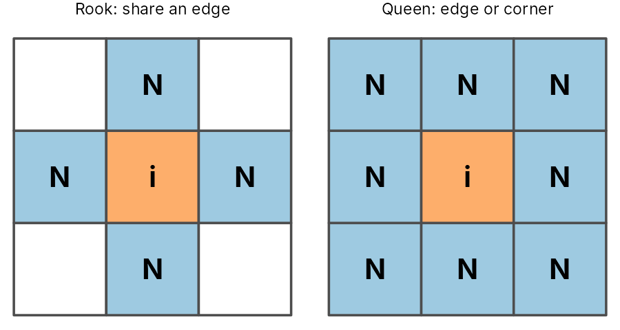
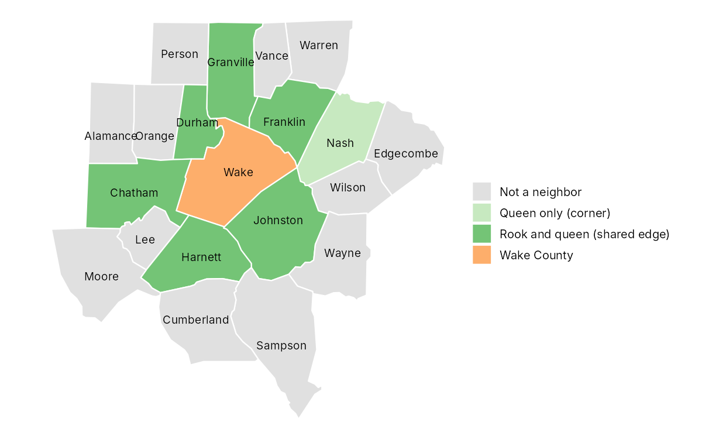

```{r}
#| label: setup-webex
#| include: false
library(webexercises)
```

::: {.callout-note appearance="simple"}
## Learning objectives

By the end of this chapter you should be able to:

1.  Tell physical from social distance, and explain distance decay.
2.  Calculate Euclidean, Manhattan, and great circle distances, and say when to use network distance or travel time instead.
3.  Explain why spatial statistics need a definition of neighbors.
4.  Define neighbors by a distance band, by inverse distance, by the *k* nearest features, and by rook or queen contiguity.
5.  Read a neighborhood weight matrix, and row-standardize it.
6.  Build neighbor lists and spatial weights in R with spdep.
:::

How far is Chapel Hill from Charlotte? About 179 km in a straight line, but more like 230 km by road, and two and a half hours by car, longer at rush hour. Which answer is right depends on your question.

This chapter has two parts. The first is about **distance**: what it means, why it matters, and the main ways to measure it. The second uses distance, and shared borders, to decide which features are **neighbors**, and stores those relationships in a **neighborhood weight matrix**. That matrix is the input to nearly every spatial statistic in the rest of this book, starting with spatial autocorrelation in Chapter 22.

## Distance is a fundamental geographic concept {#sec-distance-concept}

Distance shapes the relationships and interactions among people, things, and places: where you shop, who you know, which clinic you can reach. Geographers work with two ideas of distance:

- **Physical distance** is the separation measured across the Earth's surface, in meters, kilometers, or miles.
- **Social distance** is separation measured by connection, similarity, or interaction: how connected or isolated people and groups are. It shapes social networks, who interacts with whom, and how information or disease moves through a population.

The two often work together. Residential segregation is the classic case: two neighborhoods can sit side by side on a map yet be far apart socially.

### Distance decay

**Distance decay** is one of the central regularities in geography: interaction between places, actual or potential, decreases as the distance between them increases. Distance has "friction". Overcoming it costs time, money, or effort, so people choose closer options.

- Fewer customers visit a store the farther away they live.
- Migration between two cities shrinks as the distance between them grows.
- Clinic use drops as travel time rises.

Distance decay is often modeled as an inverse power of distance, such as 1/*d* or 1/*d*², or as an exponential function. Keep that idea in mind: we'll use the same form for continuous neighbor weights later in the chapter.

### Why measure distance?

We use distance in three ways:

1.  **Explain it:** why are some places farther from services than others?
2.  **Measure it** as an input to other calculations, such as accessibility scores or neighbor weights.
3.  **Map it:** distance surfaces, service areas, and **isochrones**, lines of equal travel time, such as the area within a 15-minute drive of a hospital.

In GIS, most work with distance falls into three operations:

| Operation | What it does | Example | In R |
|:----------|:-------------|:--------|:-----|
| Spatial query | Selects features by distance | All schools within 1 km of a highway | `sf::st_is_within_distance()` |
| Buffer | Turns a distance into an area around a feature | A 500 m zone around each transit stop | `sf::st_buffer()` |
| Identify neighbors | Finds the features within each feature's neighborhood | The census tracts that border each tract | `spdep::poly2nb()` |

: Distance-based operations in GIS. {#tbl-distance-ops}

The question you are asking decides which distance measure fits.

## Measuring distance {#sec-measuring-distance}

### Euclidean distance

**Euclidean distance** is straight-line distance, from the Pythagorean theorem. The differences in x and y between two points are the legs of a right triangle, and the distance is the hypotenuse:

$$
d = \sqrt{(x_2 - x_1)^2 + (y_2 - y_1)^2}
$$

It is a simple calculation that doesn't need a GIS, but it assumes a flat surface with the same units in x and y. That means **projected coordinates**. Never use it on latitude and longitude: a degree of longitude is about 111 km at the Equator but shrinks to nothing at the poles (Chapter 11).

```{webr-r}
euclid <- function(x1, y1, x2, y2) {
  sqrt((x2 - x1)^2 + (y2 - y1)^2)
}

euclid(1, 2, 4, 6)   # a 3-4-5 triangle
```

Euclidean distance has three limitations:

- **It assumes a flat Earth.** The error grows with distance. Over hundreds of kilometers, use great circle distance.
- **It assumes flat terrain.** It underestimates the real separation in the mountains.
- **It assumes no barriers.** Rivers, fences, buildings, and missing roads all block straight-line travel. A driver can't cross a lake just because it's the shortest path.

The next measures each relax one of these assumptions.

### Great circle distance

**Great circle distance** is the shortest distance between two points on a sphere, measured along its surface, like the route a long-haul flight takes. Use it for points stored in longitude and latitude, and always when points are far apart. With longitudes λ and latitudes φ, in radians:

$$
D = R \cdot \arccos\left[\sin\varphi_1 \sin\varphi_2 + \cos\varphi_1 \cos\varphi_2 \cos(\lambda_1 - \lambda_2)\right]
$$

where *R* is the Earth's radius, about 6,371 km on average. (The **haversine formula** gives the same answer and is more accurate for very short distances.)

```{webr-r}
greatCircle <- function(lon1, lat1, lon2, lat2, R = 6371) {
  rad <- pi / 180   # degrees to radians
  R * acos(sin(lat1 * rad) * sin(lat2 * rad) +
           cos(lat1 * rad) * cos(lat2 * rad) * cos((lon1 - lon2) * rad))
}

greatCircle(-79.0558, 35.9132, -80.8431, 35.2271)   # Chapel Hill to Charlotte, km
greatCircle(-79.0558, 35.9132, -0.1276, 51.5072)    # Chapel Hill to London, km
```

Chapel Hill to Charlotte is about 179 km, and Chapel Hill to London about 6,252 km. You rarely need to write this yourself: `sf::st_distance()` computes great circle distances automatically when your data are in longitude and latitude, and Euclidean distances when they are projected.

### Manhattan distance

**Manhattan distance**, or city-block distance, accounts for barriers by restricting travel to routes that run north-south and east-west, as on Manhattan's grid of streets. Instead of cutting diagonally, it adds the horizontal and vertical differences:

$$
d = |x_2 - x_1| + |y_2 - y_1|
$$

```{webr-r}
manhattan <- function(x1, y1, x2, y2) {
  abs(x2 - x1) + abs(y2 - y1)
}

manhattan(1, 2, 4, 6)   # 3 blocks east + 4 blocks north
```

Manhattan distance is never shorter than the Euclidean distance between the same points. For a purely diagonal trip it is about 1.41 times longer (√2). It works poorly where streets don't follow a grid.

### Network distance and travel time

**Network distance** restricts travel to the lines, or arcs, of a network, such as streets, rail lines, or rivers. The route is a chain of arcs, and the distance is the sum of their lengths. Real networks add rules: one-way streets, turn restrictions, and speed limits. Esri's Network Analyst and routing services calculate it, and so do R packages such as **sfnetworks** and **dodgr**.

**Travel time** goes one step further and measures separation in minutes instead of meters, which is closer to how people experience distance. It needs a network with speeds, or a travel-cost surface for off-road travel, and road speeds, turns, and traffic all matter. Calculating it for many origin-destination pairs can take a lot of computing. Most U.S. studies assume everyone travels by car, which overstates access for people who rely on transit or walking; better studies add other modes.

### Straight lines or networks?

People usually move along networks, so true separation shouldn't be measured as a straight line. But Euclidean and network distances are often highly correlated, and where they are, Euclidean distance is a reasonable and much cheaper stand-in. The correlation is weaker in rural areas, near water, and where networks are sparse. Before you choose, compute both for a sample of your data and check how closely they agree.

::: {.callout-tip appearance="simple"}
## Think about it

You want to measure each North Carolina county's access to hospitals. Which distance measure would you use for a county in the Triangle? For a county on the Outer Banks, where the nearest hospital may be across a sound? Why?
:::

## Neighborhoods and neighbors {#sec-neighborhoods}

### Comparing separation between features

There are two basic ways to say how far apart features are, and both become ways to define neighbors:

- **Absolute distance:** the actual distance separating them. Example: everything within 2 km.
- **Relative distance:** separation compared with other features. Examples: the nearest feature, the nearest *k* features, or features that touch (**topology**).

### Why neighbors matter

The **first law of geography** says that near things are more related than distant things. Values at nearby locations tend to be similar, and similarity decreases with distance. This dependence is **spatial autocorrelation**. To measure it, we first have to say which locations are "near": we need neighbors.

A **neighborhood**, in spatial analysis, is the zone of influence around a feature: an idea of nearness (things close to one another) or of connectedness (things that affect one another). **Neighbors** are the features inside a feature's neighborhood.

Three details matter:

- **Every observation gets its own set of neighbors.**
- **Neighbors need not be symmetric.** With nearest neighbors, A can be B's neighbor without B being A's, if B has another feature even closer.
- **Some observations may have no neighbors at all.** An island county, or an isolated point, needs special handling. In spdep, set `zero.policy = TRUE`.

Nearly every spatial method needs a neighbor definition: global spatial autocorrelation (Moran's I, Geary's C), local indicators (local Moran's I, Getis-Ord Gi\*), spatial regression (spatial lag and spatial error models), and spatial smoothing and interpolation. In every case, the neighbor definition is a choice you make, and different definitions give different neighbors and different results.

### Binary or continuous neighbors

There are two ways to record a neighbor relationship:

- **Binary** (yes or no): a feature either is a neighbor or isn't, stored as 1 or 0. Binary weights are simpler to interpret and are the default in most software.
- **Continuous:** an amount of "neighborliness", usually based on distance, so closer features get larger weights. Some neighbors are strong and others weak. Continuous weights are distance decay applied to neighbors.

## Three ways to define neighbors {#sec-define-neighbors}

| Approach | Neighbors are | In spdep |
|:---------|:--------------|:---------|
| Absolute distance | Features within a set distance | `dnearneigh()` |
| Relative distance: nearest features | The nearest one, or the nearest *k* | `knearneigh()` and `knn2nb()` |
| Relative distance: topology | Polygons that share a border | `poly2nb()`, with `queen = TRUE` or `FALSE` |

: Three ways to define neighbors. {#tbl-neighbor-defs}

### Distance band neighbors

With a **distance band**, features are neighbors if they fall within a chosen threshold distance. For points, measure between the points. For polygons, measure between their centroids, which can mislead: two large rural counties may share a long border yet have centroids far apart.

The threshold is the key decision:

- **Too small,** and many features have no neighbors.
- **Too large,** and almost everything is a neighbor.
- **A common start** is the smallest distance that gives every feature at least one neighbor, which is the largest of the nearest-neighbor distances.

The top row of @fig-band-knn shows a distance band on 19 points that are dense near the center and sparse at the edges. With *d* = 8, the central point has four neighbors. The same *d* gives a point near the edge none. This is the **edge effect**: features at the boundary of a study area, or in sparse areas, get few or no neighbors, partly because we can't see past the edge of our data. For these 19 points, every point has at least one neighbor only once *d* reaches about 20.

{#fig-band-knn fig-alt="Four panels of the same 19 white points, most clustered near the middle and a few scattered toward the edges. Top left: a small shaded circle around a red point near the center contains four blue neighbor points. Top right: the same-sized circle around a red point near the bottom edge contains no other points. Bottom left: arrows run from the central red point to its four nearest points, all very close. Bottom right: arrows run from the bottom-edge red point to its four nearest points, three of them far up in the central cluster and one off to the right."}

### Inverse distance weights

Distance band neighbors can also be continuous. Each neighbor inside the band gets a weight from an inverse function of distance:

$$
w_{ij} = \frac{1}{d_{ij}^{\,x}}
$$

where *w*~*ij*~ is the weight from observation *i* to observation *j*, *d*~*ij*~ is the distance between them, and *x* is the **distance-decay parameter**: larger values make weights fall off faster. 1 or 2 is common. Features beyond the threshold get a weight of 0.

```{webr-r}
d <- c(2, 4, 8)   # distances to three neighbors

1 / d^1   # x = 1: twice as far, half the weight
1 / d^2   # x = 2: twice as far, a quarter of the weight
```

Inverse distance weights grow very large as distance approaches 0, so check for duplicate or nearly identical points.

### k nearest neighbors

The **nearest-neighbor** approach ignores the actual distance and keeps the *k* closest features. For polygons, it uses their centroids.

- **Every feature gets exactly *k* neighbors**, so no one is left out.
- **It adapts to density.** Neighbors are close in dense areas and far apart in sparse ones (bottom row of @fig-band-knn).
- **Relationships are not always symmetric.** My nearest neighbor may have someone else even closer. spdep's `make.sym.nb()` forces symmetry if a method requires it.

A distance band gives a constant distance and a variable number of neighbors. *k* nearest neighbors gives a constant number and a variable distance. Choosing *k* is a trade-off: a small *k* keeps local detail, while a larger *k* gives more stable averages but pulls in less related features. Try a few values of *k* and check whether your conclusions change.

### Contiguity: rook and queen

**Topology-based** neighbors ignore distance altogether and ask whether two polygons touch. Points can't share a border, so this only works for polygons. (If you need contiguity for points, first build **Thiessen** or **Voronoi polygons** around them: each polygon holds the area closer to its point than to any other.) There are two common rules, named after how the chess pieces move (@fig-rook-queen-grid):

- **Rook contiguity:** polygons must share an edge, a boundary segment of some length. On a grid, each cell has four rook neighbors.
- **Queen contiguity:** a shared edge or a single shared corner is enough. On a grid, each cell has eight queen neighbors.

{#fig-rook-queen-grid width="70%" fig-alt="Two 3 by 3 grids. Left, Rook: share an edge. The center cell, i, is orange, and the four cells directly above, below, left, and right are blue and marked N; the corner cells are white. Right, Queen: edge or corner. The center cell is orange and all eight surrounding cells are blue and marked N."}

Every rook neighbor is also a queen neighbor, so the queen set is always the same size or larger. On irregular real boundaries, such as counties, the two sets are often almost the same (@fig-wake). The neighbors of the neighbors are called **second-order neighbors**.

{#fig-wake fig-alt="Map of Wake County, in orange, and the counties around it. Durham, Granville, Franklin, Johnston, Harnett, and Chatham are dark green: they share an edge with Wake. Nash, to the east, is light green: it touches Wake only at a single point. Other nearby counties, such as Orange, Wilson, and Lee, are gray."}

In the `nc` county boundaries, 14 pairs of counties touch only at a corner, so the queen rule gives 490 neighbor links and the rook rule 462.

## The neighborhood weight matrix {#sec-weight-matrix}

However you define neighbors, the result is stored the same way: a **neighborhood weight matrix**, usually called **W**. It is a table with *n* rows and *n* columns, where *n* is the number of observations. Entry *w*~*ij*~, in row *i* and column *j*, describes the relationship between observation *i* and observation *j*. The diagonal is 0, because no observation is its own neighbor.

Here are four census tracts in a row, A | B | C | D, so each touches only the tracts beside it. With binary rook contiguity:

```{webr-r}
W <- matrix(c(0, 1, 0, 0,
              1, 0, 1, 0,
              0, 1, 0, 1,
              0, 0, 1, 0),
            nrow = 4, byrow = TRUE,
            dimnames = list(c("A", "B", "C", "D"), c("A", "B", "C", "D")))
W
rowSums(W)   # number of neighbors
```

Read across a row to find a tract's neighbors: B's row has 1s under A and C.

### Row standardization

Weights are often **row-standardized**: each weight is divided by its row's total, so every row sums to 1. B's two neighbors then get 0.5 each, and the edge tracts' single neighbors get 1. In spdep this is `style = "W"`.

Why bother? Multiplying a row-standardized matrix by a variable gives each observation the *average* of its neighbors' values. That neighborhood average is called the **spatial lag**:

```{webr-r}
W <- matrix(c(0, 1, 0, 0,
              1, 0, 1, 0,
              0, 1, 0, 1,
              0, 0, 1, 0),
            nrow = 4, byrow = TRUE,
            dimnames = list(c("A", "B", "C", "D"), c("A", "B", "C", "D")))

W_std <- W / rowSums(W)   # row-standardize
W_std

income <- c(A = 10, B = 20, C = 30, D = 40)   # in thousands of dollars
W_std %*% income                              # the spatial lag: neighbors' average
```

B's neighbors, A and C, average (10 + 30) ÷ 2 = 20. Moran's I (Chapter 22) compares each value with exactly this kind of neighborhood average.

### Building neighbors and weights in R

In spdep, neighbors are stored as a **neighbor list** (class `nb`), a compact version of W that lists only each observation's neighbors. `nb2listw()` turns any neighbor list into weights. Assuming `library(sf)`, `library(spdep)`, and an sf polygon layer named `tracts` in a projected coordinate system:

```r
# Contiguity neighbors (queen is the default)
nb_queen <- poly2nb(tracts, queen = TRUE)
nb_rook  <- poly2nb(tracts, queen = FALSE)

# k nearest neighbors, using tract centroids
coords <- st_coordinates(st_centroid(tracts))
nb_knn <- knn2nb(knearneigh(coords, k = 4))

# Distance band: 0 to 5 km (in the CRS's units, meters)
nb_dist <- dnearneigh(coords, d1 = 0, d2 = 5000)

# Row-standardized spatial weights
lw <- nb2listw(nb_queen, style = "W", zero.policy = TRUE)

# Inverse distance weights (x = 1) on the distance band
idw <- lapply(nbdists(nb_dist, coords), function(d) 1 / d)
lw_idw <- nb2listw(nb_dist, glist = idw, style = "B", zero.policy = TRUE)
```

`dnearneigh()` measures in the units of your coordinate reference system, so project first. `summary(nb_queen)` reports how many neighbors each observation has, and warns about any with none.

### Weight matrices can encode social distance

Nothing requires the entries of a weight matrix to be geographic. They just record which observations are related and how strongly. They could be commuting flows between counties, airline routes, shared school districts, similarity in income or age structure, or trade and migration ties between countries. Two counties linked by heavy commuting may influence each other more than two counties that merely touch. Any *n* × *n* matrix of relationships becomes spatial weights with `spdep::mat2listw()`.

## Check your understanding

1.  Interaction between places decreasing as the distance between them increases is called: `r mcq(c(answer = "Distance decay", "Spatial heterogeneity", "The edge effect", "Row standardization"))`

2.  What is the Manhattan distance from (1, 2) to (4, 6)? `r fitb("7")`

3.  Euclidean distance is fine to calculate directly on latitude and longitude. `r torf(FALSE)`

4.  With *k* nearest neighbors, every feature gets exactly *k* neighbors. `r torf(TRUE)`

5.  Two counties that touch only at a single corner are neighbors under which rule? `r mcq(c("Rook contiguity", answer = "Queen contiguity", "Both rook and queen", "Neither"))`

6.  With inverse distance weights and *x* = 2, a neighbor twice as far away gets what share of the weight? `r mcq(c("Half", answer = "A quarter", "Twice as much", "The same"))`

7.  In a row-standardized weight matrix, each row sums to: `r fitb("1")`

8.  Which spdep function builds contiguity neighbors from polygons? `r mcq(c("knearneigh()", "dnearneigh()", answer = "poly2nb()", "nb2listw()"))`

## Summary

- **Physical distance** is measured across the Earth's surface; **social distance** by connection and similarity. **Distance decay** says interaction falls as distance grows.
- **Euclidean distance** is the straight line; use it only on projected coordinates. **Great circle distance** follows the curved Earth and suits longitude and latitude. **Manhattan distance** follows a street grid. **Network distance** and **travel time** follow real routes.
- The **first law of geography** is why neighbors matter: to measure spatial autocorrelation, we must first say who is near whom.
- Neighbors can be defined by a **distance band** (absolute distance), by the ***k* nearest neighbors**, or by **contiguity**: **rook** (a shared edge) or **queen** (an edge or a corner). Weights can be **binary** or **continuous**, such as inverse distance.
- Distance bands give a constant distance and a variable count, and leave edge features short. *k* nearest neighbors gives a constant count and a variable distance, and can be asymmetric.
- Neighbor relationships are stored in a **weight matrix**, W. **Row-standardized** weights sum to 1 across each row, so W times a variable gives the **spatial lag**: each observation's neighborhood average.
- In spdep: `poly2nb()`, `knearneigh()` with `knn2nb()`, and `dnearneigh()` build neighbors; `nb2listw()` turns them into weights. Each choice gives a different weight matrix, and can give different results, so justify yours and try more than one.

## Exercises

1.  **By hand.** For the points (2, 3) and (8, 11), calculate the Euclidean and the Manhattan distance, then check both with the functions in this chapter.
2.  **Great circles.** Find the longitude and latitude of your hometown and calculate its great circle distance from Chapel Hill. Then compare it with the driving distance from an online map. How much longer is the drive, in percent?
3.  **Wrong on purpose.** Calculate the "Euclidean distance" from Chapel Hill to Charlotte using their longitudes and latitudes as if they were x and y. What units is the answer in, and why is it meaningless?
4.  **Your county.** Using the sf package's `nc` data, build queen and rook neighbors with `poly2nb()`. How many neighbors does your home county (or Orange County) have under each rule? Which county has the most neighbors?
5.  **Three definitions.** Project `nc` with `st_transform(32119)`, find the county centroids, and build neighbors with *k* = 4 and with a distance band of 50 km. Compare `summary()` of each. Which counties have no neighbors within 50 km? What is the smallest distance band that gives every county at least one neighbor?
6.  **Spatial lag.** Make row-standardized queen weights for `nc`, and calculate the spatial lag of births per square kilometer with `lag.listw()`. Make a scatterplot of each county's value against its spatial lag. What does the pattern suggest?

## Further reading

- *Spatial Data Science: With Applications in R*, by Edzer Pebesma and Roger Bivand (CRC Press, 2023), free at <https://r-spatial.org/book/>. Chapter 14, "Proximity and Areal Data", covers neighbor lists and spatial weights in spdep.
- *Geographic Information Analysis* (2nd ed.), by David O'Sullivan and David Unwin (Wiley, 2010). Chapter 2 discusses distance, adjacency, interaction, and neighborhoods.
- Tobler, W. R. (1970). "A Computer Movie Simulating Urban Growth in the Detroit Region." *Economic Geography* 46: 234–240. The source of the first law of geography.
