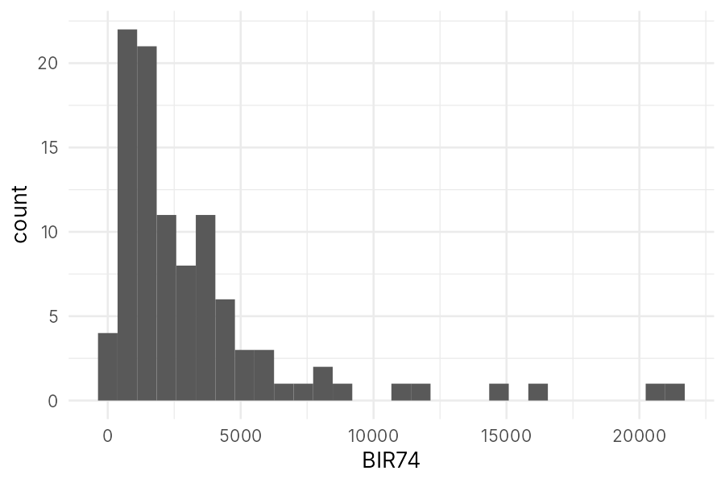
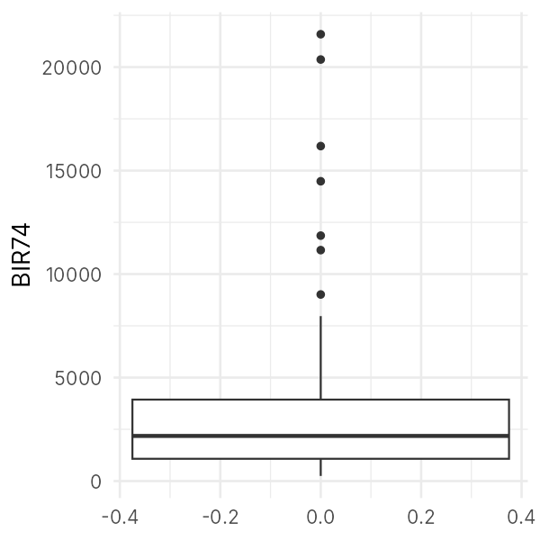
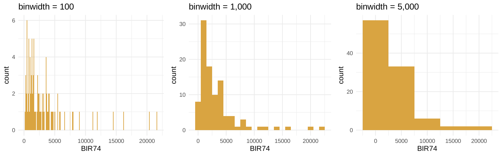
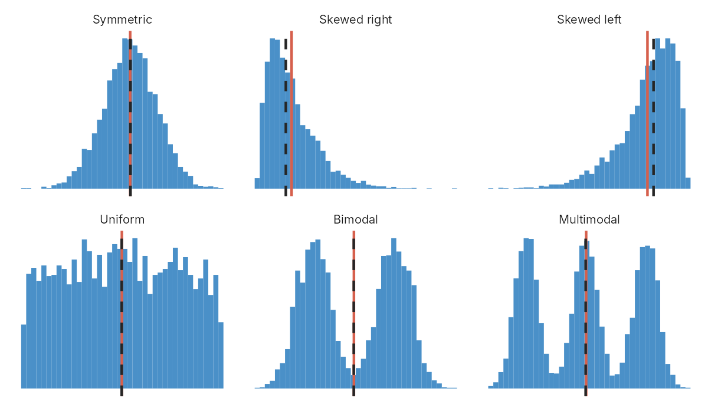
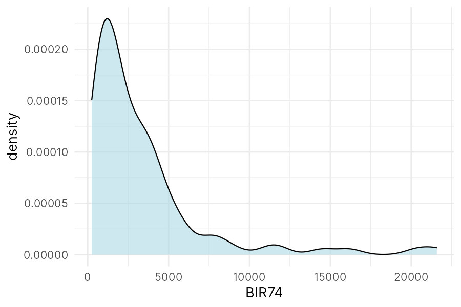
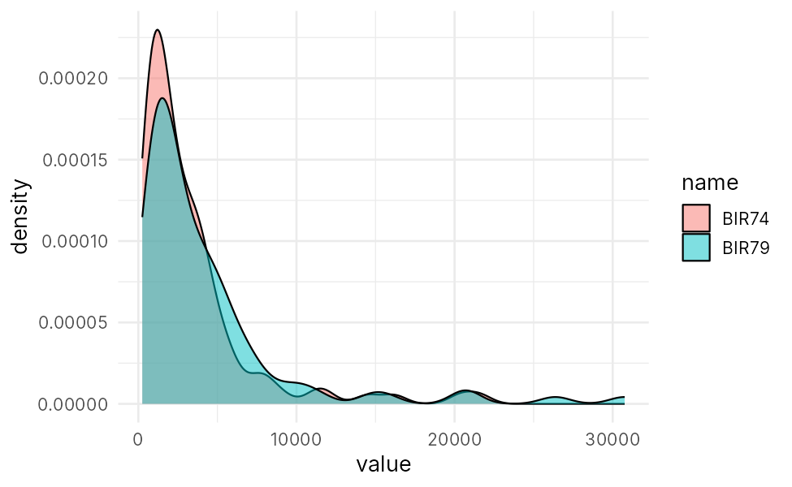
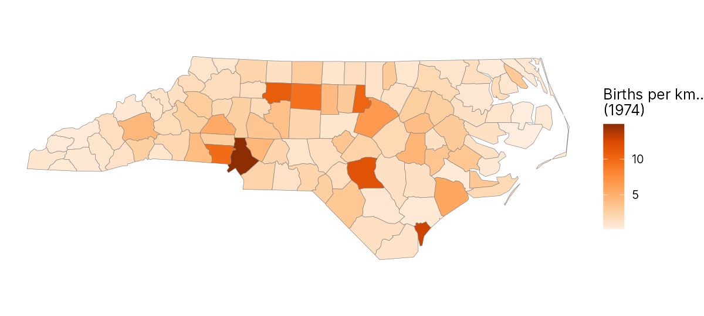

```{r}
#| label: setup-webex
#| include: false
library(webexercises)
```

::: {.callout-note appearance="simple"}
## Learning objectives

By the end of this chapter you should be able to:

1.  Explain where exploratory data analysis (EDA) fits in the data science workflow, and what makes it spatial (ESDA).
2.  Check the basics of a new data table: its size, its missing values, and the type of each field.
3.  Calculate and interpret measures of central tendency (mean, median, mode) and dispersion (range, IQR, standard deviation).
4.  Choose a histogram, boxplot, or density plot to show a distribution, and read its shape.
5.  Spot outliers and decide what to do about them.
6.  Map a variable as a rate or density, and describe what spatial descriptive statistics add.
:::

Someone hands you a data table: a hundred rows, a dozen columns. Now what?

The answer is *not* to jump straight to a model. First, get to know the data: how big it is, what each column holds, what is missing, and how each variable is spread out. That process of getting to know your data is **exploratory data analysis**, or **EDA**. When the data are spatial, we add one more question, about where values occur, and it becomes **exploratory spatial data analysis**, or **ESDA**.

Most examples in this chapter use the `nc` data that come with the sf package: North Carolina's 100 counties, with the number of births in each from 1974 to 1978 (`BIR74`) and from 1979 to 1984 (`BIR79`). The live code boxes use the `flights` data from Chapter 8.

## From EDA to ESDA {#sec-eda}

### The "understand" loop

Recall the data science workflow from *R for Data Science*. We import data and tidy it. Then we spend most of our time in a loop to **understand** it: transform, visualize, model, and back again. Only then do we communicate the results. EDA lives in that loop. It is iterative: each plot or summary raises a new question, which sends you back to transform the data again.

EDA is not one technique. It is everything we do to learn what is in a dataset before we try to explain or predict anything with it:

- cleaning and wrangling the data;
- finding duplicates and missing data (`NA`);
- calculating and transforming variables;
- making graphs, plots, charts, and maps;
- calculating descriptive statistics.

The payoff is better questions. Good data, known well, lead to good questions, and good questions guide the analysis that follows.

### Two questions guide the investigation

EDA can feel open-ended, so use two questions to keep it focused:

1.  **What type of variation occurs *within* my variables?** Answer it with central tendency, dispersion, and plots of one variable, such as histograms and boxplots. Most of this chapter answers this question.
2.  **What type of variation occurs *between* my variables?** Answer it with plots of two or more variables, such as scatterplots and grouped boxplots, and with correlation.

### ESDA adds a geographic question

Spatial data let us ask one more: **what type of *geographic* variation occurs within my variables?** Three tools answer it:

- **Maps**: where are the high and low values?
- **Spatial autocorrelation**: are similar values located near each other? This is Tobler's first law in action.
- **Clustering**: are there hot spots or cold spots?

This chapter covers maps and descriptive statistics. Chapter 14 covers spatial descriptive statistics, and spatial autocorrelation comes later in the course.

## Step one: get to know the data table {#sec-step-one}

Before you look at any one variable, check the basics of the whole table:

- The number of **observations** (rows, or features).
- The number of **complete** observations. How many have `NA`?
- The number of **fields** (variables, or columns).
- The **data type** of each field. Does it match what the field means?

Useful R functions are `nrow()`, `ncol()`, `glimpse()`, and `summary()`. Try them on `flights`:

```{webr-r}
library(dplyr)
library(nycflights13)

nrow(flights)
ncol(flights)
glimpse(flights)

# How many flights have no air_time?
sum(is.na(flights$air_time))
```

Missing values change what you can calculate: `mean()` returns `NA` unless you set `na.rm = TRUE`. Types matter too. A FIPS code stored as a number loses its leading zero, and a count stored as text can't be averaged.

For `nc`, the same checks show 100 rows and 15 columns, including the geometry, and no missing values in `BIR74`:

``` r
library(sf)
nc <- st_read(system.file("shape/nc.shp", package = "sf")) |>
  st_transform(32119)

nrow(nc)              # 100
sum(is.na(nc$BIR74))  # 0
```

These answers decide which approaches make sense: numeric fields get means and histograms, and categorical fields get counts and modes.

## Describing a variable's center {#sec-center}

**Central tendency** is one value that describes the central position of a set of values.

| Measure | What it tells you | Use it for |
|:--------|:------------------|:-----------|
| **Mean** | The average: the sum of the values divided by the count | Numeric data |
| **Median** | The middle value once the values are sorted | Numeric data, especially skewed data |
| **Mode** | The most common value | Categorical (nominal) data, or any data |

: Three measures of central tendency. {#tbl-central-tendency}

We'll work through each on the same ten values:

$$
\{3, 8, 12, 6, 5, 10, 2, 3, 6, 3\}
$$

Sorted, they are {2, 3, 3, 3, 5, 6, 6, 8, 10, 12}.

### Mean

The **mean** is what most people call the average. Add the values and divide by how many there are:

$$
\bar{x} = \frac{\sum x_i}{n} = \frac{58}{10} = 5.8
$$

Here $\bar{x}$ ("x-bar") is the mean, $\sum$ means "add up", $x_i$ is each value, and $n$ is the count. Because every value enters the sum, one extreme value can pull the mean a long way.

### Median

The **median** is the middle of the sorted values, so the first step is always to sort. With an odd number of values, the median is the single middle one. With an even number, it is the mean of the two middle values. We have 10 values, so we average the 5th and 6th: (5 + 6) / 2 = 5.5.

Half the values are below the median and half above, so extreme values barely move it.

### Mode

The **mode** is the most frequent value. In the sorted list, 3 appears three times, more than any other value, so the mode is 3. A variable can have no mode, one, or several.

The mode is the only measure of center that works for categorical data. You can find the most common land-cover class, but you can't average land-cover classes. Base R has no function for the statistical mode: `mode()` returns how R stores an object. Use `table()` or `count()` and take the most frequent value instead.

```{webr-r}
a <- c(3, 8, 12, 6, 5, 10, 2, 3, 6, 3)

mean(a)
median(a)

table(a)                    # counts of each value
names(which.max(table(a)))  # the mode
```

## Describing a variable's spread {#sec-spread}

The mean describes the center. **Dispersion** describes the spread, or variability, around it. Here are two sets of values with exactly the same mean:

- **A**: {3, 8, 12, 6, 5, 10, 2, 3, 6, 3}. Mean 5.8, from 2 to 12.
- **B**: {−56, 8, −1, 64, −34, 84, −5, 38, 6, −46}. Mean 5.8, from −56 to 84.

If you only reported the mean, these would look identical. They are not. That is why you should always pair a measure of center with a measure of spread.

### Range and interquartile range

The **range** is the largest value minus the smallest. It is quick to calculate and easy to explain, but it uses only the two most extreme values, so one outlier changes it.

**Quartiles** split the sorted values into four groups of equal size. The first quartile, **Q1**, is the 25th percentile; the third, **Q3**, is the 75th; and the median is the second. The **interquartile range** (IQR) is Q3 − Q1: the spread of the middle half of the data. It ignores the extremes, so outliers barely affect it.

Take these 12 values: {3, 1, 2, 8, 12, 6, 5, 10, 2, 3, 6, 3}. Sorted and split in half, they are

$$
\{1, 2, 2, 3, 3, 3 \mid 5, 6, 6, 8, 10, 12\}
$$

- Range = 12 − 1 = 11.
- Q1 is the median of the lower half, between 2 and 3: 2.5.
- Q3 is the median of the upper half, between 6 and 8: 7.
- IQR = 7 − 2.5 = 4.5.

Software uses slightly different rules for percentiles. R's default rule interpolates between values, so it gives Q1 = 2.75 and Q3 = 6.5, and `IQR()` returns 3.75. With a small sample the difference is visible; with hundreds of values the methods agree closely. When you work by hand, show your method.

### Standard deviation

The **standard deviation** is the most common measure of spread. It is roughly the typical distance between a value and the mean. To calculate it:

1.  Subtract the mean from each value. This is the deviation.
2.  Square each deviation, so negative ones don't cancel positive ones.
3.  Add them up and divide by *n* − 1. This is the **variance**.
4.  Take the square root, to return to the original units.

$$
s = \sqrt{\frac{\sum (x_i - \bar{x})^2}{n - 1}}
$$

For set A the standard deviation is 3.3; for set B it is 45.7. Same mean, about 14 times the spread. Like the mean, the standard deviation uses every value, so it is sensitive to outliers. Check the numbers in R:

```{webr-r}
a <- c(3, 8, 12, 6, 5, 10, 2, 3, 6, 3)
b <- c(-56, 8, -1, 64, -34, 84, -5, 38, 6, -46)

c(mean(a), mean(b))
c(sd(a), sd(b))

x <- c(3, 1, 2, 8, 12, 6, 5, 10, 2, 3, 6, 3)
range(x)
diff(range(x))
quantile(x)
IQR(x)
```

### All together

`summarize()` puts the whole toolkit in one call. Here it is for births in North Carolina's counties:

``` r
nc |>
  st_drop_geometry() |>
  summarize(min    = min(BIR74),
            q1     = quantile(BIR74, 0.25),
            median = median(BIR74),
            mean   = mean(BIR74),
            q3     = quantile(BIR74, 0.75),
            max    = max(BIR74),
            sd     = sd(BIR74),
            IQR    = IQR(BIR74))
```

| min | Q1 | median | mean | Q3 | max | sd | IQR |
|----:|---:|-------:|-----:|---:|----:|---:|----:|
| 248 | 1,077 | 2,180.5 | 3,299.6 | 3,936 | 21,588 | 3,848.2 | 2,859 |

: Summary statistics for births per county, 1974–78. {#tbl-births-summary}

The key comparison is the mean against the median. The mean is about 1.5 times the median, and the standard deviation is larger than the mean. Both are signs of **right skew**: most counties have few births, and a few large urban counties, led by Mecklenburg with 21,588, pull the mean up. For skewed variables like this one, the median and the IQR describe a typical county better than the mean and the standard deviation.

## Visualizing distributions {#sec-distributions}

Summary statistics compress a variable into a few numbers. Plots show the whole **distribution**.

### Histograms and boxplots

A **histogram** divides the range of a variable into bins, and draws a bar for the number of values in each. A **boxplot** draws the box from Q1 to Q3 with a line at the median. The whiskers reach to the furthest values within 1.5 times the IQR of the box, and points beyond them are drawn one by one as potential outliers.

``` r
library(ggplot2)

ggplot(nc, aes(x = BIR74)) + geom_histogram()
ggplot(nc, aes(y = BIR74)) + geom_boxplot()
```

::: {layout-ncol="2"}
{#fig-births-hist fig-alt="Histogram of BIR74. Most of the 100 counties are in tall bars between 0 and 5,000 births, and a few short bars trail off to the right as far as about 21,000."}

{#fig-births-box fig-alt="Vertical boxplot of BIR74. The box is short and sits near the bottom, between about 1,000 and 4,000, and the upper whisker reaches about 8,000. Seven points sit above it, the highest at about 21,000."}
:::

Both tell the same story as @tbl-births-summary: births per county are strongly right-skewed.

### Choosing a bin width

A histogram depends on one choice you make: the **bin width**. In ggplot, set `binwidth` or `bins` inside `geom_histogram()`. The default of 30 bins prints a message telling you to pick a better value.

{#fig-binwidths fig-alt="Three histograms of BIR74 side by side. With a bin width of 100, there are dozens of thin spikes and the shape is hard to see. With a bin width of 1,000, a clear peak near 1,000 births tails off to the right. With a bin width of 5,000, there are only five wide bars and most of the detail is gone."}

Too narrow, and every small fluctuation becomes its own spike; the shape is lost in noise. Too wide, and the bins swallow the detail. Try a few widths, and choose one that shows the structure without the noise.

### Shape decides whether the mean is typical

Always look at the shape of a distribution before you trust its mean (@fig-shapes).

{#fig-shapes fig-alt="Six histograms in a grid. Symmetric: a single bell-shaped peak, with the mean and median lines together at the center. Skewed right: a peak at the left with a long tail to the right, and the mean line to the right of the median. Skewed left: the mirror image. Uniform: bars of roughly equal height, with no peak. Bimodal: two separate peaks, with the mean and median in the empty dip between them. Multimodal: three peaks."}

- **Symmetric**: the mean and the median are about the same.
- **Skewed**: the long tail pulls the mean toward it. Births per county are skewed right.
- **Uniform**: there's no peak at all.
- **Bimodal** or **multimodal**: the mean can land in a dip where few values are. Two or more peaks often mean that different groups are mixed together, such as urban and rural counties.

So ask: does the mean describe a typical value here? Or should I report the median, or split the data into groups?

### Outliers

An **outlier** is a value far from the rest. Plots make outliers easy to spot. In a histogram, it is a lone bar far to the right, separated from the others by empty bins. In a boxplot, it is a point beyond the whisker. Seven counties are beyond the upper whisker in @fig-births-box, and Mecklenburg is the highest.

Ask what explains an outlier before deciding what to do. A large urban county is a real value and stays in. A typo or a wrong unit is an error to fix. Either way, outliers are why the mean and standard deviation can be so much larger than the median and IQR. Whatever you decide, say so in your write-up.

### Density plots

A **density plot** is a smoothed histogram. Instead of counting values in bins, it estimates a smooth curve. The total area under the curve is 1, so the y-axis is a density, not a count. With a variable measured in thousands, the densities are tiny numbers. Peaks show where values concentrate.

``` r
ggplot(nc, aes(x = BIR74)) +
  geom_density(fill = "lightblue", alpha = 0.6)
```

{#fig-births-density width="75%" fig-alt="A light blue density curve with a tall peak near 1,200 births and a long, low tail stretching right to about 22,000."}

Density plots shine when you compare groups, because several curves can share one set of axes. To compare two columns, first stack them into one column with `pivot_longer()`. Then map the column names to `fill`:

``` r
library(tidyr)

nc |>
  st_drop_geometry() |>
  select(BIR74, BIR79) |>
  pivot_longer(everything()) |>
  ggplot(aes(x = value, fill = name)) +
  geom_density(alpha = 0.5)
```

{#fig-births-7479 width="80%" fig-alt="Two overlapping semi-transparent density curves, red for BIR74 and teal for BIR79, with a legend. Both have a tall peak at the low end and a long right tail. The BIR79 curve is a little lower and stretches a little further right."}

The `alpha` argument makes the curves see-through, so the overlap stays visible.

### Your turn

Recreate a density plot of `air_time` for two airlines, American (AA) and United (UA). The code filters the flights, drops missing air times, and maps `carrier` to `fill`. Fill in the missing geom:

```{webr-r}
library(ggplot2)
library(dplyr)
library(tidyr)
library(nycflights13)

flights |>
  filter(carrier %in% c("AA", "UA")) |>
  drop_na(air_time) |>
  ggplot(aes(x = air_time, fill = carrier)) +
  geom_histogram()   # replace this with a semi-transparent density
```

`r hide("Show answer")`
Replace `geom_histogram()` with `geom_density(alpha = 0.6)`. Why does `air_time` have several peaks? Each peak is a group of common routes with similar distances: a multimodal distribution.
`r unhide()`

## Maps add the spatial dimension {#sec-esda-maps}

Everything so far ignores location. A map adds it back, and this is where EDA becomes ESDA.

Map a rate, a density, or a percentage, not a raw count. Big counties have more of almost everything, so a map of raw counts mostly shows which counties are big. Here we divide births by each county's area, from `st_area()`:

``` r
library(tmap)

nc |>
  mutate(area_km2 = as.numeric(st_area(geometry)) / 1e6,
         births_per_km2 = BIR74 / area_km2) |>
  tm_shape() +
  tm_polygons(fill = "births_per_km2",
              fill.scale = tm_scale_continuous(values = "brewer.oranges"))
```

{#fig-births-map fig-alt="Choropleth map of North Carolina's counties, shaded from pale to dark orange by births per square kilometer. Most counties are pale. A few stand out darker: Mecklenburg around Charlotte, darkest at about 15, along with New Hanover on the coast, Cumberland, Forsyth, Durham, Gaston, and Guilford."}

Most of the state is pale, with low density, and a handful of urban counties stand out: Mecklenburg, New Hanover, Cumberland, Forsyth, and Durham, then Gaston and Guilford. Now ask the ESDA question. Are the high values scattered, or do they cluster together?

## Spatial statistics describe location {#sec-esda-preview}

The statistics in this chapter describe *values*. **Spatial descriptive statistics** describe *locations*:

- The **mean center** is the average x coordinate and the average y coordinate of all the features.
- The **weighted mean center** does the same, but weights each feature by an attribute, such as births or population.
- The **standard distance** is how far features typically sit from the mean center: the spatial version of the standard deviation.

And the question of whether nearby values are similar is measured with **spatial autocorrelation** statistics, such as Moran's I. Chapter 14 covers the spatial descriptive statistics.

## Check your understanding

1.  What is the mean of {2, 4, 4, 10}? `r fitb("5")`

2.  What is the median of {2, 4, 4, 10}? `r fitb("4")`

3.  Which measure of center is the only one that works for categorical data, such as land-cover class? `r mcq(c("Mean", "Median", answer = "Mode", "Standard deviation"))`

4.  Which measure of spread is least affected by one extreme value? `r mcq(c("Range", "Standard deviation", answer = "Interquartile range", "Variance"))`

5.  A variable's mean is much larger than its median. Its distribution is probably: `r mcq(c(answer = "Skewed right", "Skewed left", "Symmetric", "Uniform"))`

6.  In a boxplot, the box spans: `r mcq(c("The minimum to the maximum", answer = "Q1 to Q3", "The mean plus and minus one standard deviation", "The 5th to the 95th percentile"))`

7.  The area under a density curve is equal to 1. `r torf(TRUE)`

8.  A choropleth map should usually show raw counts rather than rates or densities. `r torf(FALSE)`

## Summary

- **Exploratory data analysis** (EDA) is how we learn what's in a dataset before explaining or predicting anything. **ESDA** adds the question of how values vary across space.
- Start with the table: rows, complete rows, columns, and data types.
- Describe each variable's center with the **mean**, **median**, or **mode**, and its spread with the **range**, **interquartile range**, or **standard deviation**. For skewed data, prefer the median and IQR.
- **Histograms**, **boxplots**, and **density plots** show a whole distribution. Choose the **bin width** with care, and read the shape: symmetric, **skewed**, uniform, or multimodal.
- Plots make **outliers** easy to spot. Find out what explains them before deciding what to do.
- **Maps** add location. Map rates or densities, not raw counts, and ask whether high values cluster.
- **Spatial descriptive statistics**, such as the mean center and standard distance, describe where features are.

## Exercises

1.  **By hand, then in R.** For {7, 1, 4, 9, 4, 12, 3}, calculate the mean, median, mode, range, and standard deviation by hand. Check each with R.
2.  **Same mean, different spread.** Make two sets of 8 numbers with a mean of 10: one with a standard deviation under 2, and one with a standard deviation over 20.
3.  **Explore `BIR79`.** Repeat @tbl-births-summary for `BIR79`. Did births become more or less skewed? Which counties are outliers?
4.  **Bin widths.** Make histograms of `distance` in `flights` with three bin widths. Which shows the structure best? Describe the shape.
5.  **Rates.** Make a map of `SID74 / BIR74`, the rate of sudden infant deaths per birth. Compare it with a map of raw `SID74`. Which counties change most?
6.  **Two variables.** Make a scatterplot of `BIR74` against `BIR79`. What does it tell you about variation *between* the two variables?

## Further reading

- *R for Data Science* (2nd ed.), by Hadley Wickham, Mine Çetinkaya-Rundel, and Garrett Grolemund, free at <https://r4ds.hadley.nz>. The "Exploratory data analysis" chapter is the source of the two guiding questions.
- *Spatial Analysis Methods and Practice*, by George Grekousis (Cambridge University Press, 2020), covers exploratory spatial data analysis and spatial descriptive statistics.
- *Geographic Data Science with Python*, by Sergio Rey, Dani Arribas-Bel, and Levi John Wolf, free at <https://geographicdata.science/book>. Its chapters on choropleth mapping and spatial autocorrelation preview what comes next.
