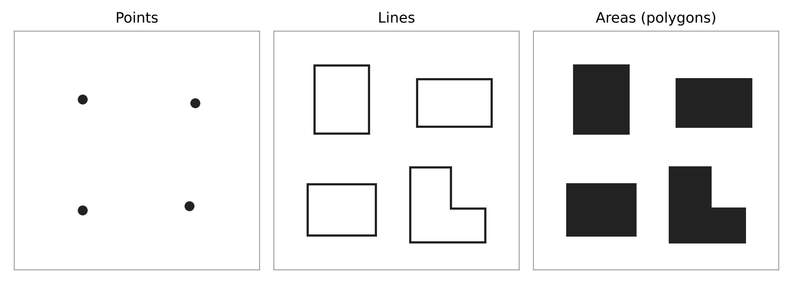
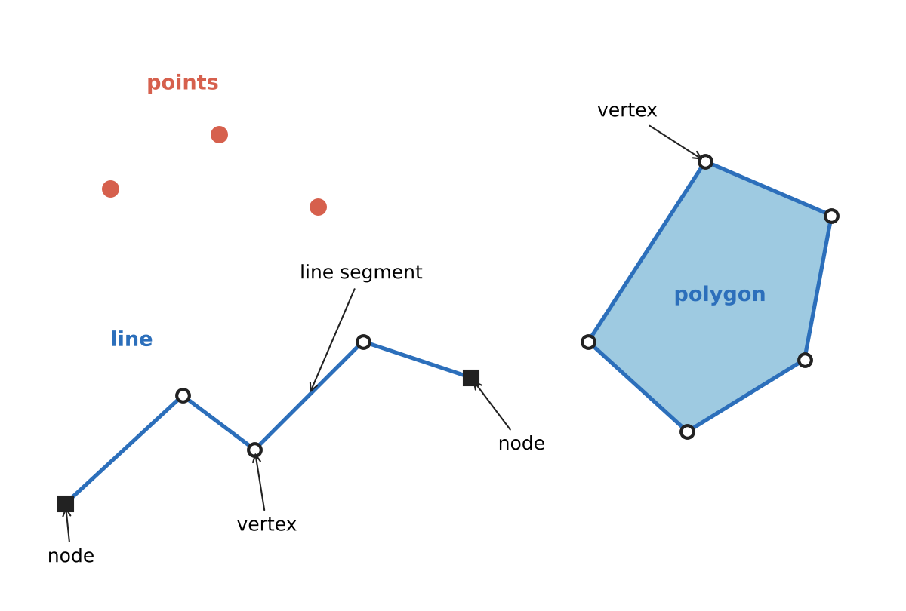
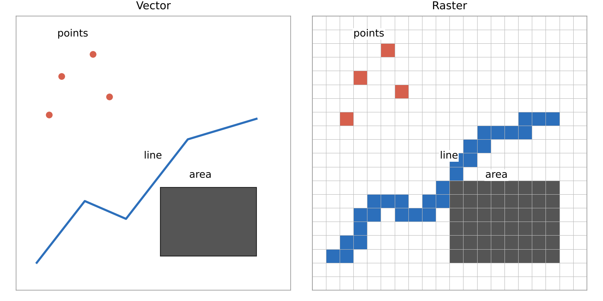
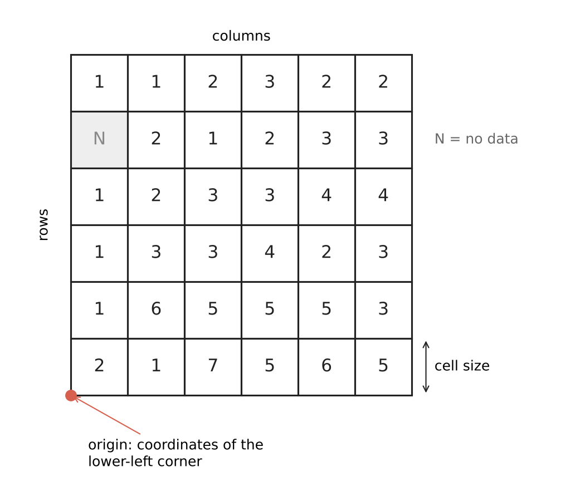
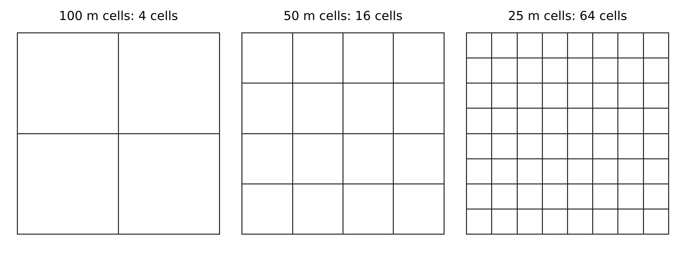

```{r}
#| label: setup-webex
#| include: false
library(webexercises)
```

::: {.callout-note appearance="simple"}
## Learning objectives

By the end of this chapter you should be able to:

1.  Explain how data abstraction turns real-world entities into features a computer can store.
2.  Tell continuous data from discrete objects, and spatial data from attributes.
3.  Describe the vector and raster data models, and choose between them for a task.
4.  Use the parts of vector data (points, nodes, vertices, line segments, polygons) and of raster data (cells, cell size, origin) correctly.
5.  Recognize common geographic file formats, and explain why metadata matters.
:::

In the last chapter you mapped campus trees, sidewalks, and buildings. But a map, or a layer of data in R, is never the world itself. A tree on the map is a dot; a building is a flat outline. Each is a **model** of reality, and every model makes choices about what to keep and what to leave out.

This chapter steps back from the code to ask how geographic information gets from the real world into a computer. It is organized around four questions:

1.  How does a map represent the world?
2.  What types of geographic data are there?
3.  What are the advantages and disadvantages of each type?
4.  How are the data stored in files that R can read?

The answers will help you choose the right data for a question, and understand what the data can and can't tell you.

## From the real world to the computer {#sec-abstraction}

### Entities and features

Everything starts with the real world. Walk across campus and you pass trees, light poles, buildings, sidewalks, and lawns. Each of these real things is an **entity**. When we put them on a map or in a database, they become **features**: simplified representations of those entities.

Not every entity makes it onto the map. A typical campus map keeps the buildings and sidewalks, and leaves out the light poles and most of the trees. Choosing what to keep is the first step of abstraction.

### Data abstraction

**Data abstraction** is the process of making the real world readable by a computer. It happens in steps, each further from what people see and closer to what a machine stores (@tbl-abstraction).

| Level | What it is | Example: a wetland |
|:--------------|:-------------------------------------|:------------------------------|
| Real world | Too detailed to store as it is | The marsh itself, with its water, plants, and edges |
| Data model | We choose which objects and properties to keep | Wetland areas, each with an ID, an area, and a type |
| Data structure | Tables and lists of coordinates organize the model | A list of x, y coordinates for each outline, and a table of attributes |
| Machine code | Everything is stored as 0s and 1s | `10011101 00110110 ...` |

: The levels of data abstraction, from the human end to the machine end. {#tbl-abstraction}

The top of the table is meaningful to people, and the bottom to machines. Geographic information science works in the middle, with **data models** and **data structures**, where both can read it.

### Continuous data and discrete objects

Geographic information comes in two broad types, and the type helps decide how to model it:

- **Continuous data** exist everywhere on the map. Every location has a value, even if we only measured some of them, and the value changes from place to place. Examples: elevation, temperature, precipitation.
- **Discrete objects** exist in one place and not in another. They are either present or absent, with clear edges. Examples: roads, houses, states.

::: {.callout-tip appearance="simple"}
## Think about it

Is population density continuous or discrete? You could think of it as a value that exists everywhere and changes smoothly across a city. Or you could count the people in each census tract, which gives one number per area with sharp edges between them. Which is more realistic? Which is easier to work with?
:::

### Geographic data models

A **geographic data model** is "a formal (meaning mathematical) means of representing and manipulating spatially-referenced information." People understand the world through ideas like *river* or *neighborhood*; computers understand numbers and rules. A data model lives in the overlap: precise enough for a computer, and meaningful enough for us. Every data model loses something, so it is always worth asking what was left out.

Geographic information reaches the computer in three main forms:

- **Vector** data store discrete features as coordinates: points for fire hydrants, lines for streets, polygons for land parcels.
- **Raster** data store a grid of cells, each holding a value, like the pixels of a satellite image or an elevation model.
- **Tabular** data hold the attributes of features: for one house, its address, year built, square footage, and number of bedrooms. Attribute tables are usually joined to vector features.

The next two sections take vector and raster data in turn.

## Vector data {#sec-vector}

### One object, three representations

The same real-world objects can be stored as different kinds of vector features. Take the buildings in an air photo (@fig-building-representations):

- As **points**, they record *where* each building is.
- As **lines**, they record each building's outline.
- As **areas** (polygons), they record the outline *and* the space inside it.

What is the difference between the lines and the areas, when both trace the same outline? Enclosure. A line is just a boundary; a polygon knows it has an inside, so you can ask how big it is, color it in, or find out whether a point falls within it.

{#fig-building-representations fig-alt="Three panels side by side. The first shows four black dots. The second shows the outlines of four buildings, three rectangles and one L shape, drawn as black lines. The third shows the same four shapes filled solid black."}

The right choice depends on the map's purpose and its scale.

### Generalization and map scale

When a map shows a place at a smaller scale, detail has to go. This is called **generalization**. Imagine three maps of the same city:

- A **large-scale map**, zoomed in on a neighborhood, draws the streets and buildings as areas.
- An intermediate map, of the region around the city, draws the city as an area and the roads as lines.
- A **small-scale map**, of the whole country, draws the city as a single point.

The names are easy to mix up. Map scale is a fraction: a large-scale map has a large fraction, such as 1:10,000, so it shows a small area in detail. A small-scale map has a small fraction, such as 1:10,000,000, so it shows a large area with little detail. The same feature can need a different geometry at a different scale, so a data model must be chosen with the map's purpose in mind.

### What makes something an entity?

To store an entity, we need to know five things about it:

1.  A **location**: an address or a set of coordinates.
2.  An **extent**: its size, boundary, or dimensions.
3.  Non-spatial **attributes**: its name, number, qualities, or color.
4.  **Time**: when it existed, or when the data were collected.
5.  A **geometry**: its shape.

Think of a lake. Its location and extent come from an air photo, its geometry is a polygon traced around the shore, and its name, depth, and water quality are attributes.

### Spatial data and attributes

**Spatial data** have a location: you could put a pin on a map for each campus building, each rain gauge in North Carolina, or each interstate highway. **Non-spatial data** have no location of their own: the parts of a bicycle, student ID numbers, or class grades.

The two meet in attributes. When we describe a spatial entity with non-spatial information, such as a building's name or the year it was built, that information is called an **attribute**. Attribute data:

- are always linked to a spatial feature;
- are usually stored in tables, with one row per feature and one column per attribute;
- have the same columns for every feature in a layer.

Follow a fire hydrant into a database. The hydrant becomes a point in a layer of hydrants, and everything we know about it goes into a row of the **attribute table**: its ID, its number of outlets, its color, its rating (@tbl-hydrants). The ID is what ties each row back to its point. Because every hydrant has the same columns, we can query the layer, for example, "show all hydrants with a low rating".

| ID | Outlets | Color | Rating |
|---:|--------:|:------|:-------|
| 1 | 3 | red | high |
| 2 | 3 | red | high |
| 3 | 2 | green | low |
| 4 | 3 | red | mid |

: An attribute table for a layer of fire hydrants. Each row is one hydrant (one point on the map), and each column is one attribute. {#tbl-hydrants}

This is the same structure as the sf objects in the last chapter: each row is a feature, each column an attribute, and the geometry column holds the points.

### The parts of vector data

These terms come up whenever you edit or analyze vector data (@fig-vector-terms):

- A **point** is a single location that stands alone.
- A **node** is the start or end point of a line.
- A **vertex** is a point in between that gives the line its shape.
- A **line segment** is the straight piece between two vertices.
- A **polygon** is a closed ring of line segments.

{#fig-vector-terms fig-alt="Diagram. At the top left, three red dots are labeled points. Below them, a blue zigzag line is labeled line; its two ends are black squares labeled node, a bend in the middle is an open circle labeled vertex, and one straight piece is labeled line segment. On the right, a light blue five-sided shape is labeled polygon, with one of its corners labeled vertex."}

Nodes matter for networks. Roads connect at nodes, which is how routing software knows two streets meet. Vertices matter for accuracy: more vertices make a smoother, more accurate line, but a bigger file.

### Thematic layers

Geographic data are organized into **thematic layers**. All the roads go in one layer, all the soils in another, and elevation in a third. Each layer holds one theme, and similar features go together.

Because every layer uses the same **coordinate system**, the layers stack exactly on top of each other, and a map is just a set of layers drawn together. That is exactly what you did in the last chapter, when you drew buildings, then sidewalks, then trees. Stacking layers is also the basis of **overlay analysis**: for example, finding the wetlands on a particular type of soil within a kilometer of a road.

## Raster data {#sec-raster}

### Vector and raster compared

**Rasters** divide space into a regular grid of cells, and each cell stores one value. @fig-vector-raster shows the same points, line, and area stored both ways. On the left, as vector data, the points are exact coordinates, the line is a chain of vertices, and the area is a polygon. On the right, as a raster, each feature is approximated by grid cells: the line becomes a staircase of cells, and the area a block of them.

{#fig-vector-raster fig-alt="Two panels. On the left, labeled Vector, four red dots, a blue zigzag line, and a dark gray rectangle are drawn with smooth edges. On the right, labeled Raster, the same features are drawn by filling in squares of a 20 by 20 grid: four red squares, a staircase of blue squares, and a block of gray squares."}

How accurate the raster version is depends entirely on the size of the cells. @tbl-vector-raster sums up the two models.

| | Vector | Raster |
|:------------------|:--------------------------------|:--------------------------------|
| Geometry | Points, lines, polygons | A regular grid of cells |
| Best for | Discrete objects | Continuous data |
| Location | Stored as coordinates | Set by the cell size and position in the grid |
| Values | Each feature has attributes | Each cell holds a value |
| Examples | Roads, parcels, wells | Elevation, satellite imagery, rainfall |
| Strengths | Precise and compact for features with clear edges | Simple to analyze; handles surfaces that vary everywhere |
| Weaknesses | Awkward for values that change continuously | Files grow quickly as cells get smaller; edges become staircases |

: The vector and raster data models compared. {#tbl-vector-raster}

### A raster is a grid of cell values

Every **cell** in a raster holds exactly one value (@fig-raster-grid). The value can be a number, like an elevation in meters, or a code for a category, like 1 for forest and 2 for water. Places with no measurement are flagged as **no data**, here as *N*. Every raster format has a way to mark those cells, and in R they become `NA`.

{#fig-raster-grid fig-alt="A 6 by 6 grid with a number from 1 to 7 in each cell, except one gray cell in the second row marked N for no data. A red dot at the bottom left corner is labeled origin: coordinates of the lower-left corner. An arrow beside the bottom row is labeled cell size."}

A raster doesn't store coordinates for every cell. It stores the coordinates of one corner, the **origin**, usually the lower-left corner, and the **cell size**: the length of one side of a cell in real-world units, such as meters. From those, the computer works out where any cell is from its row and column:

$$
N_{\text{cell}} = N_{\text{lower-left}} + \text{row} \times \text{cell size}
$$

$$
E_{\text{cell}} = E_{\text{lower-left}} + \text{column} \times \text{cell size}
$$

Here N is the northing (the y coordinate) and E the easting (the x coordinate), with rows counted up from 0 at the bottom and columns counted from 0 at the left. Try it: a raster of 30 m cells has its lower-left corner at easting 600,000 m and northing 3,950,000 m. Where is the corner of the cell in row 4, column 10?

```{webr-r}
easting_ll  <- 600000
northing_ll <- 3950000
cell_size   <- 30

row <- 4
col <- 10

northing_ll + row * cell_size
easting_ll + col * cell_size
```

Because a raster is just a grid of numbers, R can hold a small one in a **matrix**. This box makes the grid in @fig-raster-grid, with `NA` for the no-data cell, and draws it with base R's `image()`:

```{webr-r}
cells <- matrix(c(1, 1, 2, 3, 2, 2,
                  NA, 2, 1, 2, 3, 3,
                  1, 2, 3, 3, 4, 4,
                  1, 3, 3, 4, 2, 3,
                  1, 6, 5, 5, 5, 3,
                  2, 1, 7, 5, 6, 5),
                nrow = 6, byrow = TRUE)
cells
mean(cells, na.rm = TRUE)

# image() draws row 1 at the bottom, so flip the rows first
image(t(cells[6:1, ]), col = hcl.colors(7, "Greens", rev = TRUE),
      axes = FALSE, asp = 1)
```

Real rasters are far bigger, with millions of cells, and in R you would use the **terra** package for them. But the idea is the same.

### Cell size and resolution

The cell size is the raster's **resolution**. @fig-cell-sizes shows the same 200 m square at three cell sizes. Going from 100 m to 50 m to 25 m cells takes it from 4 to 16 to 64 cells.

{#fig-cell-sizes fig-alt="Three square grids of the same size side by side. The first, labeled 100 m cells: 4 cells, is divided into 2 by 2 squares. The second, 50 m cells: 16 cells, is 4 by 4. The third, 25 m cells: 64 cells, is 8 by 8."}

Smaller cells capture more detail, but the number of cells grows with the *square* of the resolution: halve the cell size and you have four times as many cells, and roughly four times as much data.

::: {.callout-tip appearance="simple"}
## Think about it

A TV screen is a raster, and each pixel is a cell. If you were buying a new TV, which of the three grids in @fig-cell-sizes would give the sharpest picture? A 4K TV has about four times as many pixels as a 1080p TV of the same size. What does that say about the size of its pixels, and about how much data it needs?
:::

### Data structures

The data model is the idea; the **data structure** is how that idea is laid out in memory or on disk. A polygon, for example, can be stored as a set of **arcs**, each a list of coordinate pairs. A pointer at the end of one arc tells the computer where the next one begins. Neighboring polygons can share an arc, so their common boundary is stored once rather than twice. Data structures that record how features connect and share boundaries like this are called **topological** data structures.

## Geographic file formats {#sec-formats}

Data models and structures are stored in files, and you will meet several formats when you load spatial data into R (@tbl-formats).

| Format | Extension | Data model | Notes |
|:----------------|:--------------|:----------|:---------------------------------------|
| Shapefile | `.shp`, plus several others | Vector | Esri's format, from the early 1990s; still very common |
| GeoJSON | `.geojson` | Vector | Open, plain-text standard; the default for web maps |
| KML | `.kml`, `.kmz` | Vector | The format behind Google Earth |
| GeoTIFF | `.tif` | Raster | An image with its location stored inside |

: Common geographic file formats. {#tbl-formats}

### Shapefiles

A **shapefile** is the most common way vector data are shared, and its name is misleading: it isn't one file, but a group of files with the same name and different extensions (@tbl-shapefile).

| File | What it holds |
|:----------------|:-----------------------------------------------|
| `roads.shp` | The geometry of each feature |
| `roads.shx` | A positional index, for faster access |
| `roads.dbf` | A database table of the attributes |
| `roads.prj` | The projection (coordinate system) |
| `roads.sbn`, `roads.sbx` | A spatial index of the features |
| `roads.shp.xml` | The metadata for the layer |

: The files that make up one shapefile, called `roads`. {#tbl-shapefile}

Only `.shp`, `.shx`, and `.dbf` are required, but without the `.prj` file the software can't place the data correctly on the Earth. Keep all the files together, in the same folder: a `.shp` on its own is not usable. When you email or download a shapefile, zip the whole set.

Shapefiles have limits worth knowing. Attribute column names can be at most 10 characters long, which is why you will see names like `SURFACE_` or `POP2020EST`, and each file can be at most 2 GB. Newer formats, such as the GeoPackage (`.gpkg`), avoid these limits.

### GeoJSON

**GeoJSON** is an open standard for simple geographic features, written in **JSON**, the plain-text format that web APIs use. You can open it in any text editor, read it, and edit it. It stores points, lines, polygons, or collections of features, and it has become the default format for web maps. The campus layers in the last chapter were GeoJSON files.

Here is a small GeoJSON file with one feature, a point at the Old Well:

``` json
{
  "type": "FeatureCollection",
  "features": [
    {
      "type": "Feature",
      "geometry": {
        "type": "Point",
        "coordinates": [-79.0512, 35.9121]
      },
      "properties": {
        "name": "Old Well"
      }
    }
  ]
}
```

A `FeatureCollection` holds a list of `Feature`s, and each feature has a `geometry` (its type and coordinates) and `properties` (its attributes). Notice that the coordinates are written **longitude first**, then latitude. GeoJSON always uses longitude and latitude on the **WGS84** datum, the same system GPS uses. (Coordinate systems get a chapter of their own later in the course.) The free website <https://geojson.io> lets you draw features on a map and see their GeoJSON appear beside it.

### KML

**KML**, Keyhole Markup Language, is the format behind Google Earth. It was created by Keyhole, the company whose Earth viewer Google bought in 2004, and it became an Open Geospatial Consortium standard in 2008. KML is written in XML, as nested tags, and stores points, paths, polygons, images, and even 3D models. Here is the same Old Well as a KML placemark:

``` xml
<Placemark>
  <name>Old Well</name>
  <Point>
    <coordinates>-79.0512,35.9121,0</coordinates>
  </Point>
</Placemark>
```

Like GeoJSON, KML uses WGS84 longitude and latitude, plus an altitude. A `.kmz` file is a zipped KML file, usually bundled with its icons or images. KML is great for sharing and display, but less so for analysis, so it is usually converted to another format before you work with it in R.

### GeoTIFF

**GeoTIFF** is the standard format for raster data: satellite images, air photos, and elevation models. It is an ordinary TIFF image with extra information inside the file saying where on Earth each pixel is, and which coordinate system it uses. It is a public-domain, open standard.

GeoTIFFs get big fast, often hundreds of megabytes. A newer variety, the **Cloud Optimized GeoTIFF (COG)**, arranges the cells in tiles with built-in zoomed-out copies, so that a web map or R can read only the area and the level of detail it needs, instead of downloading the whole file.

### Metadata

**Metadata** are data about the data. The `.shp.xml` file in a shapefile is one example. Good metadata answer these questions:

- Who created the data?
- When were they created?
- How were they created, and to what specifications?
- Where can the data be found?
- What coordinate system do they use, and how accurate are they?

In the US, federal agencies follow the **FGDC** metadata standard, from the Federal Geographic Data Committee; internationally, the standard is **ISO 19115**. Without metadata, you can't judge whether data are fit for your purpose. A practical rule: if you can't find out when and how a dataset was made, be very cautious about using it to make a decision.

### Spatial data in R

How does R handle all of this? With data frames. In the last chapter, `read_sf()` read GeoJSON files into sf objects, which are data frames with an extra column that holds each feature's geometry. The same function reads shapefiles (point it at the `.shp` file, with the other files beside it), KML, and GeoPackages. Rasters, such as GeoTIFFs, are read with the terra package. Later chapters put these to work.

## Check your understanding

1.  A real-world object, such as a tree on campus, is called an: `r mcq(c(answer = "Entity", "Attribute", "Vertex", "Origin"))`

2.  Elevation is an example of: `r mcq(c("A discrete object", answer = "Continuous data", "Non-spatial data", "Metadata"))`

3.  Which data model stores features as points, lines, and polygons? `r mcq(c(answer = "Vector", "Raster", "Tabular", "Metadata"))`

4.  A point in the middle of a line, where the line changes direction, is called a: `r mcq(c("Node", answer = "Vertex", "Cell", "Origin"))`

5.  A large-scale map, such as 1:10,000, shows a small area in a lot of detail. `r torf(TRUE)`

6.  A raster has 50 m cells. You change it to 25 m cells over the same area. How many times as many cells does it have now? `r fitb("4")`

7.  Which file in a shapefile holds the attribute table? `r mcq(c(".shp", ".shx", answer = ".dbf", ".prj"))`

8.  GeoJSON writes coordinates with latitude first, then longitude. `r torf(FALSE)`

9.  Which format is the standard for raster data such as satellite images? `r mcq(c("KML", "GeoJSON", "Shapefile", answer = "GeoTIFF"))`

`r hide("Show hint for question 6")`
Halving the cell size halves the width of each cell *and* its height, so each old cell becomes 2 × 2 = 4 new cells.
`r unhide()`

## Summary

- A map or a GIS layer is a **model** of the world. **Data abstraction** turns real-world **entities** into **features**, through a **data model** and a **data structure**, down to machine code.
- **Continuous data**, such as elevation, exist everywhere; **discrete objects**, such as roads, are either present or absent.
- **Vector** data store discrete features as **points**, **lines**, and **polygons**, built from **nodes**, **vertices**, and **line segments**. The same entity can be a polygon at a large scale and a point at a small one (**generalization**).
- **Attributes** are non-spatial information about features, stored in a table with one row per feature. Layers of one theme each stack into a map because they share a **coordinate system**.
- **Raster** data store a grid of **cells**, each with one value. Its location comes from the **origin** and the **cell size**; smaller cells mean more detail, and more data.
- Vector suits discrete objects; raster suits continuous surfaces. Common formats are the **shapefile**, **GeoJSON**, and **KML** for vector data, and **GeoTIFF** for rasters.
- **Metadata** tell you who made the data, when, how, and how accurate they are. Without them you can't judge whether data fit your purpose.

## Exercises

1.  **Entities on campus.** List ten entities you pass on your way to class. For each, say whether you would store it as a point, a line, a polygon, or a raster, for a campus map at 1:5,000. Would any change for a map of all of Orange County?
2.  **Continuous or discrete?** Classify each as continuous data or a discrete object, and explain your choice: air temperature, county boundaries, soil type, noise from an airport, bus stops, tree canopy cover.
3.  **Vector or raster?** For each task, choose vector or raster data and explain why: (a) finding the shortest driving route between two addresses; (b) mapping the slope of the land across a county; (c) counting the trees within 10 m of a sidewalk; (d) mapping land cover from a satellite image.
4.  **Cell arithmetic.** A raster covers an area 3 km wide and 2 km tall with 10 m cells. How many cells does it have? How many would it have with 30 m cells? Use R to check your answers.
5.  **Make a GeoJSON file.** Go to <https://geojson.io> and draw a point at your favorite place on campus, a line along your route to class, and a polygon around a building. Look at the GeoJSON text. Which coordinates come first? Save the file and read it into R with `sf::read_sf()`.
6.  **Read the metadata.** Find a dataset on NC OneMap, <https://www.nconemap.gov>, and look at its metadata. Who made it, when, and in what coordinate system? Would you trust it to make a decision?

## Further reading

- *GIS Fundamentals: A First Text on Geographic Information Systems*, by Paul Bolstad, covers data models, data structures, and file formats in more depth, with many diagrams.
- *Geocomputation with R* (2nd ed.), by Robin Lovelace, Jakub Nowosad, and Jannes Muenchow, free at <https://r.geocompx.org>. Its "Geographic data in R" chapter explains how sf and terra store vector and raster data.
- The GeoJSON standard, RFC 7946, at <https://datatracker.ietf.org/doc/html/rfc7946>, is short and readable.
