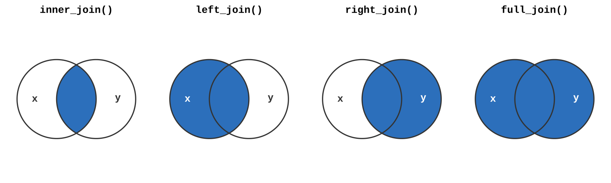
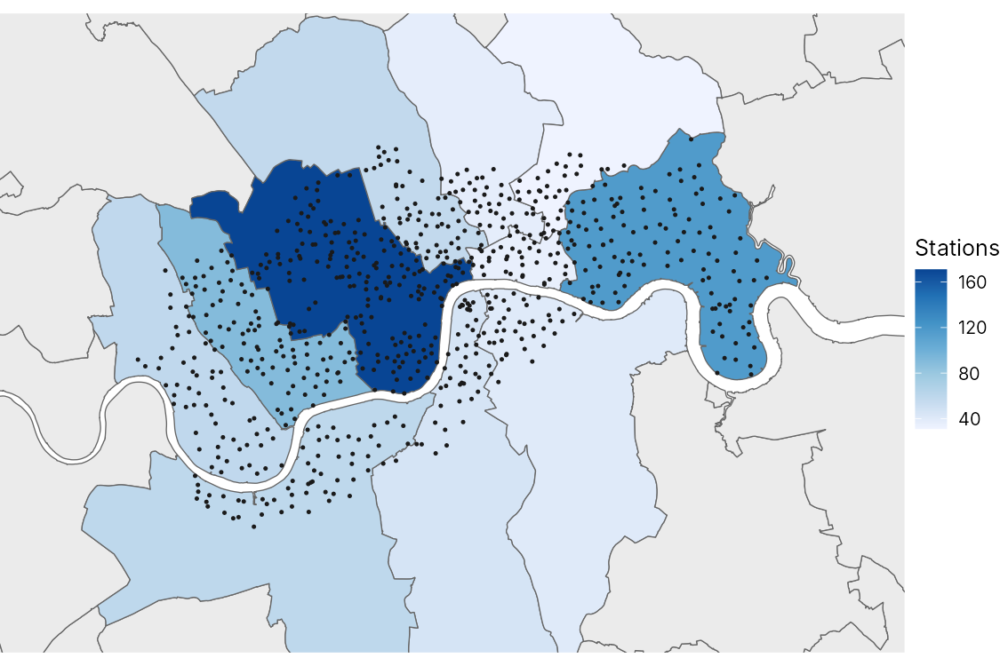

```{r}
#| label: setup-webex
#| include: false
library(webexercises)
```

::: {.callout-note appearance="simple"}
## Learning objectives

By the end of this chapter you should be able to:

1.  Explain what a join does, and combine two tables with dplyr's `inner_join()`, `left_join()`, `right_join()`, and `full_join()`.
2.  Name the key of a join with `join_by()`, and chain joins to combine three or more tables.
3.  Describe the cardinality of a relationship, and predict how many rows a join will return.
4.  Explain how a spatial join uses location instead of a shared column, and run one with `st_join()`.
5.  Choose between simple and summarized, inside and distance spatial joins.
6.  Avoid wrong distances in a spatial join by checking and projecting the coordinate reference system.
:::

Data rarely arrive in one table. Student names live in one table and the courses they take in another. Census counts live in a spreadsheet and county boundaries in a shapefile. EMS calls are points and neighborhoods are polygons. To answer most questions, you have to put two tables together.

A **join** combines two or more tables by matching rows. This chapter covers two kinds:

- An **attribute join** matches rows that share a value in a common column, such as a student ID or a county FIPS code.
- A **spatial join** matches features by their location, such as which neighborhood each EMS call falls inside.

## What is a join? {#sec-what-join}

Recall that a data table has one row per observation and one column per variable. A join lines up the rows of two tables wherever a shared column has the same value. That shared column is the **key**.

Here are two small tables. `students` has one row per student. `takes` has one row for each course a student took. Both have an `id` column. Run the box to make them:

```{webr-r}
library(dplyr)

students <- tibble(
  id   = c("00128", "12345", "11122", "22211"),
  name = c("Zhang", "Shankar", "Parr", "McKeon"),
  dept = c("Comp. Sci.", "History", "Geography", "Geography")
)

takes <- tibble(
  id        = c("00128", "00128", "12345", "33456", "45678"),
  course_id = c("CS-347", "CS-101", "HIS-222", "GEOG-215", "GEOG-215"),
  sec_id    = c(1, 2, 1, 1, 2)
)

students
takes
```

Look closely before you join. Zhang took two courses. Parr and McKeon took none. And two rows of `takes` belong to IDs, 33456 and 45678, that aren't in `students` at all. Each type of join treats these unmatched rows differently.

## Types of joins {#sec-join-types}

It helps to think of each table as a collection of rows, drawn as a circle. Where the circles overlap are the rows whose key appears in both tables. A table with no duplicate rows is a **set**; one that may have duplicates is a **bag**, and R data frames behave like bags.

{#fig-join-types fig-alt="Four pairs of overlapping circles labeled x and y. For inner_join, only the overlap is shaded blue. For left_join, the whole left circle x is shaded. For right_join, the whole right circle y is shaded. For full_join, both circles are shaded."}

### Inner join

An **inner join** keeps only the rows whose key appears in both tables:

```{webr-r}
students |> inner_join(takes, by = join_by(id))
```

Parr and McKeon are dropped because they took no courses, and the two GEOG-215 rows are dropped because no student matches them. Zhang appears twice, because Zhang took two courses.

The `by = join_by(id)` part names the key. You could leave it out and dplyr would guess, but naming it is the habit to build.

### Left join

A **left join** keeps every row of the left table, the first one, and adds the matching columns from the right table:

```{webr-r}
students |> left_join(takes, by = join_by(id))
```

Parr and McKeon now appear, with `NA` in the course columns. This is the join you will use most, because it never drops a row from the table you care about. But check the row count afterwards: it can grow when a key has several matches. `students` has 4 rows, and the result has 5.

### Right join

A **right join** is the mirror image. It keeps every row of the right table:

```{webr-r}
students |> right_join(takes, by = join_by(id))
```

Now the GEOG-215 rows appear, with `NA` for name and department. Any right join can be written as a left join by swapping the order of the tables, and most people find the left join easier to read.

### Full join

A **full join** keeps every row from both tables. It matches rows where it can and fills in `NA` where it can't, so nothing is dropped:

```{webr-r}
students |> full_join(takes, by = join_by(id))
```

### Natural joins and cross joins

Two more joins are worth knowing about, mostly so you can avoid them by accident.

A **natural join** is an inner join on every column the two tables share by name. In dplyr, if you leave out `by`, `inner_join()` does exactly this and prints a message, such as ``Joining with `by = join_by(id)` ``, to tell you which columns it used. It's convenient but fragile. If both tables also had a column called `name` or `year`, it would silently join on that too. In your own code, spell out the key.

A **cross join** pairs every row of one table with every row of the other: the cartesian product. In dplyr it is `cross_join()`. Our 4 students and 5 course rows give 20 rows. It grows fast: two tables of 1,000 rows give a million.

You may also meet a **self join**, which joins a table to itself, such as a table of employees joined to their managers in the same table.

::: {.callout-tip appearance="simple"}
## Think about it

Suppose the keys were stored differently in the two tables: `"00128"` as text in one and `128` as a number in the other. Would they match? How would you find out, and how would you fix it?
:::

### Joining more than two tables

Joins chain. Pipe the result of one join into the next to combine three or more tables. Here we add an `instructor` table, keyed by `course_id`:

```{webr-r}
instructor <- tibble(
  course_id  = c("CS-347", "CS-101", "HIS-222", "GEOG-215"),
  instructor = c("Okafor", "Lindqvist", "Moreno", "Parr")
)

roster <- students |>
  inner_join(takes, by = join_by(id)) |>
  inner_join(instructor, by = join_by(course_id))

roster
```

Notice that the key changes from step to step: `id` for the first join and `course_id` for the second. Each inner join can only drop rows, so if records go missing, check the row count after each step to see where.

## Cardinality {#sec-cardinality}

Before you run a join, ask how many rows on each side can match. **Cardinality** is the relationship between the rows of two tables, and it tells you how big the result will be.

| Cardinality | Meaning | Examples |
|:------------|:--------|:---------|
| **One-to-one** | Each row matches at most one row in the other table | Governor and state; person and passport |
| **One-to-many** | One row matches many rows in the other table | Book and pages; state and cities |
| **Many-to-one** | The same relationship, seen from the other side | Cities and state; students and advisor |
| **Many-to-many** | Rows on both sides can match many rows | Students and classes |

: The four kinds of cardinality. {#tbl-cardinality}

`students` to `takes` is one-to-many: one student can take many courses. That is why Zhang's row was copied in the result. A many-to-many join multiplies rows on both sides, and can make a result far bigger than either table. dplyr warns you when it finds one.

So here is the **rule of joining**: know the cardinality before you join. It tells you how many rows to expect, and if the result has a different number, something about your keys isn't what you thought. Cardinality will matter again when we design databases later in the course.

## Why join by location? {#sec-why-spatial}

So far the key has been a shared column. But often two tables share no ID at all, only location. Consider three questions:

- **How many EMS calls fall in each neighborhood?** The calls are points and the neighborhoods are polygons.
- **How many students attend school in each district?** The schools are points with an enrollment, and the districts are polygons.
- **What is a coffee chain's revenue in each sales region?** The stores are points with revenue, and the regions are polygons.

All three have the same shape. Join each point to the polygon it falls inside, then summarize by polygon. The key is location.

## Spatial joins {#sec-spatial-joins}

### From attribute joins to spatial joins

In GIS terms, an attribute join has a **destination table** that receives new columns, a **source table** that supplies them, and a common field that links the two. The output is the destination table with the source's columns added.

A **spatial join** has the same structure, but the link is a **spatial relationship** instead of a common field. Two relationships cover most needs:

- **Inside**: one feature falls inside, or intersects, another. Each school gets the attributes of the county it is in.
- **Distance**: one feature is closest to another. Each city gets the attributes of the nearest airport.

### Spatial joins in R

In R, the sf package does spatial joins with `st_join()`:

``` r
st_join(x, y, join = st_intersects)
```

`x` is the destination and `y` the source. The `join` argument sets the relationship:

- `st_intersects` (the default) or `st_within` for one feature inside another;
- `st_nearest_feature` for the closest feature.

By default `st_join()` keeps every row of `x`, like a left join. Set `left = FALSE` to get an inner join, which drops the features of `x` that matched nothing.

Here is a real example, using two datasets from the spData package: the 742 bicycle hire stations in London, as points, and London's 33 boroughs, as polygons. Which borough is each station in?

``` r
library(sf)
library(dplyr)
library(spData)

# Project both layers to the British National Grid, in meters
stations <- cycle_hire |> st_transform(27700)
boroughs <- lnd |> st_transform(27700)

stations_joined <- st_join(stations, boroughs["NAME"])
nrow(stations_joined)    # 742: one row per station
```

Each station now carries a `NAME` column: the borough it falls inside. One station sits just outside every borough polygon, so its `NAME` is `NA`; `left = FALSE` would drop it.

### Four kinds of spatial join

Two decisions define a spatial join: the relationship (inside, or distance), and whether you attach one match per feature or **summarize** all of them (@tbl-spatial-join-kinds).

| | **Simple**: attach one matching record | **Summarized**: aggregate all matches |
|:--|:--|:--|
| **Inside** | Which county is each school in? (schools ← counties) | How many schools are in each county? (counties ← schools) |
| **Distance** | Which attraction is closest to each hotel, and how far is it? (hotels ← attractions) | How many attractions are closest to each hotel? (hotels ← attractions) |

: Four kinds of spatial join. The arrow points from the source layer to the destination layer that receives its attributes. {#tbl-spatial-join-kinds}

A **simple join** attaches the attributes of one matching feature. Each septic system gets the geology formation underneath it; each city gets its nearest airport and the distance to it. In both cases, every destination feature has exactly one match, and one source feature can match many destination features, so the cardinality is many-to-one. There is no ambiguity about which fields to attach.

A **summarized join** handles one-to-many and many-to-many relationships. When one county contains many schools, a simple join can't pick just one. Instead, a summarized join counts or aggregates the matching features, such as the number of schools in each county, or their total enrollment, and attaches that.

The rule of joining applies to spatial joins too. Simple joins are one-to-one or many-to-one. Summarized joins handle one-to-many and many-to-many by aggregating.

### Summarized joins in R

In R, a summarized join is `st_join()` followed by `group_by()` and `summarize()`, or `count()`. To count the stations in each borough:

``` r
station_counts <- stations_joined |>
  st_drop_geometry() |>
  count(NAME, name = "n_stations")

boroughs <- boroughs |>
  left_join(station_counts, by = join_by(NAME))
```

The last step is an attribute join. Dropping the geometry first turns the joined stations into a plain table, and `left_join()` keeps all 33 boroughs, with `NA` for the 22 that have no hire stations. Westminster has the most, with 171 (@fig-cycle-hire).

{#fig-cycle-hire fig-alt="Map of central London with borough boundaries and the River Thames. About 740 small black dots cluster in the center. Boroughs are shaded in blues by how many dots they contain. Westminster, in the center north of the river, is darkest, with about 170. Tower Hamlets to the east is mid blue. Outer boroughs with no dots are light gray."}

For a distance join, use `st_nearest_feature`, then measure how far away the match is with `st_distance()`:

``` r
cities_airports <- st_join(cities, airports, join = st_nearest_feature)

nearest <- st_nearest_feature(cities, airports)
cities_airports$dist <- st_distance(cities, airports[nearest, ],
                                    by_element = TRUE)
```

## Spatial joins and the coordinate system {#sec-join-crs}

What units is a distance in? Software reports distances in the units of the data's coordinate system. If the data are in a geographic coordinate system, those units are decimal degrees, and a distance of 0.47 means 0.47 degrees. As @sec-crs-r showed, degrees can't simply be converted to miles or kilometers, because a degree of longitude shrinks toward the poles.

Worse, the *match itself* can change. Degrees stretch unevenly, so the feature that is nearest in degrees isn't always the one that is nearest on the ground. A distance join run on latitude and longitude can attach a different feature than the same join run in a projected coordinate system.

So, before any spatial join:

1.  Check each layer's coordinate system with `st_crs()`.
2.  Make sure both layers use the same one. `st_join()` stops with an error if they don't.
3.  For distance joins, project both layers with `st_transform()` to a projection that preserves distance in your study area, such as State Plane for North Carolina (EPSG:32119).

## Check your understanding

1.  Which join keeps only the rows whose key appears in both tables? `r mcq(c(answer = "inner_join()", "left_join()", "full_join()", "cross_join()"))`

2.  You left-join `students` (4 rows) to `takes`. One student took two courses and the others took none or one. Can the result have more than 4 rows? `r mcq(c(answer = "Yes, keys with several matches are repeated", "No, a left join never changes the row count", "No, it always has fewer rows"))`

3.  Any right join can be rewritten as a left join by swapping the order of the tables. `r torf(TRUE)`

4.  A cross join of a 10-row table and a 30-row table has how many rows? `r fitb("300")`

5.  What is the cardinality between students and their academic advisor, if each student has one advisor? `r mcq(c("One-to-one", "One-to-many", answer = "Many-to-one", "Many-to-many"))`

6.  In `st_join(x, y)`, which layer receives the new attributes? `r mcq(c(answer = "x, the destination", "y, the source", "Neither; it makes a new layer with only y's columns"))`

7.  Which `join` argument attaches the closest feature? `r mcq(c("st_intersects", "st_within", answer = "st_nearest_feature", "st_distance"))`

8.  Counting the schools in each county is an example of a: `r mcq(c("Simple inside join", answer = "Summarized inside join", "Simple distance join", "Natural join"))`

9.  A distance join on data in latitude and longitude gives the same matches as the same join on projected data. `r torf(FALSE)`

## Summary

- A **join** combines tables by matching rows. An **attribute join** matches a shared **key** column; a **spatial join** matches by location.
- dplyr's **inner join** keeps matches only; a **left join** keeps every row of the first table; a **right join** keeps every row of the second; a **full join** keeps everything. Name the key with `join_by()`, and chain joins with the pipe.
- A **natural join** matches on every shared column name, which is fragile. A **cross join** pairs every row with every row.
- **Cardinality** (one-to-one, one-to-many, many-to-one, many-to-many) tells you how many rows a join will return. Know it before you join.
- `st_join(x, y, join = ...)` attaches the attributes of `y` to `x` using a spatial relationship: `st_intersects` or `st_within` for inside, `st_nearest_feature` for distance. It keeps every row of `x` unless `left = FALSE`.
- **Simple** spatial joins attach one match; **summarized** joins aggregate many, with `group_by()` and `summarize()` or `count()`.
- Distances come out in the data's units. Check the CRS with `st_crs()` and project with `st_transform()` before joining by distance.

## Exercises

1.  **Predict, then run.** Before running each join in @sec-join-types, write down how many rows you expect and which names will have `NA`. Then check.
2.  **Find the unmatched rows.** dplyr has two filtering joins: `semi_join()` keeps the rows of `x` that have a match in `y`, and `anti_join()` keeps the rows that don't. Use `anti_join()` to list the students who took no courses, and the course rows with no matching student.
3.  **Cardinality.** Give the cardinality of each relationship, and explain: (a) capital city and state; (b) students and phone numbers; (c) counties and ZIP codes; (d) census tracts and counties.
4.  **Base R.** Base R's `merge()` also joins tables. Find the arguments to `merge()` that give an inner, a left, and a full join of `students` and `takes`.
5.  **London bikes.** Reproduce the station counts in @fig-cycle-hire. Then make a map of stations per square kilometer of each borough. Does the ranking change?
6.  **NC schools.** Find a point layer of North Carolina public schools on NC OneMap, <https://www.nconemap.gov>. Join it to NC counties and count the schools in each county. Which county has the most schools? The most per 10,000 people?

## Further reading

- *R for Data Science* (2nd ed.), by Hadley Wickham, Mine Çetinkaya-Rundel, and Garrett Grolemund, free at <https://r4ds.hadley.nz>. The "Joins" chapter covers keys, every dplyr join, and how to check them.
- *Geocomputation with R* (2nd ed.), by Robin Lovelace, Jakub Nowosad, and Jannes Muenchow, free at <https://r.geocompx.org>. The "Spatial data operations" chapter covers spatial joins, distance joins, and spatial aggregation.
- *Database System Concepts*, by Abraham Silberschatz, Henry F. Korth, and S. Sudarshan, explains joins and cardinality from the database side.
