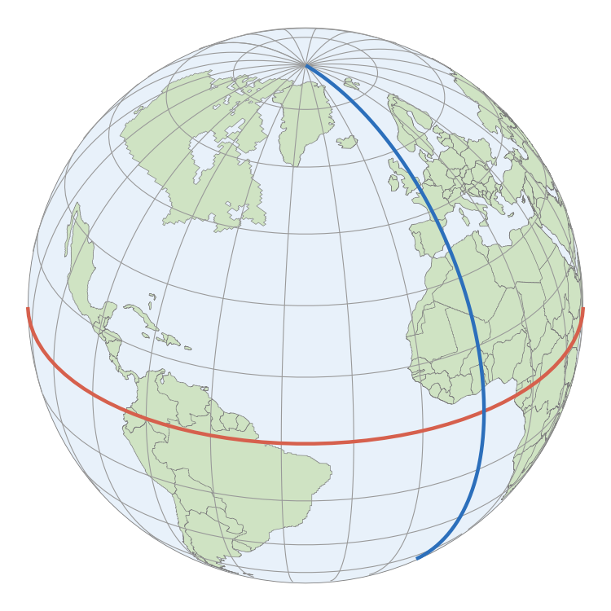
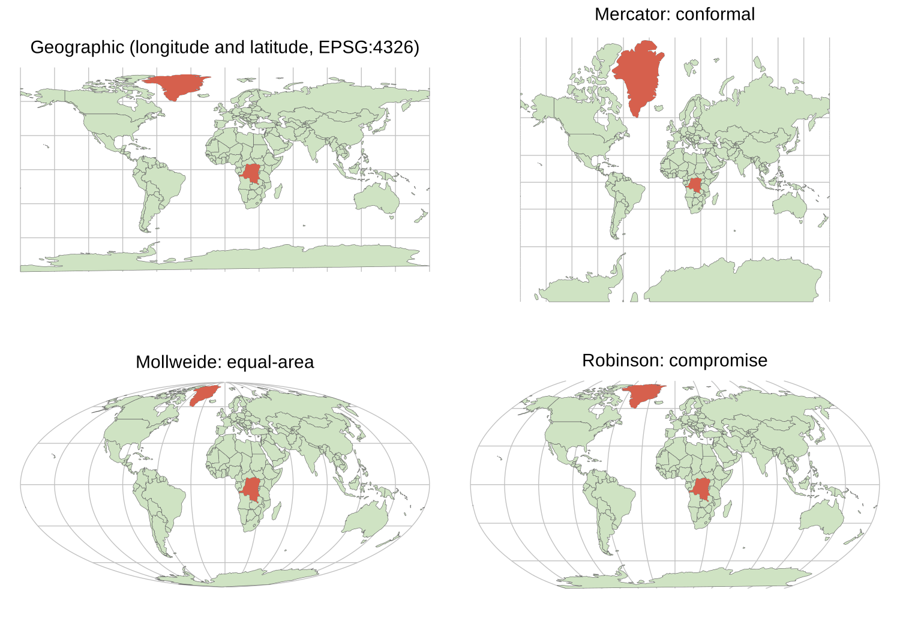
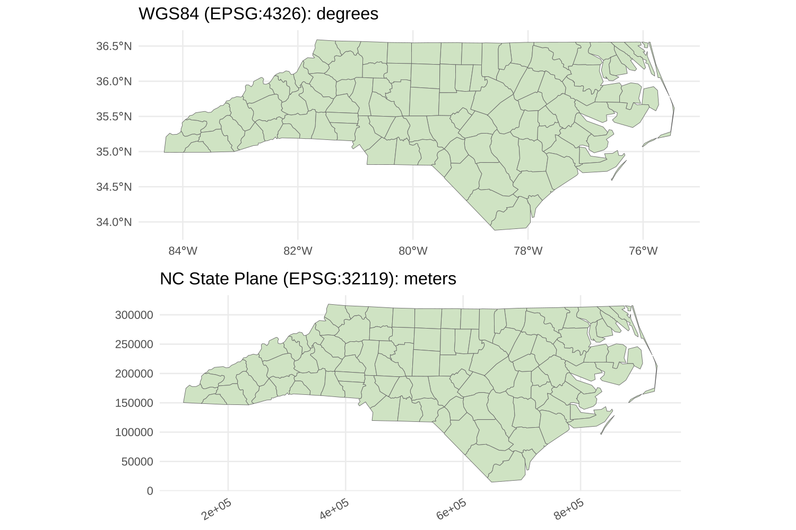

```{r}
#| label: setup-webex
#| include: false
library(webexercises)
```

::: {.callout-note appearance="simple"}
## Learning objectives

By the end of this chapter you should be able to:

1.  Explain why every location in a computer needs a datum, a coordinate system, and a projection.
2.  Describe the ellipsoid and the datums used in North America (NAD27, NAD83, and WGS84).
3.  Convert between decimal degrees and degrees, minutes, and seconds.
4.  Use latitude, longitude, parallels, meridians, and the graticule correctly.
5.  Name the four kinds of map distortion and the projection families that preserve each.
6.  Choose a projection for a task, and check and change a layer's coordinate reference system in R.
:::

The last chapter showed that a map is a model of the world. This chapter takes on what I call the first central problem of spatial data in a computer: **how do we represent the world in a computer?**

Computers store numbers, not places. So every location has to become a pair of coordinates. Three building blocks make that possible:

1.  A **datum**: a model of the Earth's size and shape, tied to the ground.
2.  A **coordinate system**: a grid laid on that model.
3.  A **map projection**: a way to flatten the grid onto a flat map or screen.

We take them in that order.

## Where are we? {#sec-where}

How would you tell someone where you are right now? You might give:

- an **address**, such as 1600 Pennsylvania Ave.;
- a pair of **coordinates**, such as 35° 54′ 47″ N, 79° 3′ 21″ W;
- a **landmark**, such as "turn left at the cairn";
- a **relative location**, such as the "you are here" dot on a mall directory.

All of these are valid ways to say where something is. But only coordinates are unambiguous, and easy for a computer to store, compare, and measure between. A landmark only helps people who know it, and "you are here" only works on that one map. Location always depends on what you measure from, and at what scale.

## Geodesy: the shape of the Earth {#sec-geodesy}

### Measuring the Earth

**Geodesy** is the science of measuring the Earth's size, shape, orientation, and gravity. Every coordinate you will ever use rests on a geodetic model of the Earth.

People have measured the Earth for a long time. Around 240 BCE, the Greek scholar Eratosthenes noticed that at noon on the summer solstice, the sun shone straight down a well in Syene, in southern Egypt. At the same moment in Alexandria, to the north, a vertical stick cast a shadow at an angle of about 7.2°. That is one-fiftieth of a circle, so he multiplied the distance between the cities by 50 to estimate the Earth's circumference. His answer was close to the modern value of about 40,000 km. Just how close depends on the length of the *stadion*, the unit he used, which historians still argue about.

### Sphere or ellipsoid?

Is the Earth a sphere? Close, but not quite. Because it spins, the Earth bulges at the Equator and is flattened at the poles. Its shape is an **ellipsoid** (also called a **spheroid**): a sphere squashed a little along its axis.

- The **semi-major axis**, *a*, runs from the center to the Equator: about 6,378 km.
- The **semi-minor axis**, *b*, runs from the center to a pole: about 6,357 km.

The difference is only 21 km, but it matters for precise mapping. We describe it with the **flattening**:

$$
f = \frac{a - b}{a} \approx \frac{1}{298}
$$

A sphere is fine for a small-scale map of the world. For anything precise, we use an ellipsoid. Different ellipsoids were fitted at different times and for different places. **Clarke 1866** was fitted for North America; **GRS80** and **WGS84** fit the whole globe, and are almost identical to each other.

The real Earth is lumpier still. The surface that gravity defines, roughly where mean sea level would be if the oceans flowed under the continents, is called the **geoid**. The ellipsoid is the simplest smooth shape that comes close to it.

You can work out the flattening yourself from the WGS84 axes:

```{webr-r}
a <- 6378137        # semi-major axis, meters (WGS84)
b <- 6356752.314    # semi-minor axis, meters

f <- (a - b) / a
f
1 / f               # the "1 in 298" you'll see quoted
(a - b) / 1000      # the difference, in km
```

### Datums

An ellipsoid is a shape floating in space. A **datum** pins it to the real Earth. A geodetic datum says which ellipsoid to use and exactly where it sits relative to the Earth, so that a latitude and longitude point to one place on the ground.

On the ground, a datum is made real by thousands of surveyed **control points**. The brass disks you can find set into bridges, sidewalks, and mountain tops are **benchmarks** placed by the National Geodetic Survey. A witness post nearby often warns people not to disturb them.

Three datums show up again and again in North American data:

| Datum | Ellipsoid | Notes |
|:------|:----------|:------|
| **NAD27** (North American Datum of 1927) | Clarke 1866 | Surveyed from one origin point, at Meades Ranch, Kansas |
| **NAD83** (North American Datum of 1983) | GRS80 | Centered on the Earth's mass; readjusted several times; now maintained through **CORS**, a network of Continuously Operating Reference Stations |
| **WGS84** (World Geodetic System 1984) | WGS84 | The global datum that GPS uses |

: Common datums in North America. {#tbl-datums}

In North America, NAD83 and WGS84 differ by only a meter or two. But moving from NAD27 to NAD83 can shift a point by tens of meters or more. Change the datum and the same coordinates point to a different place on the ground, so always check which datum your data use.

## Building a coordinate system {#sec-graticule}

With a model of the Earth in hand, we can lay a grid on it. Building a coordinate system takes two anchors, and both come from the Earth's rotation:

1.  **The poles.** The North and South Poles are where the Earth's spin axis meets the surface.
2.  **The Equator.** The circle halfway between the poles. It is 0° latitude, and it divides the Northern Hemisphere from the Southern.

Then we draw the grid (@fig-graticule-globe):

- **Parallels** are lines of **latitude**. They run east–west, parallel to the Equator, and measure from 0° at the Equator to 90° north or south at the poles.
- **Meridians** are lines of **longitude**. They run from pole to pole, meet at the poles, and measure from 0° to 180° east or west.

Unlike the Equator, the starting line for longitude has no natural place. It had to be agreed on. In 1884, an international conference chose the meridian through the Royal Observatory in Greenwich, England, as the **Prime Meridian**, 0° longitude. (So the Prime Meridian is 0° W, or 0° E. And the Equator is 0° N, or 0° S. Zero is zero.)

{#fig-graticule-globe width="60%" fig-alt="A globe centered on the Atlantic Ocean, showing North and South America, Europe, and Africa, covered by a grid of gray lines every 15 degrees. A thick red line, the Equator, crosses South America and Africa. A thick blue line, the Prime Meridian, runs from the North Pole down through Britain, France, and West Africa."}

A full circle of longitude around the Earth is 360°. Latitude only covers 180°, from pole to pole.

### The graticule

The **graticule** is the network of parallels and meridians drawn on a map. It is a reference grid, not data. Which lines should you show? Match the interval to the scale: every 30° on a world map, every 1° or less on a map of a state. Keep the lines thin and light so they don't compete with the data. On many thematic maps you can leave them off.

### A degree isn't a fixed distance

Meridians meet at the poles, so the parallels get shorter as you move away from the Equator. One degree of latitude is always about 111 km. But one degree of longitude is about 111 km at the Equator, and shrinks to zero at the poles. It is roughly 111.32 km times the cosine of the latitude:

```{webr-r}
lat <- c(0, 30, 36, 60, 89)   # Chapel Hill is near 36 degrees north
km_per_degree_lon <- 111.32 * cos(lat * pi / 180)
round(km_per_degree_lon, 1)
```

At Chapel Hill's latitude, a degree of longitude is about 90 km. This is why you can't treat degrees as if they were meters. We'll come back to it in @sec-crs-r.

## Writing coordinates {#sec-dms}

There are two common ways to write the same angle:

- **Decimal degrees (DD)** are a single signed number, such as −104.54°. Negative means south latitude or west longitude. This is the format GIS software and GPS units store.
- **Degrees, minutes, and seconds (DMS)** split the angle into whole degrees, minutes (′), and seconds (″), such as 104° 32′ 24″ W. A letter, N, S, E, or W, replaces the sign.

There are 60 minutes in a degree and 60 seconds in a minute, so 3,600 seconds in a degree.

**DD to DMS.** Take the whole number of degrees. Multiply the decimal part by 60 to get minutes. Multiply the decimal part of that by 60 to get seconds. For −104.54°: 0.54 × 60 = 32.4′, and 0.4 × 60 = 24″. So −104.54° is 104° 32′ 24″ W.

**DMS to DD.** Add the parts back up: degrees + minutes / 60 + seconds / 3600, then add the sign.

```{webr-r}
# DMS to decimal degrees
dms_to_dd <- function(deg, min, sec) {
  deg + min / 60 + sec / 3600
}
-dms_to_dd(104, 32, 24)   # west, so negative

# Decimal degrees to DMS
dd  <- abs(-104.54)
deg <- floor(dd)
min <- floor((dd - deg) * 60)
sec <- ((dd - deg) * 60 - min) * 60
c(deg, min, round(sec, 2))
```

GIS software almost always wants decimal degrees, so this conversion comes up when you type in coordinates from older maps or documents.

## Map projections {#sec-projections}

A grid on a globe is still not a flat map. Before we flatten it, it helps to see how the pieces stack up. Read @tbl-pyramid from the bottom up: each layer rests on the one below it.

| Layer | What it adds |
|:------|:-------------|
| Map projection | Flattens the curved grid onto a plane, in meters or feet |
| Geographic coordinate system | Latitude and longitude, in degrees |
| Datum | Pins the ellipsoid to the real Earth |
| Ellipsoid | A smooth mathematical model of the Earth's shape |
| The Earth | Lumpy and irregular |

: Building a projection, from the Earth up. {#tbl-pyramid}

If you change a lower layer, everything above it shifts. That is why two datasets must share a datum and a projection before they will line up.

### Projecting the globe

A **map projection** is a method for moving the graticule from the globe to a flat surface. Picture a clear globe with a light bulb inside it. The bulb throws the shadow of the grid onto a sheet of paper. Wrap the paper into a cylinder around the globe, roll it into a cone, or hold it flat against one point, and you get the three classic projection surfaces: **cylindrical**, **conic**, and **planar** (or azimuthal).

### Distortion

You can't flatten an orange peel without stretching or tearing it, and you can't flatten the globe without distortion. Every projection distorts at least one of four properties:

1.  **Shape**
2.  **Area**
3.  **Distance**
4.  **Direction**

The Mercator projection, for example, keeps local shapes and angles true, which made it ideal for navigation. But it badly inflates areas near the poles. On a Mercator map, Greenland looks about as big as Africa. In fact Africa is about 14 times larger. Greenland is about the same size as the Democratic Republic of the Congo, roughly 2.2 million km² against 2.3 million km². Compare the two red countries in @fig-projections.

{#fig-projections fig-alt="Four world maps in a two by two grid, each with a light gray graticule, land in pale green, and two countries in red. Top left, Geographic: a rectangle where longitude and latitude are drawn as equal squares. Top right, Mercator: Greenland is huge, much bigger than the Congo, and Antarctica is stretched along the bottom. Bottom left, Mollweide: an oval where Greenland and the Congo look about the same size. Bottom right, Robinson: a rounded shape with Greenland a little bigger than the Congo."}

The first map in @fig-projections is not really a projection at all. It plots longitude as x and latitude as y, as if degrees were a flat grid. Many programs draw unprojected data this way, which is why a map of raw latitude and longitude looks stretched east–west away from the Equator.

### Why distance distorts

Imagine a flat map surface that cuts through the ellipsoid along two lines, like a knife slicing an orange. A surface that cuts the globe this way is called **secant**. Along the two lines where the surfaces meet, called **standard lines**, the scale is exactly true. Between them, distances on the map shrink. Outside them, distances stretch. The farther you go from a standard line, the bigger the distortion. This is why projections designed for small areas, with standard lines close by, distort so little.

### Projection families

Every projection is designed to keep some properties at the cost of others (@tbl-projection-families).

| Property | Preserves | Examples |
|:---------|:----------|:---------|
| **Conformal** | Local shape and angles | Mercator, Lambert Conformal Conic |
| **Equal-area** | Area | Albers Equal-Area Conic, Mollweide |
| **Equidistant** | Distance from one point, or along chosen lines | Azimuthal Equidistant, Equidistant Conic |
| **Azimuthal** | Direction from a center point | Lambert Azimuthal Equal-Area, Gnomonic |

: The four projection families and what each preserves. {#tbl-projection-families}

The key trade-off: **no projection can be both conformal and equal-area.** Some **compromise** projections, such as Robinson, preserve nothing exactly but keep every distortion moderate, which is why they are popular for world maps.

::: {.callout-tip appearance="simple"}
## Think about it

If you had to pick one projection for every map you will ever make, which would you choose, and why? What would go wrong with your choice for a map of the whole world? For a map of Chapel Hill?
:::

### The State Plane Coordinate System

For local work in the United States, surveyors and governments use the **State Plane Coordinate System**: a set of local projections, with one or more zones per state. Each zone is small enough to keep scale error under 1 part in 10,000. Zones that run long north–south use **Transverse Mercator**; zones that run long east–west use **Lambert Conformal Conic**. Coordinates are in feet or meters, not degrees.

North Carolina is wide from east to west, so it has a single Lambert Conformal Conic zone. That is the projection we use in this book: NAD83 / North Carolina, EPSG code **32119**, in meters.

## Choosing a projection {#sec-choosing}

There is no single best projection. Two rules of thumb help you choose:

**Fit your area.** The smaller the area, the less distortion.

- Working in Chapel Hill or Raleigh? The North Carolina State Plane zone (EPSG:32119).
- Working across the Southeast? A UTM zone, such as UTM Zone 17N, or an Albers projection for the region.
- Working across the lower 48 states? Albers Equal-Area Conic (EPSG:5070) is the standard.

**Preserve what you measure.**

- Comparing areas or densities? Use an equal-area projection. Over a small area, such as a city, a conformal projection is close enough.
- Measuring distances? Use an equidistant projection, or an azimuthal equidistant one centered on your starting point.
- Measuring directions from a point? Use an azimuthal projection centered on that point.
- Keeping shapes? Use a conformal projection.

And if you work with elevation data, make sure the horizontal units match the vertical ones. Mixing feet and meters wrecks slope and hillshade calculations.

## Coordinate reference systems in R {#sec-crs-r}

In R, the datum, the coordinate system, and the projection travel together as a **coordinate reference system** (CRS). Every sf object carries one. Most are identified by an **EPSG code**, a number from a public registry: 4326 is WGS84 latitude and longitude, and 32119 is NC State Plane in meters.

Check a layer's CRS with `st_crs()`, and change it with `st_transform()`:

``` r
library(sf)

nc <- st_read(system.file("shape/nc.shp", package = "sf"))

st_crs(nc)$epsg          # 4267: NAD27, in degrees
st_crs(nc)$units         # NULL: a geographic CRS has no linear units

nc_sp <- nc |> st_transform(32119)
st_crs(nc_sp)$units      # "m"
```

`st_transform()` recalculates every coordinate. It is different from `st_set_crs()`, which only changes the label and leaves the numbers alone. Use `st_set_crs()` only when a layer has no CRS and you know what it should be.

{#fig-nc-crs fig-alt="Two maps of North Carolina's 100 counties. The top map has axes in degrees, from 84 to 76 degrees west and 34 to 36.5 degrees north, and the state looks slightly stretched east to west. The bottom map has axes in meters, from about 150,000 to 950,000 east and 0 to 300,000 north, and the state looks a little more compact."}

### Degrees are not meters

Why does it matter? Chapel Hill and Raleigh are about 0.44 degrees apart. That number is not a distance you can use: a degree of longitude here is about 90 km, but a degree of latitude is about 111 km, so there's no single factor to convert it. Measured properly, the two cities are about 40.5 km apart:

``` r
towns <- st_sfc(st_point(c(-79.0558, 35.9132)),   # Chapel Hill
                st_point(c(-78.6382, 35.7796)),   # Raleigh
                crs = 4326)

st_distance(towns)                       # about 40,465 m, on the ellipsoid
st_distance(st_transform(towns, 32119))  # about 40,530 m, in State Plane
```

For latitude and longitude, sf measures distance on the curved Earth, so `st_distance()` still returns meters. But many other operations, and many other programs, treat coordinates as if they were flat. Before you measure, buffer, or join by distance, check the CRS with `st_crs()` and project your data with `st_transform()`. And before you combine two layers, make sure they share the same CRS.

## Check your understanding

1.  The science of measuring the Earth's size, shape, orientation, and gravity is called: `r mcq(c("Cartography", answer = "Geodesy", "Geology", "Topography"))`

2.  The Earth's equatorial radius is larger than its polar radius. `r torf(TRUE)`

3.  Which datum does GPS use? `r mcq(c("NAD27", "Clarke 1866", answer = "WGS84", "State Plane"))`

4.  Lines of latitude are called: `r mcq(c(answer = "Parallels", "Meridians", "Graticules", "Datums"))`

5.  Convert −79.25° (a longitude) to degrees, minutes, and seconds. How many minutes? `r fitb("15")`

6.  Which property does the Mercator projection preserve? `r mcq(c("Area", answer = "Shape (it is conformal)", "Distance everywhere", "Nothing at all"))`

7.  A projection can be both conformal and equal-area. `r torf(FALSE)`

8.  Which function changes the coordinates of an sf layer to a new CRS? `r mcq(c("st_crs()", "st_set_crs()", answer = "st_transform()", "st_distance()"))`

`r hide("Show hint for question 5")`
Take the decimal part, 0.25, and multiply by 60. The answer is 79° 15′ 0″ W.
`r unhide()`

## Summary

- To store a location, a computer needs a **datum** (a model of the Earth tied to the ground), a **coordinate system** (a grid on that model), and a **map projection** (a way to flatten it).
- **Geodesy** measures the Earth. Its shape is an **ellipsoid**, flattened at the poles by about 1/298. Common North American datums are **NAD27**, **NAD83**, and **WGS84**.
- **Latitude** runs from 0° at the **Equator** to 90° at the poles along **parallels**; **longitude** runs 0° to 180° east or west of the **Prime Meridian** along **meridians**. The grid of both is the **graticule**.
- Coordinates can be written in **decimal degrees** or **degrees, minutes, and seconds**. A degree of longitude shrinks toward the poles, so degrees are not a distance.
- Every projection distorts **shape**, **area**, **distance**, or **direction**. **Conformal**, **equal-area**, **equidistant**, and **azimuthal** projections each protect one property, and none is both conformal and equal-area.
- Choose a projection that fits your area and preserves what you measure. For North Carolina, use **State Plane** (EPSG:32119).
- In R, check a layer's **CRS** with `st_crs()` and change it with `st_transform()`.

## Exercises

1.  **Your own coordinates.** Find the latitude and longitude of the building you're in, using a phone or an online map. Write them in decimal degrees and in degrees, minutes, and seconds.
2.  **Eratosthenes.** The distance from Syene to Alexandria was about 5,000 stadia, and the shadow angle was 7.2°. What circumference did Eratosthenes get, in stadia? If a stadion was 157.5 m, how far off was he from 40,075 km?
3.  **The true size.** Use <https://www.thetruesize.com> to drag Greenland, Alaska, and North Carolina toward the Equator. What happens to their size on the Mercator map, and why?
4.  **Pick a projection.** Choose a projection, and say why, for (a) a map comparing forest area in every country; (b) a map showing flight distances from RDU airport; (c) a map of parcels in Orange County.
5.  **Check the CRS.** Load the `nc` data from the sf package (see @sec-crs-r). What datum is it in? Transform it to EPSG:32119 and to EPSG:5070, and plot all three. What changes?
6.  **Degrees and distance.** Pick two towns in North Carolina, one north of the other, and two at the same latitude, about the same number of degrees apart. Use `st_distance()` to compare the distances. Explain the difference.

## Further reading

- *GIS Fundamentals: A First Text on Geographic Information Systems*, by Paul Bolstad, has a full chapter on geodesy, datums, map projections, and State Plane coordinates.
- *Geocomputation with R* (2nd ed.), by Robin Lovelace, Jakub Nowosad, and Jannes Muenchow, free at <https://r.geocompx.org>. See the chapter "Reprojecting geographic data".
- *Map Projections: A Working Manual*, by John P. Snyder (U.S. Geological Survey, 1987), is the classic reference, free from the USGS.
- The EPSG registry at <https://epsg.io> lets you search for any coordinate reference system by name or code.
