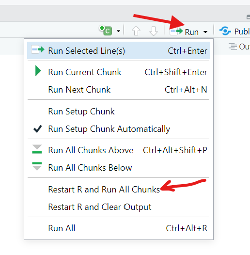
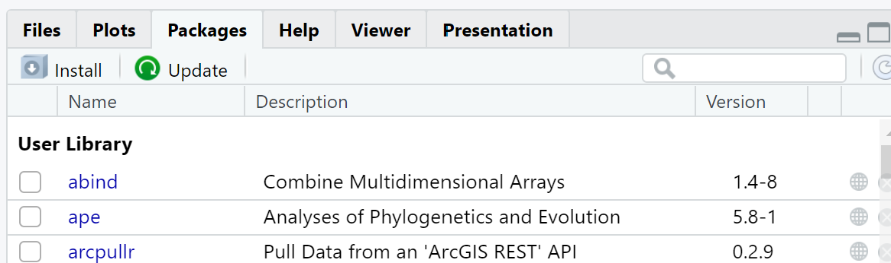
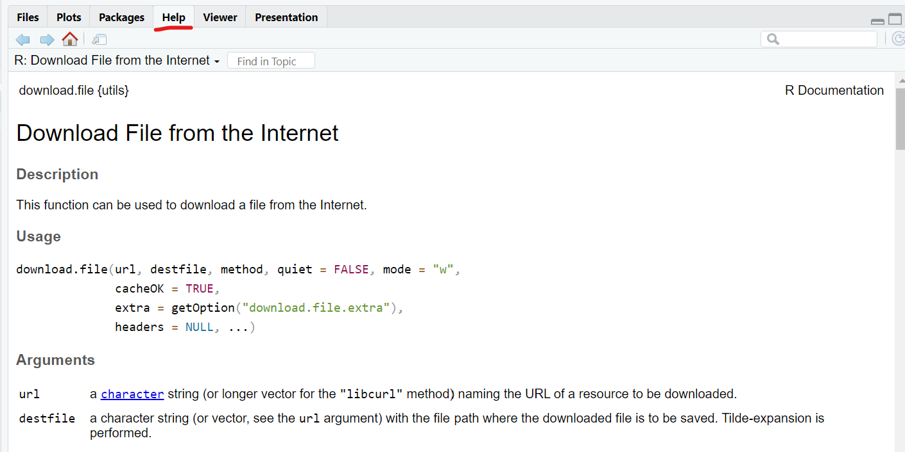

```{r}
#| label: setup-webex
#| include: false
library(webexercises)
```

::: {.callout-note appearance="simple"}
## Learning objectives

By the end of this chapter you should be able to:

1.  Explain how R runs code one line at a time, and why the order you run code in matters.
2.  Install a package once and load it in every session.
3.  Use R's four basic data types: logical, integer, numeric, and character.
4.  Name variables clearly and consistently.
5.  Find help when your code breaks.
:::

The last chapter introduced R, RStudio, and R Markdown, and the building blocks of a line of code. This chapter moves from reading code to writing it. It covers four things you will rely on in every assignment: how R actually runs your code, how to add new abilities to R with packages, how R stores different kinds of values, and what to do when something goes wrong.

None of it is spatial yet. But every map and every analysis later in the book is built from these pieces, and most of the problems students hit in the first weeks of the course come from one of them: chunks run out of order, a package that was never loaded, a number stored as text, or an error message nobody read.

## How R runs your code {#sec-how-r-runs}

### R is an interpreted language

R is an **interpreted language**. An **interpreter** is a program that executes instructions directly, one line at a time: it reads a line of code, translates it into something the computer can act on, runs it, and then moves on to the next line.

Other languages, such as C or Java, use a **compiler** instead. A compiler translates the whole program into machine code before any of it runs. A good analogy is translation at a conference. An interpreter is like a live translator who translates the speaker sentence by sentence, as the speech happens. A compiler is like a book translator, who translates the whole book before anyone reads a page.

Being interpreted is what makes R so good for exploring data. You can run a single line, look at the result, and decide what to do next, without building and running a whole program. That is exactly what you do in RStudio every time you press Ctrl+Enter.

### Order matters

The flip side is that R only knows what you have run so far, *in the order you ran it*. Nothing stops you from running the chunks of an R Markdown file out of order, and when you do, the same code can leave a different result.

Here are three chunks. Each one stores a different number in a variable called `day`.

```{webr-r}
day <- 1
```

```{webr-r}
day <- 2
```

```{webr-r}
day <- 3
```

And here is a chunk that prints whatever `day` holds right now:

```{webr-r}
day
```

Run the three chunks top to bottom, then run the last one: `day` is 3. Now run the second chunk again, and then the last one: `day` is 2. The code in the file hasn't changed, but the value in memory has, because R keeps whichever value it was given most recently. Before you click, try to predict what `day` will be.

In RStudio, the **Environment** pane always shows the current value of every variable, so it is the place to check what R is holding at any moment.

### Knitting runs everything again

Out-of-order code is a quiet problem while you work, and a loud one when you knit. As the last chapter explained, knitting starts a fresh R session and runs every chunk from the top of the file to the bottom. If your file only worked because you ran chunk 5 before chunk 3, or because a variable you made in the Console is still sitting in the Environment, the knit fails. This is the most common reason an assignment won't knit.

### Rule one: think sequentially

The fix is a habit, and it is the first rule of this course: **think sequentially.**

- Run your code in order, top to bottom, at least while you are learning.
- Check the Environment pane to see which variables exist and what they hold.
- Every so often, choose **Run \> Restart R and Run All Chunks** (@fig-run-menu). This clears memory and reruns the whole file from the top, the same way knitting does. If it works, your file will knit.

{#fig-run-menu width="55%" fig-alt="Screenshot of RStudio's Run menu, opened from the Run button at the top right of the Editor. The menu lists Run Selected Lines, Run Current Chunk, Run Next Chunk, Run Setup Chunk, Run All Chunks Above, Run All Chunks Below, Restart R and Run All Chunks, Restart R and Clear Output, and Run All. A red arrow points to Restart R and Run All Chunks."}

## Packages and libraries {#sec-packages}

### What is a package?

Base R, the R you get when you install it, can do arithmetic, statistics, and basic plots. Almost everything else reaches you through **packages**. A package bundles functions, data, and documentation that someone else has written and tested, and that you can add to your own copy of R. A useful comparison is a car: base R is the engine, and packages are the add-ons, like GPS or a sunroof. In this course you will use the **tidyverse** for cleaning data, **sf** for spatial data, and **tmap** for maps, all of them packages.

Packages are worth using for four reasons:

- **They save you from reinventing the wheel.** Why write your own code for a complex task when an expert has already written, tested, and documented a function for it?
- **They give you specialized tools** for particular fields, from spatial analysis to genomics to finance.
- **They are often faster** than code you would write yourself, because they are optimized for speed and memory.
- **They make your work reproducible.** Anyone who installs the same packages can rerun your analysis.

### Packages versus libraries

The words *package* and *library* are often used as if they meant the same thing, but there is a difference:

- A **package** is the bundle itself: the collection of code, data, and documentation.
- A **library** is the folder on your computer where installed packages are stored. You can have more than one.

You *install* a package *into* a library. Then, confusingly, you load it with a function called `library()`. In casual conversation people say "the tidyverse library," and that's fine, but it helps to know which is which.

### CRAN

Most packages come from **CRAN**, the Comprehensive R Archive Network. CRAN is the official repository for R packages: think of it as R's app store. It hosts thousands of packages, and each one passes a set of quality checks before it is published. You may later meet other sources, such as Bioconductor for genomics packages or GitHub for development versions, but everything in this course comes from CRAN.

### Install once, load every session

Using a package takes two steps, and the difference between them matters (@tbl-install-load).

| | Install | Load |
|:----------------|:-----------------------|:-----------------------|
| What it does | Downloads the package into your library | Makes the package's functions available right now |
| How often | **Once** per computer (and again to update) | **Every** R session |
| How | RStudio's Packages tab, or `install.packages("tidyverse")` | `library(tidyverse)` |
| Quotes? | Yes, around the package name | No |
| Belongs in your `.Rmd` file? | **No** | **Yes**, at the top |

: Installing a package compared with loading it. {#tbl-install-load}

**Installing** downloads the package from CRAN and saves it in your library. You can do it with code, `install.packages("tidyverse")`, but in this course please use RStudio instead: open the **Packages** tab in the bottom-right pane, click **Install**, type the package name, and click **Install** again (@fig-packages-tab). Either way, you only need to do it once on each computer.

{#fig-packages-tab fig-alt="Screenshot of the RStudio Packages tab, next to the Files, Plots, Help, Viewer, and Presentation tabs. Below the tab are Install and Update buttons and a search box. A list headed User Library shows installed packages with a checkbox, name, description, and version, starting with abind, ape, and arcpullr."}

Never leave `install.packages()` in an R Markdown file. Knitting runs every line, so the file would download and reinstall the package every single time you knit.

**Loading** makes an installed package's functions available in the current session. Put a `library()` call for each package you need at the top of every R Markdown file:

``` r
library(tidyverse)
```

You need to load packages every time, because every R session, including the fresh one that knitting starts, begins with no packages loaded. Notice that `library()` doesn't need quotation marks around the package name, while `install.packages()` does. That small difference trips up a lot of people.

If a file calls `library()` for a package that isn't installed, R stops with an error like `there is no package called 'tidyverse'`. RStudio also tries to help: when you open a file that uses a package you don't have, a yellow bar at the top of the Editor offers to install it for you.

## Data types {#sec-data-types}

Before you can analyze data, you need to know how R stores it. This section covers variables, vectors, and the four basic kinds of values R works with.

### Variables, again

Recall from the last chapter that a **variable** is a named piece of data in memory, and that the **assignment operator** `<-` puts the value on its right into the name on its left:

``` r
# a character (text) variable
myName <- "Harry Potter"
```

Read it out loud as "`myName` gets `"Harry Potter"`." In R we (usually) assign from right to left. The name always goes on the left of the arrow and the value on the right. `"Harry Potter" -> myName` also works, but it is easy to misread, so don't use it.

### Vectors

The most basic data structure in R is the **vector**: a sequence of values that all have the **same data type**. You make one with `c()`, short for *combine*:

```{webr-r}
temps <- c(71, 75, 68, 80, 77)          # numbers
cities <- c("Chapel Hill", "Durham")    # text
isRaining <- c(TRUE, FALSE, FALSE)      # TRUE or FALSE

temps
cities
isRaining
```

Even a single value is a vector, with a length of one. That is why R prints `[1]` in front of `5 + 6`: the answer is the first (and only) element of a vector. It is also why so many R functions work on whole vectors at once. `temps * 2` doubles every temperature, with no loop required.

### The four atomic data types

R has four main **atomic data types**, the basic kinds of values a vector can hold (@tbl-data-types).

| Type | What it stores | Example |
|:-------------|:--------------------------------|:--------------------------|
| **logical** | `TRUE` or `FALSE` | `isHot <- TRUE` |
| **integer** | Whole numbers | `myAge <- 21L` |
| **numeric** | Numbers that can have decimals | `myAccount <- 103.21` |
| **character** | Text, always in quotation marks | `myName <- "Harry Potter"` |

: R's four main atomic data types. {#tbl-data-types}

- **Logical** values are `TRUE` and `FALSE`, written in capitals with no quotation marks. They are the answers to yes-or-no questions such as "is it raining?" or "is this county's income above the median?" The next chapter uses them to pick out data.
- **Integer** values are whole numbers. One detail surprises people: R stores a number you type, such as `21`, as *numeric* unless you add an `L` to the end, as in `21L`. In practice you rarely need to care; R converts between integers and numerics for you.
- **Numeric** values (also called *doubles*) are numbers that can have a decimal part, such as temperatures, incomes, or coordinates. Most numbers you work with will be numeric.
- **Character** values are text, also called **strings**. They always go inside quotation marks, which is how R tells the text `"Durham"` apart from a variable named `Durham`.

The function `class()` tells you what type a value is. Run this box, then try changing the values:

```{webr-r}
class(TRUE)
class(21L)
class(21)
class(103.21)
class("Harry Potter")
```

### One type per vector

Because a vector holds values of a single type, mixing types forces R to convert some of them. This conversion is called **coercion**, and R picks the type that can hold everything without losing information. Text can hold anything, so if a vector contains even one character value, the whole vector becomes character:

```{webr-r}
mixed <- c(71, 75, "68", 80)
mixed
class(mixed)
mean(mixed)
```

The numbers have all turned into text (notice the quotation marks), and `mean()` can no longer average them. It returns `NA` with a warning. This is a very common source of trouble with real data: one stray letter or symbol in a column of numbers, such as `"N/A"` or `"12,000"`, turns the entire column into text. When a calculation gives an odd result, `class()` is one of the first things to check.

### Naming variables

Variable names can't contain spaces, so names made of several words need a convention. Two are common (@tbl-naming).

| Convention | How it works | Examples |
|:-----------------|:-----------------------------------|:-----------------------|
| **camelCase** | Join the words; capitalize every word after the first | `whatIsTheTemp`, `popChapelHill` |
| **snake_case** | Lowercase words joined by underscores | `what_is_the_temp`, `pop_chapel_hill` |

: Two conventions for naming variables. {#tbl-naming}

The tidyverse's style guide uses snake_case, and so do most of the packages you will use. Either is fine in this course, as long as you **pick one and use it consistently**. Remember that names are case-sensitive, so `popChapelHill` and `popchapelhill` are different variables, and a file that mixes conventions is an easy place for that kind of typo to hide.

Whichever convention you use, choose names that say what the variable holds. `popChapelHill` tells a reader something; `x` or `data2` does not. Short abbreviations, such as `popCH`, are fine if they are clear in context.

## Debugging and getting help {#sec-getting-help}

### Mistakes are a fact of life

Everyone's code breaks, including the code of people who have programmed for decades. A helpful way to think about errors is as puzzles to solve, not failures. Each one is a chance to understand the code, the language, and the problem a little better, so the time you spend **debugging** is an investment in your skills, not time wasted. If you get stuck, that is part of learning to program, and it gets easier with practice.

When something breaks, work through it in order:

1.  **Read the error message**, word by word. It usually says what went wrong, and often names the object or line involved.
2.  **Find the line** that caused it. In a knit, the error names the chunk.
3.  **Make a guess** about the cause, change one thing, and run the code again.

### The most common mistakes

Three mistakes account for most of the problems students run into early in the course. Check for these first.

1.  **Not programming sequentially**, and then being surprised when the file won't knit (@sec-how-r-runs).
2.  **Not storing files consistently**, for example working straight out of the Downloads folder, so that R can't find the data.
3.  **Missing parentheses, commas, and quotation marks.** One missing `)` or `"` is enough to stop a program.

The second one has a simple fix. For now, save all of the files for an assignment in the same folder, inside your `geog215` folder. When you knit, the HTML file appears in that folder; when you download data, save it there too. Then R will find everything. Don't use the Desktop or Downloads folders as a place to work.

### Getting help with a function

If you aren't sure what a function does, or what arguments it takes, open its **help page**. Either of these works:

``` r
help(mean)
?mean
```

The help page opens in the Help tab of the bottom-right pane (@fig-help-pane). Every help page has the same layout: a **Description** of what the function does, its **Usage** (how to call it, with each argument's default value), a list of **Arguments**, and, at the bottom, **Examples** you can copy and run. The examples are often the quickest way to understand a function.

{#fig-help-pane fig-alt="Screenshot of the RStudio Help tab showing the help page for download.file from the utils package, titled Download File from the Internet. It has a Description section, a Usage section showing download.file with arguments url, destfile, method, quiet, mode, cacheOK, extra, and headers, and the start of an Arguments section describing url and destfile."}

### Getting help with an error

If you don't understand an error message, copy it into a search engine. Someone has almost always run into the same error before, and the answer is often on Stack Overflow or the Posit Community forum. Leave out the parts that are specific to you, such as your variable names, so the search matches other people's posts.

### Using AI in this course

You may use AI tools such as Copilot to help *explain* an error message. For example, given the line `my_age -> 39`, an AI tool can point out that the assignment arrow is backwards and that you meant `my_age <- 39`. Use the explanation to understand the fix, then make the change yourself.

Don't use AI to *write* your code. Generated code is often buggy, it often doesn't follow the course's coding standards (code that doesn't won't receive credit), and, most importantly, the point is for you to learn to write R yourself.

### Getting help from people

In GEOG 215 there are three ways to get help from the teaching team:

- **Post in the Help! channel** in the course's Microsoft Teams team. The TAs and the instructor check it daily, and your classmates can learn from the answer too.
- **Come to office hours**, in person or online, with the instructor or a TA.
- **Email the instructor** for anything private, such as grades or accommodations.

When you ask, include the code you ran and the full error message. "My code doesn't work" is hard to answer; "`library(tidyverse)` gives `there is no package called 'tidyverse'`" can be answered in one line.

## Check your understanding

1.  An R Markdown file has three chunks: `day <- 1`, `day <- 2`, and `day <- 3`. You run the third chunk, then the first. What does `day` hold now? `r fitb(1, num = TRUE)`

2.  How often do you need to install a package on your computer? `r mcq(c("Every R session", "Every time you knit", answer = "Once", "Every time you use one of its functions"))`

3.  Which line belongs at the top of an R Markdown file? `r mcq(c("install.packages(\"tidyverse\")", answer = "library(tidyverse)"))`

4.  A *library* is the folder on your computer where installed packages are stored. `r torf(TRUE)`

5.  What does `class("103.21")` return? `r mcq(c("numeric", "integer", answer = "character", "logical"))`

6.  What type is the vector `c(1, 2, "three")`? `r fitb("character", ignore_case = TRUE)`

7.  Which variable name follows the snake_case convention? `r mcq(c("popChapelHill", answer = "pop_chapel_hill", "Pop Chapel Hill", "PopChapelHill"))`

8.  Which command opens the help page for the function `round()`? `r mcq(c("help.round()", "round(help)", answer = "?round", "#round"))`

`r hide("Show hint for question 1")`
R keeps whichever value it was given most recently. The order you *ran* the chunks matters, not their order in the file.
`r unhide()`

`r hide("Show hint for question 6")`
A vector holds one type. Text can hold anything, so one character value turns the whole vector into character.
`r unhide()`

## Summary

- R is an **interpreted language**: it runs one line at a time, in the order you run it. The same chunks run in a different order can leave different values in memory.
- **Knitting** reruns every chunk from the top in a fresh session. Think sequentially, check the Environment pane, and use **Restart R and Run All Chunks** to make sure your file will knit.
- A **package** is a bundle of code written by others; a **library** is the folder where installed packages live. Most packages come from **CRAN**.
- **Install** a package once per computer, with the Packages tab. **Load** it in every session with `library()`, at the top of every R Markdown file. Never put `install.packages()` in an `.Rmd` file.
- A **vector** is a sequence of values of one type, made with `c()`. R's four atomic types are **logical**, **integer**, **numeric**, and **character**; `class()` tells you which one you have. Mixing types **coerces** the whole vector, usually to character.
- Name variables in **camelCase** or **snake_case**, consistently, with names that say what they hold.
- Errors are normal. Read the message, find the line, and check the common mistakes first. For help, use `?function`, search the error, and ask on Teams or in office hours. Use AI to explain errors, not to write your code.

## Exercises

1.  **Order matters.** Make a new R Markdown file with three chunks: `x <- 10`, `x <- x * 2`, and `x`. Run them in order and note the result. Now run the second chunk two more times, then the third. What is `x`, and why? What will `x` be after you knit?
2.  **Install and load.** Using the Packages tab, install the `nycflights13` package, which you will use in a later chapter. Then load it in a chunk at the top of your file and knit. What happens if you remove the `library()` line and run `head(flights)`?
3.  **Data types.** Create one variable of each atomic type, describing yourself or your hometown (for example, the town's name, its population, its area in square miles, and whether you live there now). Use `class()` on each one. Did the population come out as integer or numeric? Why?
4.  **Coercion.** Predict the type of each vector below, then check with `class()`. Which result surprised you?
    ``` r
    c(1, 2, 3.5)
    c(TRUE, FALSE, 1)
    c(1, "2", 3)
    c(TRUE, "FALSE")
    ```
5.  **Naming.** Rewrite these names in snake_case and in camelCase: `median household income`, `Number of Counties`, `pop 2020`. Which convention will you use this semester?
6.  **Read a help page.** Open the help page for `seq()`. What do its `from`, `to`, and `by` arguments do? Use the Examples section to make the sequence 2, 4, 6, ..., 20.
7.  **Debug.** Each line below has one mistake. Find and fix it, and say which of the "most common mistakes" it is.
    ``` r
    my_age -> 39
    myCities <- c("Raleigh", "Durham, "Chapel Hill")
    round(mean(c(4, 8, 15), digits = 1)
    library("tidyverse
    ```

## Further reading

- *R for Data Science* (2nd ed.) by Hadley Wickham, Mine Çetinkaya-Rundel, and Garrett Grolemund, free at <https://r4ds.hadley.nz>. The chapters "Workflow: basics" and "Workflow: getting help" cover the same ground as this chapter.
- The *tidyverse style guide*, <https://style.tidyverse.org>, explains snake_case and many other conventions for writing readable R code.
- *What They Forgot to Teach You About R* by Jenny Bryan and Jim Hester, <https://rstats.wtf>, has practical advice on project folders and working sequentially.
