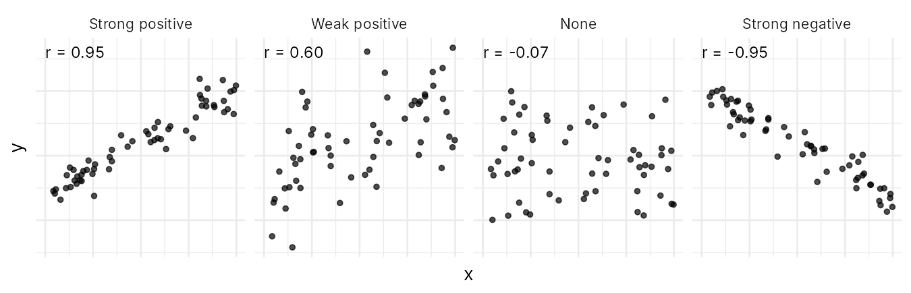
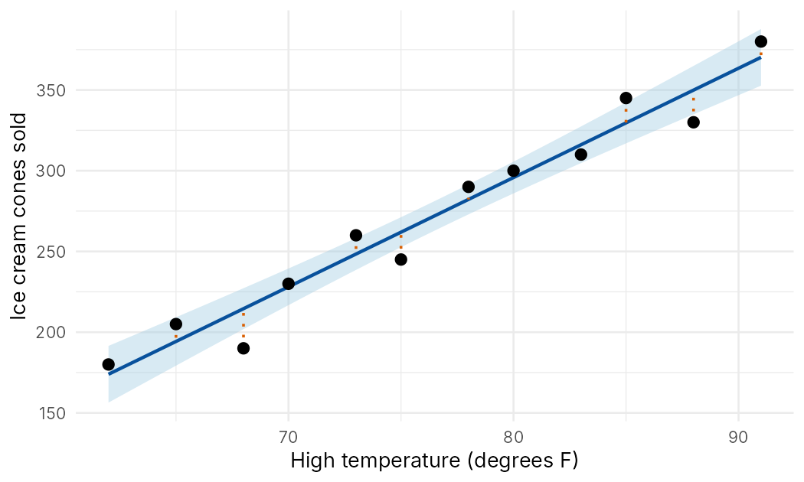
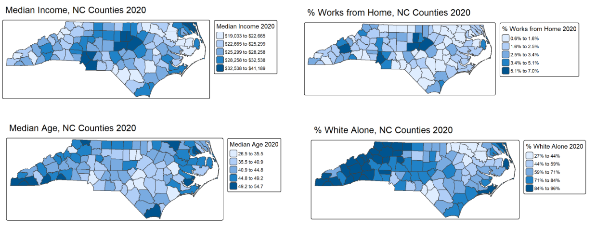
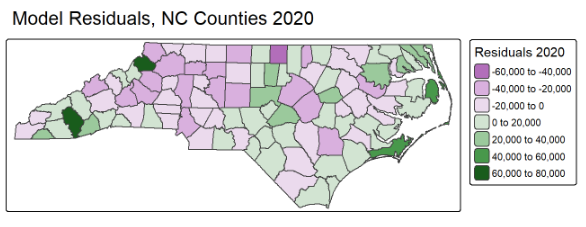

```{r}
#| label: setup-webex
#| include: false
library(webexercises)
```

::: {.callout-note appearance="simple"}
## Learning objectives

By the end of this chapter you should be able to:

1.  Describe how data become information and then knowledge, and why spatial data need their own methods.
2.  Tell a dependent variable from an independent variable, and correlation from regression.
3.  Write a regression formula and fit a linear regression in R with `lm()`.
4.  Read a model summary: coefficients, p-values, R², and adjusted R².
5.  Build a multivariate model and compare it with a simpler one.
6.  Map a model's residuals and explain what clusters of similar residuals mean.
:::

Chapter 18 asked whether groups of places differ. This chapter asks a different question: **how does one variable change as another changes?** Do counties where more people work from home have higher house values? By how much? And how well does that explain the differences between counties?

The tool is **regression**. We'll start with where regression fits in turning data into knowledge, build it up on a small example you can run, and then follow a North Carolina project on median house values from research question to residual map.

## From data to knowledge {#sec-data-to-knowledge}

**Data science** is using data to gain information or knowledge about the world. Data become knowledge in steps, each adding context:

| Step | What it is | North Carolina example |
|:-----|:-----------|:-----------------------|
| Data | Raw values without context | Median house value and the share of people working from home in each county |
| Information | Data organized and summarized | A map showing which counties have the highest house values |
| Knowledge | Information explained and tested | A regression showing that counties with more remote workers have higher house values |

: Each step adds context, ending in a tested explanation. {#tbl-data-knowledge}

Regression is one of the main ways we take that last step: from a pattern on a map to a tested explanation.

### Spatial data are special

Spatial data need their own methods, for four reasons:

- **Location is a core attribute, and location is messy:** projections, geocoding errors, and boundaries that change.
- **Nearby things are more alike.** This **spatial autocorrelation** breaks the **independence** assumption behind standard statistics, including the regression in this chapter.
- **Spatial data are visual,** so they call for maps and other visualizations.
- **Spatial data often change over time,** which adds a temporal side to the analysis.

Spatial data science draws on many fields to deal with these: environmental and sociodemographic data with location and time attached; remote sensing, geostatistics, spatial databases, and geographic information science; cloud platforms and APIs; and programming in R, Python, and SQL.

## Regression explains how one variable changes with others {#sec-regression}

**Regression analysis** fits a model that estimates one variable from one or more others.

- The **dependent variable**, *y*, is the outcome you want to explain: here, median house value.
- The **independent variables**, *x*, are the variables you think explain it: the percent working from home, median income, median age.

A regression estimates three things about each independent variable:

- **Direction:** does *y* rise or fall as *x* rises?
- **Strength:** how much of the variation in *y* does *x* explain?
- **Size:** how much does *y* change for each one-unit change in *x*?

### Correlation and regression

**Correlation** shows whether two variables move together. The **correlation coefficient**, *r*, runs from −1 (a perfect negative straight-line relationship) through 0 (none) to 1 (a perfect positive one) (@fig-correlation).

{#fig-correlation fig-alt="Four scatterplots side by side. Strong positive, r = 0.95: points lie close to a line rising to the right. Weak positive, r = 0.60: points rise to the right but are widely scattered. None, r = -0.07: points fill the panel with no trend. Strong negative, r = -0.95: points lie close to a line falling to the right."}

Regression goes further. It estimates *how much* *y* changes for each unit of *x*, and it draws the **line of best fit**: the straight line that comes closest to the points, in the sense that the squared vertical distances from the points to the line add up to as little as possible. That's why it is called **ordinary least squares**.

The line has the familiar form

$$
y = b_0 + b_1 x
$$

where *b*₀ is the **intercept** (the value of *y* when *x* is 0) and *b*₁ is the **slope**: how much *y* changes when *x* goes up by one. The intercept and slope are the model's **coefficients**.

## Writing a regression formula {#sec-formula}

In R, a regression formula puts the dependent variable on the left of the tilde, `~`, and the independent variables on the right, joined by `+`:

```r
dependent ~ independent1 + independent2 + ... + independentN
```

For example:

```r
ice_cream_sales ~ temperature
weight ~ height + sex + cheeseburgers_per_day + steps_per_day + phone_number
```

The second formula makes a point: every variable needs a reason to be there. Height, sex, diet, and exercise all plausibly affect weight. A phone number has no plausible link at all, even if, by chance, it happened to correlate with weight in your data. Choose variables from what you know about the process, not by trying everything.

`lm()`, for **linear model**, fits the regression:

```r
lm(median.house.value ~ works.from.home.percent, data = ncCounties)
```

### A small example to try

An ice cream stand records its high temperature and the number of cones sold on 12 days:

```{webr-r}
temp  <- c(62, 65, 68, 70, 73, 75, 78, 80, 83, 85, 88, 91)
cones <- c(180, 205, 190, 230, 260, 245, 290, 300, 310, 345, 330, 380)

cor(temp, cones)          # correlation: do they move together?

model <- lm(cones ~ temp) # regression: by how much?
model
```

The correlation is 0.98: temperature and sales move together very closely. The regression says

$$
\text{cones} = -245.7 + 6.77 \times \text{temperature}
$$

so each extra degree goes with about 6.8 more cones sold. The intercept, −245.7, is the predicted sales at 0 °F. It's needed to place the line, but it means nothing on its own: no one buys ice cream at 0 °F, and the stand never opened on a day that cold.

Use the model to predict with `predict()`:

```{webr-r}
temp  <- c(62, 65, 68, 70, 73, 75, 78, 80, 83, 85, 88, 91)
cones <- c(180, 205, 190, 230, 260, 245, 290, 300, 310, 345, 330, 380)
model <- lm(cones ~ temp)

predict(model, data.frame(temp = c(77, 100)))
```

At 77 °F the model predicts about 275 cones. At 100 °F it predicts 431, but be careful: that is **extrapolation**, a prediction outside the range of the data (62 to 91 °F). The straight line may not hold there.

## Anatomy of a regression {#sec-anatomy}

@fig-ice-cream shows the parts of a fitted regression:

{#fig-ice-cream fig-alt="Scatterplot of ice cream cones sold, from 180 to 380, against high temperature, from 62 to 91 degrees F. Twelve black points rise steadily to the right. A blue straight line runs through them with a light blue band around it, narrowest in the middle. Short dotted orange lines join each point to the line; the longest is for the point at 68 degrees, which sits about 25 cones below the line."}

- **The line of best fit** is the best estimate of *y* for any value of *x*.
- **R²** (R-squared) is the share of the variance in *y* that the model explains, from 0 to 1. Here R² = 0.96: temperature explains 96% of the day-to-day variation in sales. As a rough guide, below about 0.3 the two variables are barely connected.
- **The 95% confidence band** shows how uncertain the line itself is. It's narrowest near the middle of the data and widens toward the ends.
- **Residuals** are the vertical distances from each point to the line: observed minus predicted. Points far from the line are **outliers** worth understanding, not deleting. On the 68 °F day, the stand sold about 25 fewer cones than predicted. Was it raining?

```{webr-r}
temp  <- c(62, 65, 68, 70, 73, 75, 78, 80, 83, 85, 88, 91)
cones <- c(180, 205, 190, 230, 260, 245, 290, 300, 310, 345, 330, 380)
model <- lm(cones ~ temp)

round(residuals(model), 1)
```

## Reading the model summary {#sec-model-summary}

`summary()` reports the statistical results:

```{webr-r}
temp  <- c(62, 65, 68, 70, 73, 75, 78, 80, 83, 85, 88, 91)
cones <- c(180, 205, 190, 230, 260, 245, 290, 300, 310, 345, 330, 380)
model <- lm(cones ~ temp)

summary(model)
```

Work down the output:

- **Call:** the model you fitted.
- **Residuals:** a five-number summary of the residuals. Roughly symmetric around 0 is good.
- **Coefficients:** one row per coefficient.
    - **Estimate:** the intercept, and the slope for each independent variable. Here 6.77 cones per degree.
    - **Std. Error:** how uncertain each estimate is.
    - **t value:** the estimate divided by its standard error.
    - **Pr(>|t|):** the p-value for the null hypothesis that the true coefficient is 0, that is, that *x* has no relationship with *y*. Stars flag small p-values: `***` means *p* < 0.001. For temperature, *p* = 4.5 × 10⁻⁸ (R writes `4.51e-08`), so the relationship is very unlikely to be chance.
- **Residual standard error:** the typical size of a residual, about 14 cones.
- **Multiple R-squared** and **Adjusted R-squared:** the share of variation explained. **Adjusted R²** lowers R² a little for each independent variable in the model, so that adding useless variables can't make a model look better. Use it to compare models with different numbers of variables.
- **F-statistic:** a test of whether the model as a whole explains anything, with its p-value.

## Example: house values in North Carolina {#sec-nc-house-values}

Now a real project, written up as an R Markdown report. Its research question: **what demographic variables may influence median house value in North Carolina counties in 2020?** In particular, is the share of people working from home related to house values, and by how much?

The data are Census Bureau estimates for North Carolina's 100 counties for 2020, loaded as an sf object called `ncCounties`. (Names ending in `E`, such as `median.house.valueE`, are estimates from the American Community Survey, as tidycensus names them.) Before modeling, map each independent variable (@fig-explanatory):

{#fig-explanatory fig-alt="Four choropleth maps of North Carolina's counties in shades of blue. Median Income, 2020: the darkest counties, up to about 41,000 dollars, are around the Triangle and Charlotte. Percent Works from Home: also darkest around the Triangle and Charlotte, up to 7 percent. Median Age: darkest in the mountains and along parts of the coast, up to about 55 years. Percent White Alone: darkest in the mountains and the west, palest in the northeast and southeast."}

Higher incomes and more remote work stand out around the Triangle and Charlotte. Older populations are in the mountains and along parts of the coast.

::: {.callout-tip appearance="simple"}
## Think about it

Why might counties where more people work from home have higher house values? Think of at least two explanations. Does working from home push prices up, or do the jobs that allow remote work simply pay more?
:::

### The first model

```r
first.model <- lm(median.house.valueE ~ works.from.home.percent, data = ncCounties)
summary(first.model)
```

```
Call:
lm(formula = median.house.valueE ~ works.from.home.percent, data = ncCounties)

Residuals:
   Min     1Q Median     3Q    Max
-60097 -19670  -5395  13763 102485

Coefficients:
                        Estimate Std. Error t value Pr(>|t|)
(Intercept)                73974       5839   12.67   <2e-16 ***
works.from.home.percent    36564       2185   16.73   <2e-16 ***
---
Signif. codes:  0 '***' 0.001 '**' 0.01 '*' 0.05 '.' 0.1 ' ' 1

Residual standard error: 29220 on 98 degrees of freedom
Multiple R-squared:  0.7408,	Adjusted R-squared:  0.7381
F-statistic:   280 on 1 and 98 DF,  p-value: < 2.2e-16
```

Read the three key numbers:

- **The coefficient.** Each additional percentage point of people working from home goes with a median house value about **$36,564** higher.
- **The p-value.** Below 2 × 10⁻¹⁶, effectively zero. Three stars: *p* < 0.001.
- **Adjusted R².** 0.7381: the share working from home alone accounts for about 74% of the variation in median house value between counties.

### Adding variables: a multivariate model

A model with more than one independent variable is a **multivariate** (or multiple) regression. The second model adds median age, median income, and the percent white:

```r
second.model <- lm(median.house.valueE ~ works.from.home.percent +
                     median.ageE + median.incomeE + white.percent,
                   data = ncCounties)
summary(second.model)
```

```
Coefficients:
                          Estimate Std. Error t value Pr(>|t|)
(Intercept)             -7.949e+04  2.596e+04  -3.062  0.00286 **
works.from.home.percent  2.434e+04  2.324e+03  10.476  < 2e-16 ***
median.ageE              1.839e+02  4.794e+02   0.384  0.70218
median.incomeE           4.313e+00  7.233e-01   5.964 4.19e-08 ***
white.percent            8.154e+02  1.432e+02   5.695 1.37e-07 ***
---
Residual standard error: 21620 on 95 degrees of freedom
Multiple R-squared:  0.8624,	Adjusted R-squared:  0.8567
F-statistic: 148.9 on 4 and 95 DF,  p-value: < 2.2e-16
```

R writes large and small numbers in scientific notation: `2.434e+04` means 2.434 × 10⁴, or 24,340. What changed?

- **Adjusted R² rose from 0.74 to 0.86.** Together the four variables explain about 86% of the variation.
- **Median age is not significant** (*p* = 0.70). Once the other variables are in the model, age adds little.
- **The other three are significant.** Holding the others constant, each extra dollar of median income goes with $4.31 more house value (so $4,313 per $1,000 of income), and each extra percentage point white goes with about $815.
- **The work-from-home coefficient shrank,** from $36,564 to about $24,340. Part of what the first model credited to remote work really went with income: counties where more people work from home also tend to have higher incomes. A coefficient in a multivariate model is the change in *y* for one unit of *x* *with the other variables held constant*.

::: {.callout-warning appearance="simple"}
## Correlation is not causation

Even a strong, significant coefficient doesn't show that *x* causes *y*. Here it isn't clear which way the relationship runs: working from home could drive up house prices, or people whose jobs allow remote work may earn more and so buy more expensive houses. A good write-up says so.
:::

## Mapping residuals {#sec-residual-maps}

A regression isn't finished until you check its residuals, and with spatial data that means **mapping** them. A residual is a county's observed house value minus the model's prediction. Residuals near 0 mean the model fits that county well; large positive or negative residuals mean a poor fit.

```r
ncCounties$resids <- second.model$residuals

tm_shape(ncCounties) +
  tm_polygons(fill = "resids",
              fill.scale = tm_scale_intervals(midpoint = 0),
              fill.legend = tm_legend("Residuals 2020",
                                      position = tm_pos_out("right"))) +
  tm_title("Model Residuals, NC Counties 2020")
```

{#fig-residuals fig-alt="Choropleth map of North Carolina's counties titled Model Residuals, NC Counties 2020, with a diverging purple-to-green legend from minus 60,000 to plus 80,000. Many counties are pale, near zero. Darker green counties, where values are higher than predicted, appear in the mountains and along parts of the coast; purple counties are scattered through the Piedmont and the east."}

Look for **clusters**. If counties with large positive residuals sit next to each other, the model is missing something spatial: here, perhaps second homes and vacation markets in the mountains and on the beach, which raise house values beyond what local incomes predict. Clustered residuals also mean the observations aren't independent, so the model's standard errors and p-values are too small.

The fix is a cycle:

1.  **Fit the model.**
2.  **Map the residuals.**
3.  **Test them with Moran's I** (Chapter 22), which measures whether the residuals cluster more than chance would produce.
4.  **Revise the model:** add the missing variables, or move to a spatial regression model, such as a **spatial lag model** or a **spatial error model**, that builds neighbors into the model.

Repeat steps 2 to 4 until the residuals no longer cluster.

## Check your understanding

1.  In `lm(house_value ~ income, data = d)`, the dependent variable is: `r mcq(c(answer = "house_value", "income", "d", "lm"))`

2.  Correlation tells you how much *y* changes for each unit of *x*. `r torf(FALSE)`

3.  A slope of 36,564 for `works.from.home.percent` means each extra percentage point working from home goes with a median house value that is: `r mcq(c(answer = "$36,564 higher", "$36,564 lower", "36,564% higher", "36,564 times higher"))`

4.  An adjusted R² of 0.74 means the model explains about what percent of the variation in *y*? `r fitb(c("74", "74%"))`

5.  Which number should you use to compare models with different numbers of independent variables? `r mcq(c("Multiple R-squared", answer = "Adjusted R-squared", "The intercept", "The residual standard error"))`

6.  In the second model, median age has *p* = 0.70. This means: `r mcq(c(answer = "Median age adds little once the other variables are in the model", "Median age explains 70% of house value", "Median age is the most important variable", "The model is wrong"))`

7.  A residual is: `r mcq(c(answer = "The observed value minus the predicted value", "The predicted value minus the mean", "The slope of the line", "The p-value of a coefficient"))`

8.  Clusters of similar residuals on a map suggest the model is missing something spatial. `r torf(TRUE)`

## Summary

- Data become **information** when organized and **knowledge** when explained and tested. Regression is a main tool for the last step.
- Spatial data need their own methods: location is messy, nearby things are alike (**spatial autocorrelation**), and the data are visual and change over time.
- **Regression** models a **dependent variable** (*y*) from one or more **independent variables** (*x*). **Correlation** says whether two variables move together; regression says by how much, and draws the **line of best fit**.
- In R: `lm(y ~ x1 + x2, data = d)`, then `summary()`. Read each **coefficient**, its p-value, and the **adjusted R²**. Every variable needs a reason to be in the model.
- In North Carolina in 2020, each percentage point working from home went with about $36,564 higher median house value (adjusted R² = 0.74). Adding income and percent white raised adjusted R² to 0.86 and shrank that coefficient to about $24,340.
- Regression shows association, not causation.
- **Map the residuals.** Clusters of similar residuals mean the model misses something spatial; test them with Moran's I, then revise the model.

## Exercises

1.  **Ice cream by hand.** Using the ice cream model, predict sales at 70 °F and at 85 °F from the equation, then check with `predict()`. Which of the 12 days has the largest positive residual?
2.  **Fahrenheit to Celsius.** Convert `temp` to degrees Celsius and refit the model. What happens to the slope, the intercept, and R²? Why?
3.  **Your own variables.** Download median house value (`B25077_001`), median household income (`B19013_001`), and one variable of your choice for North Carolina's counties with tidycensus (Chapter 13). Fit a model with income, then with both variables. Did adjusted R² go up?
4.  **Map the residuals.** Map the residuals from your model in Exercise 3. Where does the model over-predict and under-predict? Do the residuals look clustered?
5.  **Births.** With the sf package's `nc` data, regress `BIR79` on `BIR74`. Interpret the slope and R². Why is this a less interesting model than it looks?

## Further reading

- *OpenIntro Statistics* (4th ed.), by David Diez, Mine Çetinkaya-Rundel, and Christopher Barr, free at <https://www.openintro.org/book/os/>. Chapters 8 and 9 cover linear and multiple regression.
- *Geocomputation with R* (2nd ed.), by Robin Lovelace, Jakub Nowosad, and Jannes Muenchow, free at <https://r.geocompx.org>. Its chapter on statistical learning applies models to spatial data.
- *Spatial Regression Models* (2nd ed.), by Michael D. Ward and Kristian Skrede Gleditsch (SAGE, 2018), introduces the spatial lag and spatial error models.
