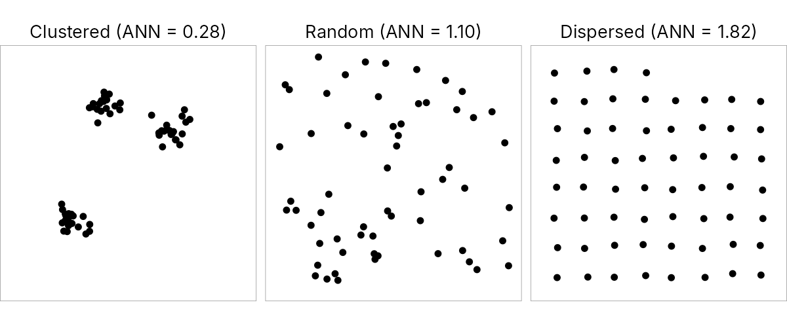
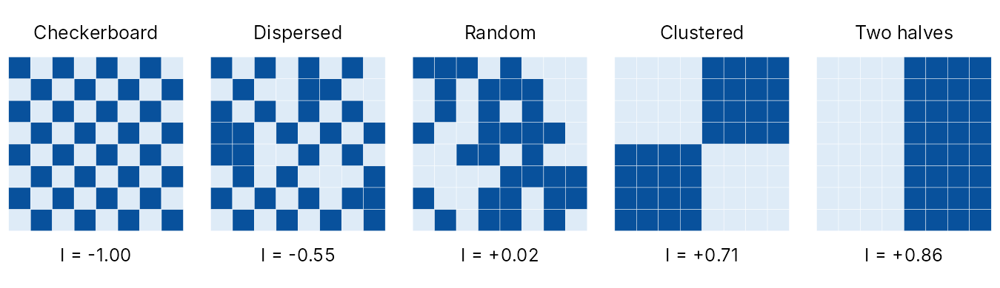
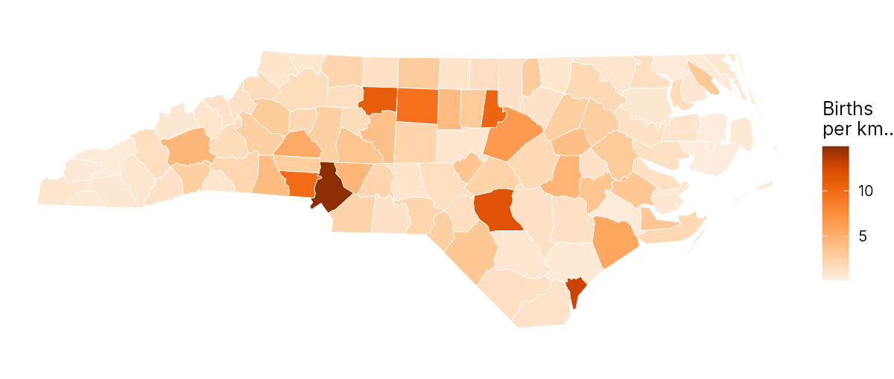
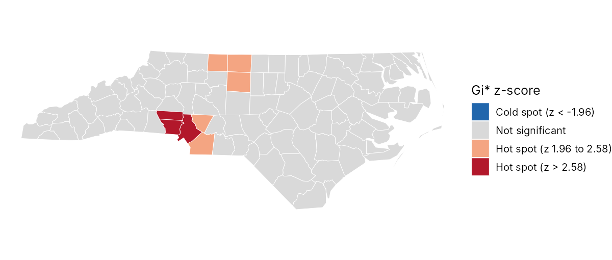

```{r}
#| label: setup-webex
#| include: false
library(webexercises)
```

::: {.callout-note appearance="simple"}
## Learning objectives

By the end of this chapter you should be able to:

1.  Explain why the first law of geography means real-world patterns are rarely random.
2.  Tell global from local measures of clustering, and spatial pattern from spatial autocorrelation.
3.  Calculate and interpret the Average Nearest Neighbor ratio for a set of points.
4.  Explain how Moran's I is calculated, and interpret its magnitude, its significance, and its importance.
5.  Run Moran's I and a local Getis-Ord Gi\* hot-spot analysis in R with spdep, and map the results.
6.  Choose the right statistic for a question: Average Nearest Neighbor, Moran's I, or Getis-Ord Gi\*.
:::

Look at a map of reported Lyme disease cases in the United States and you'll see cases clustered in the Northeast and the upper Midwest. Look at COVID-19 case rates by ZIP code and you'll see high-rate ZIP codes next to other high-rate ZIP codes. Our eyes are very good at seeing clusters. They are also very good at seeing clusters that aren't there.

This chapter is about testing, objectively, whether things on a map are **clustered, random, or dispersed**. It builds on the neighbors and weight matrices of Chapter 21. We'll cover spatial pattern, measured with the Average Nearest Neighbor ratio; spatial autocorrelation, measured with Moran's I; and local hot-spot analysis, with Getis-Ord Gi\*.

## Tobler's first law {#sec-tobler}

Waldo Tobler's **first law of geography** (1970): "everything is related to everything else, but near things are more related than distant things." Values at locations near each other tend to be similar, and the similarity fades with distance. That means phenomena are *not* distributed randomly across space.

Imagine how the world would look if they were. A map of population density with every county's value shuffled at random would look like static: no cities, no empty mountains, no suburbs around them. A random elevation map would have no mountain ranges and no river valleys. Real maps almost never look like that. They have structure, and this chapter's statistics measure it.

### Geographic variation

**Geographic variation** is the change in a phenomenon from place to place. We can list it in a table, but we see it in a map. Three kinds of things vary:

- **Events,** such as disease cases, mapped as points.
- **Locations,** such as hospitals, also points.
- **Values,** such as average income, usually attached to polygons such as counties.

### Seeing a pattern is not testing it

Looking at a map is subjective. Two people can look at the same map and disagree about whether it is clustered. And map design changes what we see: the classification breaks and the color ramp (Chapter 10) can make the same data look clustered or not. Spatial statistics give repeatable, testable answers.

## Spatial cluster analysis: global and local {#sec-global-local}

There are two main approaches to finding clusters:

- **Global** methods ask: are the events or values clustered *anywhere* in the study area? They return one result for the whole dataset, but they don't tell us *where* things are happening.
- **Local** methods ask: *which* areas have clusters of high or low values? They calculate a result for every observation, so the results can be mapped.

A global statistic for income inequality in U.S. counties would look at all 3,000-plus counties at once and return one number. A local statistic would give every county its own value, based on its neighbors, and show where high inequality sits next to high inequality.

## Spatial pattern: how objects are arranged {#sec-spatial-pattern}

A **spatial pattern** is the arrangement of objects in space. Describing and explaining patterns, how people, objects, and features are distributed across a landscape and why, is one of the central concerns of geography. Based only on where events are, there are three basic patterns (@fig-point-patterns):

- **Clustered:** events are located near one another.
- **Random:** there is no regular pattern; any location is equally likely.
- **Ordered** or **dispersed:** events are spread out in a regular, repeating way.

### The Average Nearest Neighbor ratio

The **Average Nearest Neighbor (ANN) ratio** asks: how are my points arranged, compared with a random arrangement?

$$
ANN = \frac{\bar{D}_O}{\bar{D}_E}
$$

$\bar{D}_O$ is the observed mean distance from each point to its nearest neighbor. $\bar{D}_E$ is the mean distance you'd expect if the same number of points were placed at random in the same area: $0.5 / \sqrt{n / A}$, for *n* points in an area *A*.

- **ANN < 1:** points are closer together than random: **clustered**.
- **ANN > 1:** points are more spread out than random: **dispersed**.
- **ANN ≈ 1:** **random**.

{#fig-point-patterns fig-alt="Three square panels of 60 black points. Clustered, ANN = 0.28: the points form three tight groups. Random, ANN = 1.10: the points are scattered unevenly across the square, with some close pairs and some gaps. Dispersed, ANN = 1.82: the points sit in a nearly regular grid, evenly spaced."}

```{webr-r}
ann <- function(x, y, area) {
  d <- as.matrix(dist(cbind(x, y)))   # distance from every point to every other
  diag(d) <- Inf                      # a point isn't its own nearest neighbor
  observed <- mean(apply(d, 1, min))  # mean nearest-neighbor distance
  expected <- 0.5 / sqrt(length(x) / area)
  observed / expected
}

set.seed(22)
x <- runif(60, 0, 100)   # 60 random points in a 100 x 100 square
y <- runif(60, 0, 100)
ann(x, y, area = 100 * 100)
```

Sixty random points give an ANN of 1.10: close to 1, as expected. In the lecture example, a set of crime points in a city gave an ANN of 0.57, well below 1, so the crimes are clustered.

### Limits of the ANN ratio

- **It ignores values.** ANN uses only locations. Two datasets with the same point locations but very different attribute values get the same ratio.
- **It looks at one dataset by itself.**
- **It is global.** One ratio for the whole pattern says nothing about where the clusters are.
- **It depends on the study area.** The expected distance depends on *A*, so a larger boundary makes the same points look more clustered. Always report the study area with an ANN ratio.

To account for values, we need spatial autocorrelation.

## Spatial autocorrelation {#sec-spatial-autocorrelation}

The same three patterns apply to attribute **values**, not just locations. Values can be clustered (similar values next to each other), random, or dispersed (neighbors tend to be different, like a checkerboard). **Spatial autocorrelation** is the degree of similarity between objects that are located near each other. It describes how values are arranged across a landscape, and it can be measured, for a whole region (a global statistic) or for smaller areas within it (local statistics).

The key distinction:

- **Spatial pattern** cares only about location and arrangement. Use ANN.
- **Spatial autocorrelation** cares about location *and* values. Use Moran's I and Getis-Ord Gi.

Notice the "auto": *self*. Spatial autocorrelation describes how a *single* variable relates to itself at nearby locations. Correlation between two different variables, such as income and education, is a different question, answered with regression (Chapter 19).

### Which data suit spatial autocorrelation?

It works for areal (polygon), point, or raster data. In each case we measure how the *values* are arranged. Avoid raw counts, unless the populations generating the counts are the same everywhere: a county with more people will have more cases simply because of its size. Use rates or densities instead, such as cases per 1,000 residents or births per square kilometer.

### It depends on who counts as a neighbor

Because spatial autocorrelation is about similarity between things that are *near* each other, we must define neighbors first: by contiguity (rook or queen), by a distance band, or by the *k* nearest neighbors (Chapter 21). Queen contiguity is the usual default for polygons such as counties. Different neighbor definitions can give different answers, so report the one you used.

## Moran's I: a global test {#sec-morans-i}

**Moran's I** is the most widely used statistic for describing and testing spatial autocorrelation in a region. It is global: it considers the whole study area, and returns a single value, *I*, that measures the magnitude of spatial autocorrelation, along with a p-value.

### How Moran's I is calculated

$$
I = \frac{N}{W} \cdot \frac{\sum_i \sum_j w_{ij}(x_i - \bar{x})(x_j - \bar{x})}{\sum_i (x_i - \bar{x})^2}
$$

- *N* is the number of observations.
- *w*~*ij*~ is the spatial weight between *i* and *j*: 1 if they are neighbors and 0 if not, in the simplest case.
- *W* is the sum of all the weights.
- $x_i - \bar{x}$ is how far observation *i* is from the mean.

You won't compute it by hand, but know what drives it. For every pair of neighbors, multiply how far each is from the mean. If both are above the mean, or both below, the product is positive. If one is above and the other below, it is negative. So when neighbors tend to be alike, the sum is positive and *I* rises toward 1; when neighbors tend to differ, it is negative and *I* falls toward −1. The denominator standardizes by the overall variance.

### Moran's I ranges from −1 to 1

- **−1:** perfectly dispersed, like a checkerboard.
- **0:** random.
- **+1:** perfectly clustered.

More precisely, the value expected under complete spatial randomness is −1/(*N* − 1), which is close to 0 for large datasets. @fig-grid-morans shows five arrangements of the same 64 cells, half dark and half light. Only the arrangement changes, and arrangement is all Moran's I responds to.

{#fig-grid-morans fig-alt="Five 8 by 8 grids of dark and light blue cells, each half dark. Checkerboard, I = -1.00: dark and light alternate in every direction. Dispersed, I = -0.55: mostly a checkerboard, with some cells swapped. Random, I = +0.02: dark and light cells scattered with no pattern. Clustered, I = +0.71: four 4 by 4 blocks, dark in two opposite corners. Two halves, I = +0.86: the left half light, the right half dark."}

You can check these values with a few lines of base R. Each cell's rook neighbors are the cells exactly 1 unit away:

```{webr-r}
cells <- expand.grid(row = 1:8, col = 1:8)
W <- (as.matrix(dist(cells)) == 1) * 1   # 1 if rook neighbors, 0 if not

moranI <- function(x, W) {
  z <- x - mean(x)
  n <- length(x)
  (n / sum(W)) * sum(W * outer(z, z)) / sum(z^2)
}

checkerboard <- (cells$row + cells$col) %% 2
halves <- as.integer(cells$col > 4)

moranI(checkerboard, W)
moranI(halves, W)
```

### Is it significant?

How do we know whether an *I* is bigger than chance? The **Monte Carlo** (or **permutation**) test answers it directly: shuffle the values across the locations many times, calculate *I* each time, and see where the observed *I* falls among those random results.

```{webr-r}
cells <- expand.grid(row = 1:8, col = 1:8)
W <- (as.matrix(dist(cells)) == 1) * 1
moranI <- function(x, W) {
  z <- x - mean(x)
  (length(x) / sum(W)) * sum(W * outer(z, z)) / sum(z^2)
}
halves <- as.integer(cells$col > 4)

set.seed(215)
random_I <- replicate(999, moranI(sample(halves), W))   # 999 shuffles
hist(random_I, main = "Moran's I for 999 random shuffles", xlab = "I")
abline(v = moranI(halves, W), col = "red", lwd = 2)

mean(random_I)   # close to -1/63
```

The shuffled values give *I* near 0 (about −0.013, close to −1/63). None comes anywhere near 0.857, so the two-halves pattern is very unlikely to be chance.

## Interpreting Moran's I {#sec-interpreting-morans}

Interpret a Moran's I result in three steps: its magnitude, its significance, and its importance.

### Magnitude: the I value

The closer to 1, the more clustered the values; the closer to −1, the more dispersed. There's no official scale for describing strength, but this rule of thumb from the GEOG 215 lectures is a useful guide:

| *I* value | Interpretation |
|:----------|:---------------|
| > 0.5 | Highly clustered |
| 0.3 to 0.5 | Moderately clustered |
| 0.1 to 0.3 | Slightly clustered |
| 0 to 0.1 | Barely clustered (≈ random) |
| 0 to −0.1 | Barely dispersed (≈ random) |
| −0.1 to −0.3 | Slightly dispersed |
| −0.3 to −0.5 | Moderately dispersed |
| < −0.5 | Highly dispersed |

: A rule of thumb for describing the strength of Moran's I. {#tbl-moran-strength}

### Significance: the p-value

The p-value is the probability of an *I* this extreme if the values were arranged at random. If *p* < 0.05, the result is statistically significant. If *p* > 0.05, the pattern can't be distinguished from random.

### Importance

Beware of a significant but unimportant result. The p-value depends on the number of observations, so:

- With many observations, a tiny deviation from random can be significant: *I* = 0.04, *p* < 0.001 is significant, but essentially random in practice.
- With few observations, a small amount of clustering, say *I* = 0.11, may not reach significance.

Always report and interpret *both* I and p (Chapter 18).

::: {.callout-tip appearance="simple"}
## Think about it

Would you expect Moran's I for median household income in North Carolina's census tracts to be positive, near 0, or negative? What about elevation? The number of fast-food restaurants per person? Why?
:::

## Moran's I in R {#sec-morans-r}

In R, the **spdep** package does the work. Here is Moran's I for births per square kilometer in North Carolina's counties from 1974 to 1978, using the sf package's `nc` data (Chapter 16) and queen contiguity (@fig-nc-density):

```r
library(sf)
library(spdep)

nc <- st_read(system.file("shape/nc.shp", package = "sf")) |>
  st_transform(32119)
nc$births_per_km2 <- nc$BIR74 / (as.numeric(st_area(nc)) / 1e6)

nb <- poly2nb(nc)                    # queen contiguity neighbors
lw <- nb2listw(nb, style = "W")      # row-standardized weights

moran.test(nc$births_per_km2, lw)

set.seed(215)
moran.mc(nc$births_per_km2, lw, nsim = 499)   # Monte Carlo version
```

```
	Monte-Carlo simulation of Moran I

data:  nc$births_per_km2
weights: lw
number of simulations + 1: 500

statistic = 0.12675, observed rank = 487, p-value = 0.026
alternative hypothesis: greater
```

{#fig-nc-density fig-alt="Choropleth map of North Carolina's counties in shades of orange. Most counties are pale. Mecklenburg, around Charlotte, is darkest, and nearby Gaston and the Triad counties of Forsyth and Guilford are also darker, as are Durham, Wake, Cumberland, and New Hanover."}

The two numbers to report are the statistic, *I* = 0.127, and the p-value, 0.026. By the rule of thumb, 0.127 is **slightly clustered**, and because *p* < 0.05 the result is statistically significant. (`moran.test()`, which uses a formula instead of shuffling, gives the same *I* and *p* = 0.015.) Counties with many births per square kilometer tend to be near each other, but the effect is modest.

The lecture used the population of North Carolina's counties from the ACS and got a very similar result: *I* = 0.158, *p* = 0.028, slightly clustered and significant.

## Local hot-spot analysis: Getis-Ord Gi\* {#sec-getis-ord}

A **global statistic** gives one number for one variable, such as Moran's I for county population. A **local statistic** gives a value for *each observation*: Getis-Ord Gi\*, or local Moran's I, for each county. Because local results are attached to places, we can map them and see where the clusters are.

The **Getis-Ord G** statistic asks a slightly different question from Moran's I: are *high values near high values*, or *low values near low values*? Like Moran's I, it has a global and a local version. The local version gives every observation a **z-score**:

- A **hot spot** is an area of high values surrounded by high values: a large positive z-score.
- A **cold spot** is an area of low values surrounded by low values: a large negative z-score.
- Values near 0 are not clustered.

There are two versions. **Gi** leaves the observation itself out and looks only at its neighbors. **Gi\*** includes the observation along with its neighbors; it is the version most software uses by default. As a rule of thumb, a z-score above 1.96 or below −1.96 is significant at the 0.05 level, and beyond ±2.58 at the 0.01 level.

### Local Getis-Ord Gi\* in R

The workflow has three steps:

1.  **Define neighbors.** For counties, queen contiguity; for points, the *k* nearest neighbors, such as `knn2nb(knearneigh(coords, k = 10))`.
2.  **Convert them to binary weights.** For Gi\*, `include.self()` adds each observation to its own neighborhood, and `style = "B"` makes every neighbor a 1.
3.  **Run `localG()`** to get a z-score for every observation, then map it.

```r
nb_self <- include.self(poly2nb(nc))
lw_b <- nb2listw(nb_self, style = "B")

nc$gi <- as.numeric(localG(nc$births_per_km2, lw_b))

nc$gi_class <- cut(nc$gi, c(-Inf, -1.96, 1.96, 2.58, Inf),
                   labels = c("Cold spot (z < -1.96)", "Not significant",
                              "Hot spot (z 1.96 to 2.58)", "Hot spot (z > 2.58)"))

tm_shape(nc) +
  tm_polygons(fill = "gi_class",
              fill.scale = tm_scale_categorical(
                values = c("#2166ac", "grey85", "#f4a582", "#b2182b")),
              fill.legend = tm_legend("Gi* z-score"))
```

{#fig-nc-gi fig-alt="Map of North Carolina's counties, almost all gray for not significant. Three counties around Charlotte, Gaston, Lincoln, and Mecklenburg, are dark red: hot spots with z above 2.58. Cabarrus and Union, beside Mecklenburg, are light red, as are Stokes, Rockingham, and Guilford in the Triad on the Virginia border. No county is a cold spot."}

Eight counties are significant hot spots (@fig-nc-gi). The strongest, with z-scores above 2.58, are Gaston (3.9), Lincoln (3.4), and Mecklenburg (3.2): the Charlotte area, where high-density counties are surrounded by other high-density counties. A second group of hot spots is in the Triad: Guilford, Rockingham, and Stokes. No county is a significant cold spot: the lowest z-scores, in the far west and the northeast, reach only about −1.8.

Notice that Wake and Durham, which have high densities themselves, are *not* hot spots. Their neighbors, such as Johnston, Harnett, Chatham, and Person, had far fewer births per square kilometer in the 1970s, so the neighborhood as a whole isn't unusual. Gi\* finds clusters of high values, not single high values.

The lecture ran the same analysis on county population from the ACS: counties around Charlotte formed the strongest hot spot (z from 3.0 to 4.0), with a second band of positive values across the north-central Piedmont, and low-population cold spots in the northeast and far west.

## Summary: choosing a spatial statistic {#sec-choosing}

| Method | Uses | Scope | Answers |
|:-------|:-----|:------|:--------|
| Average Nearest Neighbor | Locations only | Global | Are points clustered, random, or dispersed? |
| Moran's I | Locations and values | Global | Are similar values near each other overall? |
| Getis-Ord Gi / Gi\* | Locations and values | Local | Where are the hot spots and cold spots? |

: Choosing a spatial statistic. {#tbl-choosing}

Whichever you use: define your neighbors first, report both the statistic and its p-value, and map local results.

## Check your understanding

1.  A spatial statistic that returns one value for the whole study area is: `r mcq(c(answer = "Global", "Local", "Dispersed", "Contiguous"))`

2.  An Average Nearest Neighbor ratio of 0.57 means the points are: `r mcq(c(answer = "Clustered", "Random", "Dispersed", "Impossible to tell"))`

3.  ANN takes the attribute values of the points into account. `r torf(FALSE)`

4.  A perfect checkerboard of two values has a Moran's I of: `r mcq(c(answer = "-1", "0", "0.5", "1"))`

5.  Moran's I = 0.158 with *p* = 0.028 describes a pattern that is: `r mcq(c(answer = "Slightly clustered and statistically significant", "Highly clustered and not significant", "Dispersed and significant", "Random"))`

6.  Why should you usually use rates instead of raw counts for spatial autocorrelation? `r mcq(c(answer = "Places with more people have more cases just because of their size", "Counts can't be mapped", "Moran's I only works on percentages", "Rates are always normally distributed"))`

7.  A county with a large positive Gi\* z-score is a: `r mcq(c(answer = "Hot spot", "Cold spot", "Outlier", "Random value"))`

8.  A Gi\* z-score of 2.3 is significant at the 0.05 level. `r torf(TRUE)`

## Summary

- The **first law of geography** means real-world values are rarely random across space. Seeing a pattern on a map is subjective; spatial statistics test it.
- **Global** statistics give one answer for the whole study area; **local** statistics give one per observation, which you can map.
- **Spatial pattern** uses locations only. The **Average Nearest Neighbor ratio** compares the observed mean nearest-neighbor distance with the random expectation: below 1 is clustered, above 1 dispersed. It depends on the study area.
- **Spatial autocorrelation** uses locations and values: the similarity of a single variable at nearby locations. Use rates, not counts, and define neighbors first.
- **Moran's I** is global and runs from −1 (dispersed) through 0 (random) to +1 (clustered). Interpret its magnitude, its p-value, and whether it matters. In R: `poly2nb()`, `nb2listw()`, then `moran.test()` or `moran.mc()`.
- **Getis-Ord Gi\*** is local. A large positive z-score is a **hot spot**, a large negative one a **cold spot**; |z| > 1.96 is significant at 0.05. In R: `include.self()`, `nb2listw(style = "B")`, then `localG()`.
- Births per square kilometer in North Carolina's counties, 1974–78, are slightly clustered (*I* = 0.127, *p* = 0.026), with hot spots around Charlotte and in the Triad.

## Exercises

1.  **ANN by hand.** Five points are at (1, 1), (2, 1), (1, 2), (8, 8), and (9, 8), in a 10 × 10 study area. Find each point's nearest-neighbor distance, the observed mean, the expected mean, and the ANN ratio. Then double the study area to 20 × 20. What happens to the ratio, and why?
2.  **Shuffle a map.** Shuffle the values of `births_per_km2` across North Carolina's counties with `sample()`, map the result, and calculate Moran's I. Compare both with the real map and the real *I*.
3.  **Neighbors matter.** Recalculate Moran's I for births per square kilometer with rook contiguity, with *k* = 4 nearest neighbors, and with a 50 km distance band (Chapter 21). How much does *I* change?
4.  **Sudden infant deaths.** Calculate the rate of sudden infant deaths per 1,000 births, `SID74 / BIR74 * 1000`, and test it for spatial autocorrelation. Is it more or less clustered than births per square kilometer? Then map its Gi\* hot and cold spots.
5.  **Residuals.** Fit a regression of `BIR79` on `BIR74` (Chapter 19), and test its residuals with `lm.morantest()`. Are the residuals spatially autocorrelated? What would you do next?
6.  **Local Moran's I.** Run `localmoran()` on births per square kilometer, and compare which counties stand out with the Gi\* map. What does local Moran's I find that Gi\* doesn't?

## Further reading

- *Spatial Data Science: With Applications in R*, by Edzer Pebesma and Roger Bivand (CRC Press, 2023), free at <https://r-spatial.org/book/>. Chapter 15, "Measures of Spatial Autocorrelation", covers Moran's I and local indicators in spdep.
- Getis, A., and Ord, J. K. (1992). "The Analysis of Spatial Association by Use of Distance Statistics." *Geographical Analysis* 24(3): 189–206. The paper that introduced the G statistics.
- Goodchild, M. F. (1986). *Spatial Autocorrelation*. Concepts and Techniques in Modern Geography (CATMOG) 47. Geo Books. A short, classic introduction, with grid examples like @fig-grid-morans.
- Tobler, W. R. (1970). "A Computer Movie Simulating Urban Growth in the Detroit Region." *Economic Geography* 46: 234–240.
