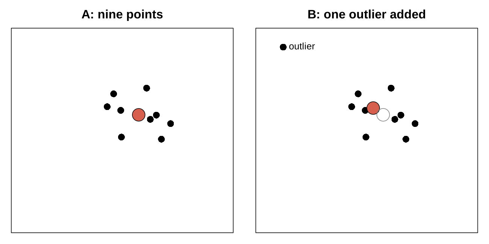
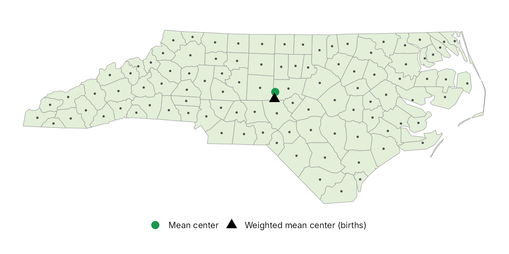
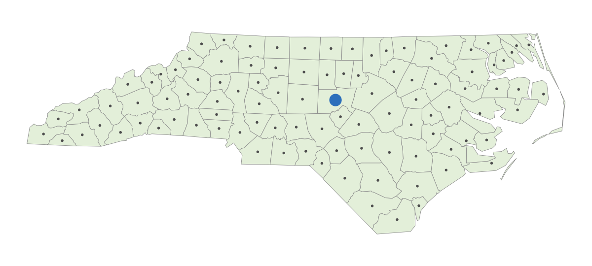
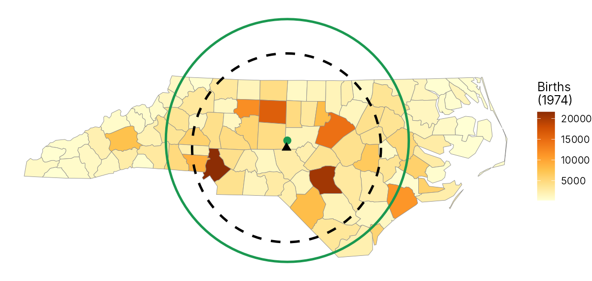

```{r}
#| label: setup-webex
#| include: false
library(webexercises)
```

::: {.callout-note appearance="simple"}
## Learning objectives

By the end of this chapter you should be able to:

1.  Describe where a set of features is with spatial descriptive statistics.
2.  Match each spatial statistic to the familiar statistic it extends: the mean, the median, or the standard deviation.
3.  Calculate a mean center, a weighted mean center, a central feature, and a standard distance, by hand and in R.
4.  Write your own function in R, with inputs and a return value.
5.  Read a function that calculates a weighted mean center for a layer of polygons.
:::

Chapter 16 described the *values* of a variable: where its center is and how spread out it is. This chapter does the same for *locations*. Where is the middle of a set of features? Which feature is most central? And how spread out are they?

The answers are **spatial descriptive statistics**. In the second half of the chapter, you will also write your own functions in R, and read one that calculates a weighted mean center.

## Many statistics have a spatial counterpart {#sec-counterparts}

Most descriptive statistics you already know have a spatial version (@tbl-counterparts).

| Statistic | Spatial counterpart | Question it answers |
|:----------|:--------------------|:--------------------|
| Mean | Mean center; weighted mean center | Where is the average location? |
| Median | Central feature | Which real feature is most central? |
| Standard deviation | Standard distance | How spread out are the locations? |

: Descriptive statistics and their spatial counterparts. {#tbl-counterparts}

A quick refresher on the last row. The standard deviation measures how spread out values are around their mean. In a normal, bell-shaped distribution, about 68% of values fall within one standard deviation of the mean, and about 95% within two. Keep that picture in mind: the standard distance draws the same idea on a map, as a circle.

Throughout the chapter we'll use six points, with x and y in kilometers and a weight, such as population in thousands:

```{webr-r}
x <- c(2, 4, 5, 7, 8, 12)
y <- c(3, 7, 2, 5, 9, 4)
w <- c(10, 50, 5, 20, 5, 10)

plot(x, y, pch = 16, cex = sqrt(w) / 2, asp = 1,
     xlim = c(0, 13), ylim = c(0, 10))
text(x, y, labels = 1:6, pos = 4)
```

## Mean center {#sec-mean-center}

The **mean center** is the simplest spatial statistic. Average all the x coordinates, average all the y coordinates, and that pair is the mean center:

$$
\bar{X} = \frac{\sum x_i}{n}, \qquad \bar{Y} = \frac{\sum y_i}{n}
$$

```{webr-r}
mean_x <- mean(x)
mean_y <- mean(y)
c(mean_x, mean_y)
```

For our six points the mean center is at (6.33, 5). It doesn't have to be one of the points, and here it isn't.

Like the ordinary mean, the mean center is sensitive to outliers. In @fig-mc-outlier, adding one distant point drags the center toward it.

{#fig-mc-outlier fig-alt="Two square panels of black dots. In panel A, nine dots cluster in the middle with a red circle among them, the mean center. In panel B, the same nine dots plus one more far to the upper left, labeled outlier. The red mean center has moved up and to the left of the cluster, away from an open gray circle that marks its old position."}

### The mean center of North Carolina

@fig-nc-mean-centers shows the mean center of North Carolina's counties, calculated from the centroid of each of the 100 counties. It falls in the Piedmont, in Chatham County. Every county counts the same here, so tiny Chowan County pulls as hard as Wake or Mecklenburg.

## Weighted mean center {#sec-weighted-mean-center}

Often some locations matter more than others. A county with a million people should count for more than one with 4,000. The **weighted mean center** multiplies each coordinate by its weight, *w*, adds them up, and divides by the sum of the weights:

$$
\bar{X}_w = \frac{\sum w_i x_i}{\sum w_i}, \qquad \bar{Y}_w = \frac{\sum w_i y_i}{\sum w_i}
$$

Base R's `weighted.mean()` does exactly this:

```{webr-r}
wmc_x <- weighted.mean(x, w)
wmc_y <- weighted.mean(y, w)
c(wmc_x, wmc_y)

# The same thing, written out
sum(w * x) / sum(w)
```

Point 2 carries half the total weight, so it pulls the center from (6.33, 5) to (5.45, 5.75), toward itself.

The best-known weighted mean center is the U.S. **center of population**. After every census, the Census Bureau calculates the mean center of the country's population, weighting each location by the number of people who live there. As @fig-pop-center shows, it has moved from Maryland in 1790 to Missouri in 2020: west with settlement, and since about 1950 south as well, with the growth of the Sun Belt.

Now the same for North Carolina, with each county weighted by its births from 1974 to 1978 (@fig-nc-mean-centers).

{#fig-nc-mean-centers fig-alt="Map of North Carolina's counties in pale green, with a small gray dot at the center of each county. A large green dot, the mean center, sits in the middle of the state in Chatham County. A black triangle, the weighted mean center, sits just below it, about 12 kilometers to the south."}

The weighted center moves about 12 km, almost due south. Several of the counties with the most births, such as Mecklenburg, Cumberland, Onslow, and New Hanover, lie south of the state's middle, while many counties along the Virginia line had few. East to west, Mecklenburg and the Triangle roughly balance each other. With recent population data, the Triangle's fast growth pulls the weighted center east instead. The weights you choose change the answer, so say which you used.

::: {.callout-tip appearance="simple"}
## Think about it

What would the center of North Carolina look like if you weighted each county by its land area instead? By its number of hog farms? What question would each center answer?
:::

## Central feature {#sec-central-feature}

The **central feature** is the existing feature that is closest to all the others. To find it, measure the distance from each feature to every other feature, add them up, and pick the feature with the smallest total.

It is the spatial cousin of the median. Instead of averaging, it picks a real feature from the data. That matters when the answer must be a real place: say, choosing which of your existing offices should host a regional meeting.

```{webr-r}
pts <- cbind(x, y)
d <- as.matrix(dist(pts))   # distance from every point to every other
round(d, 1)

total <- rowSums(d)
round(total, 1)
which.min(total)            # the central feature
```

Point 4, at (7, 5), has the smallest total distance, 21.8 km, so it is the central feature. The mean center, (6.33, 5), is close by, but it isn't a point in the data.

For North Carolina, the central feature of the county centroids is Chatham County (@fig-nc-central).

{#fig-nc-central fig-alt="Map of North Carolina's counties with a small gray dot at the center of each. One dot in the middle of the state, in Chatham County, is drawn larger and in blue."}

## Standard distance {#sec-standard-distance}

The **standard distance** is the spatial version of the standard deviation: the typical distance between features and their mean center.

$$
SD = \sqrt{\frac{\sum (x_i - \bar{X})^2}{n} + \frac{\sum (y_i - \bar{Y})^2}{n}}
$$

Take each point's distance from the mean center in x and in y, square them, average, add, and take the square root.

```{webr-r}
sd_dist <- sqrt(sum((x - mean(x))^2) / length(x) +
                sum((y - mean(y))^2) / length(y))
sd_dist

plot(x, y, pch = 16, asp = 1, xlim = c(0, 13), ylim = c(0, 10))
points(mean(x), mean(y), pch = 4, cex = 2, col = "red")
symbols(mean(x), mean(y), circles = sd_dist, inches = FALSE,
        add = TRUE, fg = "red")
```

We draw it as a circle centered on the mean center, with the standard distance as its radius. A large circle means the features are spread out; a small one means they cluster tightly.

Comparing circles is how we compare dispersion: between two weightings, two time periods, or two kinds of features. In @fig-nc-sd, the solid circle uses every county equally, and has a radius of about 203 km. The dashed circle is weighted by births. It is smaller, about 158 km, because most births happened in a few urban Piedmont counties.

{#fig-nc-sd fig-alt="Map of North Carolina's counties shaded from pale yellow to dark brown by births. Mecklenburg and Cumberland are darkest. A large green circle centered in Chatham County covers the middle two-thirds of the state. A smaller dashed black circle, centered just south of it, covers the central Piedmont."}

## Functions in R {#sec-functions}

So far we have calculated these statistics one line at a time. A **function** wraps code up so you can run it on any data with one line.

### What is a function?

You have used functions all along: `mean()`, `st_read()`, `ggplot()`, and Chapter 5 showed how to write your own. Here is a quick review before we put them to work on spatial statistics. A function is a named, reusable block of code. Every function has:

- a **name**;
- **inputs**, called **arguments**;
- an **output**, called the **return value**.

You call a function by its name, with its inputs in parentheses.

### Writing your own

Here is a function named `addSeven`. Its one input is `numbers`, and it returns those numbers plus 7:

```{webr-r}
addSeven <- function(numbers) {
  numbers + 7
}

addSeven(c(1, 2, 3))
addSeven(c(4, 5, 6))
```

The name goes on the left of the assignment arrow. The word `function` is followed by the inputs in parentheses, and the code goes inside the braces. The value of the last line is what the function returns. `addSeven(c(1, 2, 3))` returns 8, 9, 10, because R adds 7 to every element of the vector.

Your turn. Write `timesTwo()`, which doubles its input. Then write `addAny()`, with a second input, `amount`, so that it adds any number you choose:

```{webr-r}
timesTwo <- function(numbers) {
  # your code here
}

timesTwo(c(1, 2, 3))   # should return 2 4 6
```

`r hide("Show answer")`
``` r
timesTwo <- function(numbers) {
  numbers * 2
}

addAny <- function(numbers, amount) {
  numbers + amount
}

addAny(c(1, 2, 3), 10)   # 11 12 13
```
`r unhide()`

A function can also bundle up a whole calculation. This one returns the standard distance of any set of points:

```{webr-r}
standardDistance <- function(x, y) {
  sqrt(sum((x - mean(x))^2) / length(x) +
       sum((y - mean(y))^2) / length(y))
}

standardDistance(x, y)
standardDistance(c(0, 1, 0, 1), c(0, 0, 1, 1))
```

### A function for the weighted mean center

Here is a function, `meanCenter()`, that finds the weighted mean center of any layer of polygons. Its inputs are a spatial layer and a vector of weights. Its output is a point:

``` r
library(sf)

meanCenter <- function(layer, weights) {
  # convert the polygons into points
  points <- st_centroid(layer)
  # calculate the weighted mean x and y coordinates
  mc_x <- weighted.mean(st_coordinates(points)[, 1], weights)
  mc_y <- weighted.mean(st_coordinates(points)[, 2], weights)
  # create a point
  mean_center <- st_sfc(st_point(c(mc_x, mc_y)))
  # give it the same coordinate reference system as the layer
  mean_center <- st_set_crs(mean_center, st_crs(layer))
  # return the point
  mean_center
}
```

Walk through it from top to bottom. `st_centroid()` turns each polygon into a point. `st_coordinates()` returns a matrix of those points' coordinates, with x in the first column and y in the second, and `weighted.mean()` averages each one using the weights. `st_point()` and `st_sfc()` turn the two numbers into a point geometry, and `st_set_crs()` gives it the same coordinate reference system as the input layer. The last line, `mean_center`, is what the function returns.

Notice that `weights` works just like `amount` in `addAny()`: it's a second input that changes the result. Pass a column of 1s, or any constant, and you get the unweighted mean center. Use it like this:

``` r
nc <- st_read(system.file("shape/nc.shp", package = "sf")) |>
  st_transform(32119)

mc_births <- meanCenter(nc, nc$BIR74)
mc_plain  <- meanCenter(nc, rep(1, nrow(nc)))

st_distance(mc_plain, mc_births)   # about 12,200 m
```

Why project to State Plane first? The mean of latitudes and longitudes isn't a true center, for the same reasons degrees aren't a distance (@sec-crs-r). Calculate spatial statistics in a projected coordinate system.

## Check your understanding

1.  The spatial counterpart of the median is the: `r mcq(c("Mean center", answer = "Central feature", "Standard distance", "Weighted mean center"))`

2.  Three points are at (0, 0), (4, 0), and (2, 6). What is the x coordinate of their mean center? `r fitb("2")`

3.  And the y coordinate? `r fitb("2")`

4.  The mean center is always one of the features in the data. `r torf(FALSE)`

5.  Adding one distant outlier moves the mean center toward it. `r torf(TRUE)`

6.  The U.S. center of population is an example of a: `r mcq(c("Central feature", answer = "Weighted mean center", "Standard distance", "Spatial join"))`

7.  A larger standard distance circle means the features are: `r mcq(c(answer = "More spread out", "More tightly clustered", "Closer to the Equator", "More heavily weighted"))`

8.  In `addAny <- function(numbers, amount) { numbers + amount }`, what does `addAny(c(1, 2), 5)` return? `r mcq(c(answer = "6 7", "5 5", "8", "1 2 5"))`

## Summary

- **Spatial descriptive statistics** describe the center and spread of a set of locations.
- The **mean center** is the average x and the average y. Like the mean, it is pulled by outliers.
- The **weighted mean center** weights each feature by an attribute, such as population. The U.S. **center of population** is the best-known example.
- The **central feature** is the real feature with the smallest total distance to all the others: the spatial cousin of the median.
- The **standard distance** is the typical distance from the mean center: the spatial standard deviation, drawn as a circle.
- A **function** packages code you'll reuse. It has a name, **arguments** (inputs), and a **return value** (the last line). `meanCenter()` combines sf functions to find the weighted mean center of any layer.
- Calculate spatial statistics on projected data.

## Exercises

1.  **By hand.** Five stores are at (1, 1), (3, 2), (2, 5), (6, 4), and (8, 8), in km. Find the mean center, the central feature, and the standard distance by hand, then check them in R.
2.  **Weights.** Give the five stores weights of 100, 20, 20, 20, and 500 (their sales). Find the weighted mean center. Which way did it move, and why?
3.  **Your own function.** Write a function, `centralFeature(x, y)`, that returns the number of the central feature. Test it on the six points in this chapter.
4.  **Weighted standard distance.** Extend `standardDistance()` to take a third input, `w`, and return the weighted standard distance. (Replace each mean with `weighted.mean()`, and each division by *n* with a division by the sum of the weights.)
5.  **Two periods.** Use `meanCenter()` to find the weighted mean center of births in North Carolina for `BIR74` and for `BIR79`. Did it move? How far, and in which direction?
6.  **Population.** Once you have read Chapter 13, download the population of each North Carolina county from the American Community Survey with tidycensus, and find the population-weighted mean center. How does it compare with the center for 1970s births?

## Further reading

- *Spatial Analysis Methods and Practice*, by George Grekousis (Cambridge University Press, 2020). Chapter 2 covers the mean center, weighted mean center, central feature, standard distance, and the standard deviational ellipse.
- The U.S. Census Bureau's Centers of Population page, <https://www.census.gov/geographies/reference-files/time-series/geo/centers-population.html>, has the national, state, and county centers for every census since 1790.
- *R for Data Science* (2nd ed.), by Hadley Wickham, Mine Çetinkaya-Rundel, and Garrett Grolemund, free at <https://r4ds.hadley.nz>. The "Functions" chapter explains when and how to write your own.
