```{r}
#| label: setup-webex
#| include: false
library(webexercises)
```

::: {.callout-note appearance="simple"}
## Learning objectives

By the end of this chapter you should be able to:

1.  Load point, line, and polygon layers into R with `read_sf()`, and explain what an sf object is.
2.  Build a map in layers with `tm_shape()` and `tm_dots()`, `tm_lines()`, or `tm_polygons()`.
3.  Color features by an attribute, and control the classes with `n` and `style`.
4.  Combine several layers in one map, and add a title, a scale bar, and a north arrow.
5.  Switch between static and interactive maps with `tmap_mode()`.
:::

The last chapter turned tables into graphs with ggplot2. This chapter turns them into *maps*. A **thematic map** shows how one theme, such as tree height, the age of buildings, or the population of cities, varies from place to place. It is the most common kind of map in spatial data science, and in R the quickest way to make one is the **tmap** package.

The examples use three layers of data about the UNC Chapel Hill campus: its trees, its sidewalks, and its buildings. Between them they cover the three kinds of vector data, **points**, **lines**, and **polygons**, so by the end of the chapter you will have mapped all three.

::: {.callout-important appearance="simple"}
## Run this chapter in RStudio

The code in this chapter needs the tmap and sf packages and data files from your computer, so it doesn't run in the browser like the code in earlier chapters. Follow along in an R Markdown file in RStudio. The maps you see here were made with exactly the code printed above them.
:::

## Spatial data are tidy data {#sec-spatial-tidy}

### Features and attributes

Spatial data follow the same tidy rules as any other data frame. In a spatial layer, each row is one **feature**: one tree, one stretch of sidewalk, one building. Each column is one **attribute** of those features: a tree's species or height, a building's year built or number of floors.

What makes the data spatial is one extra column. The **sf** package ("simple features") stores each feature's shape in a **geometry column**, as a point, a line, or a polygon. Everything else about an sf object is an ordinary data frame. That means the tidyverse verbs you already know, such as `filter()`, `mutate()`, and `count()`, work on spatial data too, and they keep the geometry attached to each row.

### tmap: the thematic mapper

**tmap** was written by Martin Tennekes. Like ggplot2, it builds a map in layers, joined with `+`:

- `tm_shape()` names the data to draw.
- A layer function draws it: `tm_dots()` for points, `tm_lines()` for lines, and `tm_polygons()` for polygons.
- More functions add the parts of a finished map: `tm_title()`, `tm_scalebar()`, `tm_compass()`, and `tm_layout()`.

tmap reads sf objects directly, and the same code makes a static map for a report or an interactive web map you can zoom into. This book uses **tmap version 4**, which changed many argument names. If you find older code online that uses `col =` for polygon colors or `tm_layout(title = ...)`, it was written for version 3. It will often still run, but tmap prints a message suggesting the new form.

Load three packages at the top of every script:

``` r
library(tidyverse)
library(sf)
library(tmap)
```

### Our data: three campus layers

The three layers come from UNC's open data portal, <https://gisdata-uncadmin.opendata.arcgis.com> (@tbl-campus-layers). Download each one as a GeoJSON file and save it in the same folder as your R Markdown file.

| Layer | Geometry | One feature is | Attributes used here |
|:----------------|:----------|:------------------------|:-------------------------|
| Tree Inventory | Points | One campus tree | `COMMONNAME`, `HEIGHT` |
| Sidewalks | Lines | One sidewalk segment | `SURFACE_` |
| Building Footprints | Polygons | One building outline | `YEARBUILT`, `FLOORS` |

: The three UNC campus layers. {#tbl-campus-layers}

`read_sf()` reads each file into an sf object:

``` r
buildings <- read_sf("Building_Footprints.geojson")
sidewalks <- read_sf("Sidewalks.geojson")
trees <- read_sf("Tree_Inventory.geojson")
```

Run `glimpse(trees)` to see the attributes, and check that the last column is `geometry`. Run `st_crs(trees)` to see the layer's **coordinate system**. GeoJSON files always use longitude and latitude, so all three layers share a coordinate system and will line up when you draw them together.

### tmap and ggplot2 on the same trees

ggplot2 can draw maps too, with `geom_sf()`. Here is the same tree layer drawn by each package (@fig-tmap-ggplot):

``` r
trees |>
  tm_shape() + tm_dots()

trees |>
  ggplot() + geom_sf()
```

::: {#fig-tmap-ggplot layout-ncol="2"}
{#fig-trees-tmap fig-alt="A map of campus trees drawn as small black dots inside a plain rectangular frame, with no axes."}

{#fig-trees-ggplot fig-alt="The same campus trees drawn as black dots on a gray panel with white grid lines, and longitude and latitude labels on the axes."}

The same trees drawn by tmap and by ggplot2.
:::

Both start from the same sf object. tmap gives a clean map frame by default, and has built-in scale bars, north arrows, and an interactive mode. ggplot2 adds axes and a gray panel, as it would for any plot. ggplot2 is the more general tool, and you can make fine maps with it, but for everyday thematic maps tmap takes less code. The rest of this chapter uses tmap.

## Points: mapping trees with tm_dots() {#sec-points}

### Color trees by height

Each tree in the inventory is one point. To color the trees by height, pass the name of a column to `fill`, in quotes:

``` r
trees |>
  tm_shape() +
  tm_dots(fill = "HEIGHT") +
  tm_layout(bg.color = "gray")
```

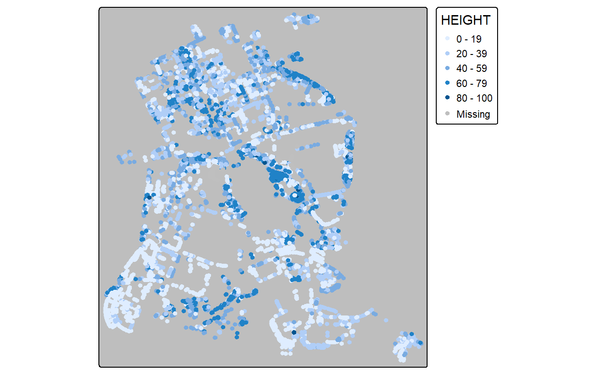{#fig-trees-height fig-alt="Map of campus trees on a gray background. Each dot is shaded from very pale blue for trees under 20 feet to dark blue for trees 80 to 100 feet tall. A legend headed HEIGHT lists five classes and Missing."}

Two details matter. First, the column name goes in quotes, `fill = "HEIGHT"`. (ggplot2's `aes()` takes column names without quotes, but tmap wants them as text.) Second, because `HEIGHT` is a number, tmap uses a **sequential palette**, a ramp from light to dark, so that taller trees look darker. It also breaks the heights into a few **classes**, 0–19, 20–39 and so on, and builds the legend.

`tm_layout()` controls the map as a whole rather than one layer. Here `bg.color = "gray"` makes the background gray, so the palest dots still show up.

::: {.callout-tip appearance="simple"}
## Think about it

Look at @fig-trees-height. Where on campus are the tallest trees? Can you think of a reason why?
:::

### Color trees by species

Now try a text column, the species name:

``` r
trees |>
  tm_shape() +
  tm_dots(fill = "COMMONNAME")
```

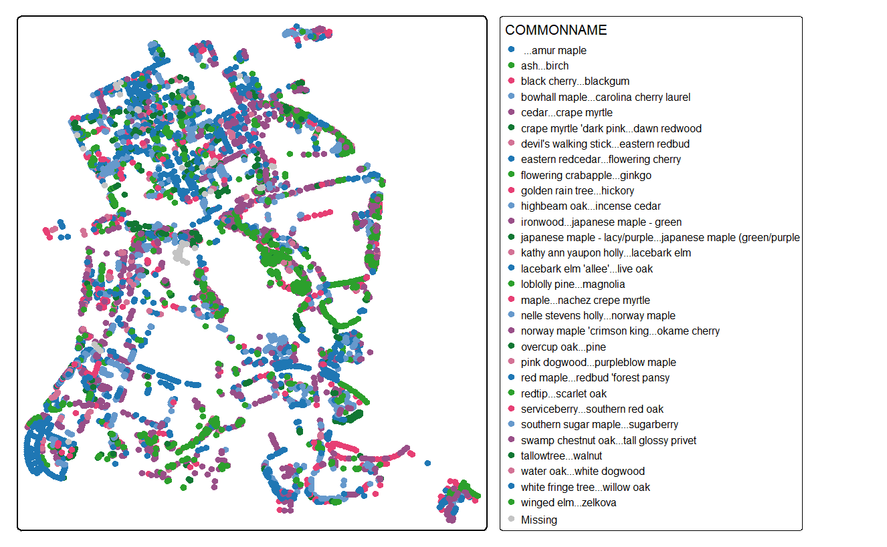{#fig-trees-species fig-alt="Map of campus trees with dots in many repeating colors, next to a very long legend headed COMMONNAME that lists dozens of species in small type, from amur maple to zelkova."}

For a text column, tmap uses a **qualitative palette**: distinct colors with no order, one per category. That works for a handful of categories. With 158 species, the colors repeat and the legend takes up as much room as the map, so you can't tell which tree is which (@fig-trees-species). There are two fixes: map only the most common species, or lump the rare ones together.

### Fix 1: map only the top five species

First, find the most common species with `count()`:

``` r
trees |>
  st_drop_geometry() |>
  count(COMMONNAME, sort = TRUE)
```

| COMMONNAME | n |
|:------------------|------:|
| oak | 778 |
| holly | 570 |
| loblolly pine | 513 |
| `NA` | 498 |
| maple | 259 |
| willow oak | 234 |
| pine | 229 |
| crape myrtle | 223 |
| hickory | 217 |
| dogwood | 183 |

: The ten most common values of `COMMONNAME`. {#tbl-tree-species}

`st_drop_geometry()` turns the sf object back into an ordinary data frame. That isn't required, but it makes counting much faster, because otherwise sf tries to merge the points of every species into one shape. Oak, holly, and loblolly pine lead, and 498 trees have no species name (@tbl-tree-species).

Then `filter()` to the top five, and map them:

``` r
trees |>
  filter(COMMONNAME %in% c("oak", "holly", "loblolly pine", "maple", "willow oak")) |>
  tm_shape() +
  tm_dots(fill = "COMMONNAME", size = 0.05) +
  tm_title("UNC Trees") +
  tm_layout(bg.color = "lightgray")
```

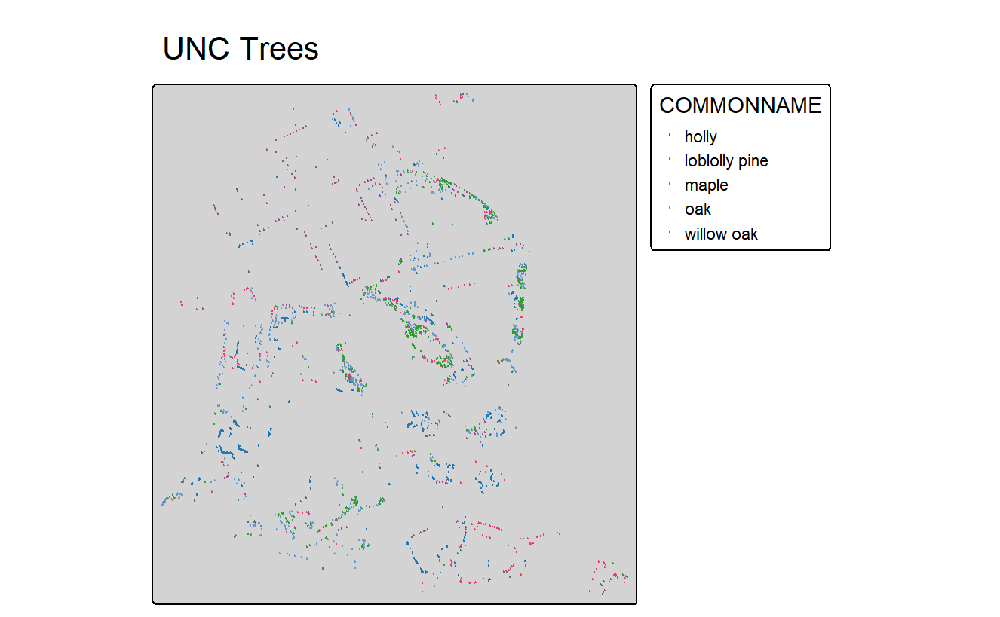{#fig-trees-top-five fig-alt="Map titled UNC Trees with a sparse scatter of small colored dots on a light gray background, and a short legend with five species: holly, loblolly pine, maple, oak, and willow oak."}

Ordinary tidyverse verbs work on sf objects and keep the geometry, so the filtered trees go straight into `tm_shape()`. `size = 0.05` sets the size of the dots, and `tm_title()` adds a title. The legend is readable now, but the map has lost more than half the trees.

### Fix 2: group rare species as "other"

Instead of dropping the rare species, give them a new label. `mutate()` makes a new column, `name`, that keeps the nine most common species and calls everything else "other":

``` r
top_nine <- c("oak", "willow oak", "pine", "crape myrtle", "hickory",
              "dogwood", "holly", "loblolly pine", "maple")

trees |>
  mutate(name = if_else(COMMONNAME %in% top_nine, COMMONNAME, "other")) |>
  tm_shape() +
  tm_dots(fill = "name", size = 0.05) +
  tm_title("UNC Trees") +
  tm_layout(bg.color = "lightgray")
```

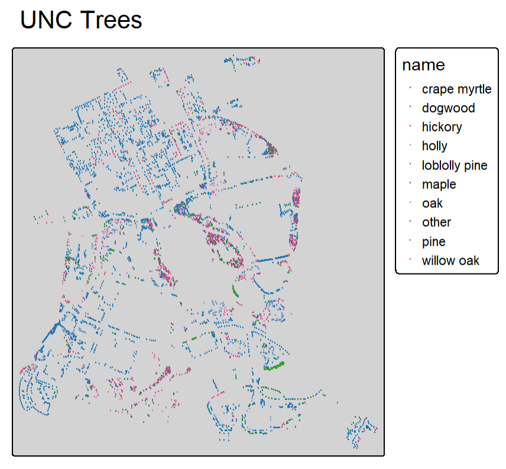{#fig-trees-other fig-alt="Map titled UNC Trees showing all campus trees as small colored dots on a gray background. The legend, headed name, lists crape myrtle, dogwood, hickory, holly, loblolly pine, maple, oak, other, pine, and willow oak."}

`if_else(condition, yes, no)` checks each tree: if its species is in `top_nine`, it keeps the name; if not, it becomes "other". The 498 trees with no name go to "other" too, because `NA %in% top_nine` is `FALSE`. Every tree stays on the map, and ten categories keep the legend readable (@fig-trees-other).

## Lines: mapping sidewalks with tm_lines() {#sec-lines}

### Draw the sidewalk network

The sidewalk layer is a network of line segments. `tm_lines()` is the line version of `tm_dots()`:

``` r
sidewalks |>
  tm_shape() +
  tm_lines()
```

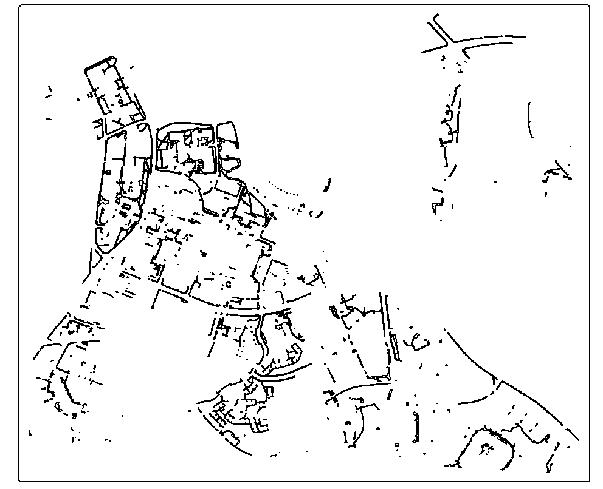{#fig-sidewalks fig-alt="Map of the campus sidewalk network drawn as thin black lines, dense in the north of campus and sparser to the south, with gaps between clusters of paths."}

With no arguments, every segment is the same thin black line (@fig-sidewalks). The gaps on the map are places with no sidewalk *data*, not places with no pavement: the layer only covers what has been surveyed.

### Color sidewalks by surface

``` r
sidewalks |>
  tm_shape() +
  tm_lines(col = "SURFACE_")
```

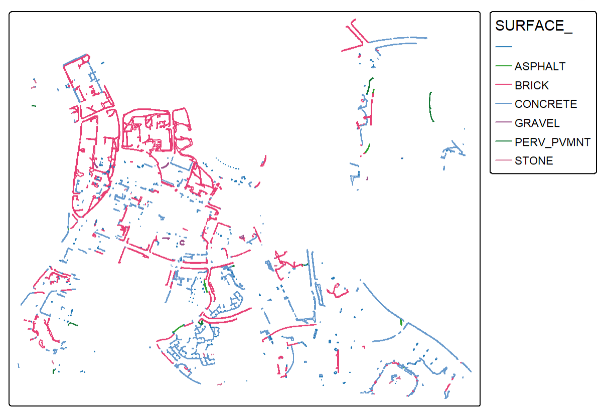{#fig-sidewalks-surface fig-alt="Map of the sidewalk network with each line colored by surface: asphalt, brick, concrete, gravel, pervious pavement, and stone. Pink brick paths dominate the north of campus and blue concrete paths the south."}

A line has no inside to fill, so lines take `col =` rather than `fill =`. `SURFACE_` is a text column, so tmap picks a qualitative palette. (The underscore at the end of the column name comes from the source data; you must type it exactly.) Brick and concrete make up most of central campus (@fig-sidewalks-surface).

## Polygons: mapping buildings with tm_polygons() {#sec-polygons}

### Draw the building footprints

Building footprints are areas, so `tm_polygons()` draws each one with a fill and an outline:

``` r
buildings |>
  tm_shape() +
  tm_polygons()
```

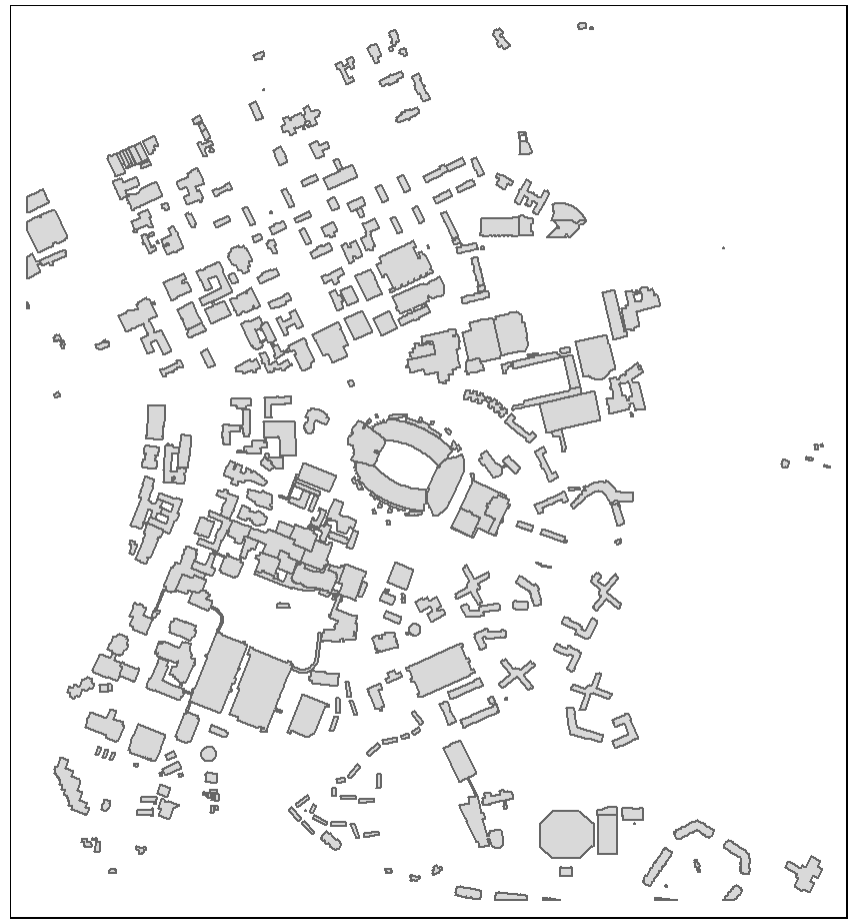{#fig-buildings fig-alt="Map of campus building outlines, all filled in the same light gray with dark outlines, including the oval of Kenan Memorial Stadium near the center."}

With no arguments, every building gets the same gray fill (@fig-buildings). That already shows the shape of campus, before any attribute is mapped.

### Shade buildings by year built

Map `fill` to a numeric column, and you have a **choropleth map**: areas shaded by a value.

``` r
buildings |>
  tm_shape() +
  tm_polygons(fill = "YEARBUILT")
```

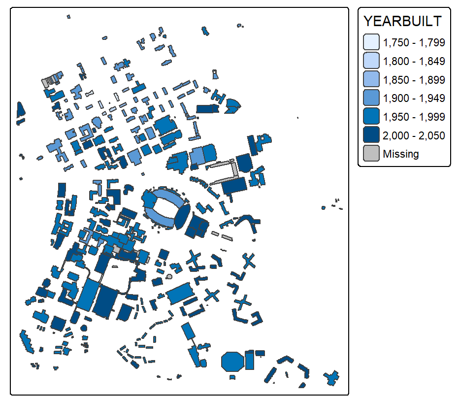{#fig-buildings-year fig-alt="Map of campus buildings shaded from pale blue for buildings from 1750 to 1799 to dark blue for 2000 to 2050. A few buildings are gray, labeled Missing in the legend."}

By default, tmap chooses "pretty" breaks, round numbers, here 50-year classes from 1750 to 2050 (@fig-buildings-year). Buildings with no year recorded are drawn gray and labeled *Missing* in the legend.

::: {.callout-tip appearance="simple"}
## Think about it

Where are the oldest buildings on campus? The newest? What does the map suggest about how the campus grew?
:::

### Control the classes with n and style

How many classes the map uses, and where the breaks between them fall, change what the reader sees. This is called **classification**, and two settings control it:

- **`n`** sets the number of classes.
- **`style`** sets the method for choosing the breaks. `"equal"` makes **equal intervals**: every class covers the same range of values.

In tmap version 4, both go in a **scale** function, `tm_scale_intervals()`, given to the `fill.scale` argument:

``` r
buildings |>
  tm_shape() +
  tm_polygons(fill = "YEARBUILT",
              fill.scale = tm_scale_intervals(n = 4, style = "equal"))
```

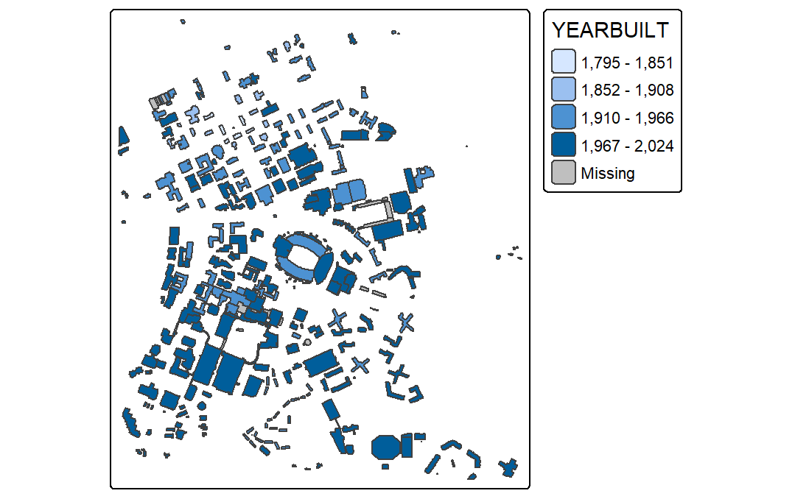{#fig-buildings-equal fig-alt="Map of campus buildings in four shades of blue, with a legend headed YEARBUILT listing 1,795 to 1,851, 1,852 to 1,908, 1,910 to 1,966, 1,967 to 2,024, and Missing."}

Equal intervals split the range from the oldest building to the newest into four equal parts (@fig-buildings-equal). You can also write `tm_polygons(fill = "YEARBUILT", n = 4, style = "equal")`, the shorter form from version 3. It still works, but tmap prints a message suggesting `fill.scale`. Other styles include `"quantile"` (the same number of buildings in each class) and `"jenks"` (**Jenks natural breaks**, which puts the breaks in the biggest gaps between values). Later chapters return to classification, because the choice can change the story a map tells.

## Putting a map together {#sec-combine}

### Combine points, lines, and polygons

To draw several layers in one map, save each layer as its own object, then add them together with `+`:

``` r
# 1. Define independent layers
map_buildings <- buildings |>
  tm_shape() +
  tm_polygons(fill = "FLOORS")

map_sidewalks <- sidewalks |>
  tm_shape() +
  tm_lines()

map_trees <- trees |>
  tm_shape() +
  tm_dots(fill = "HEIGHT", size = 0.02)

# 2. Add them together, placing buildings first to set the map extent
map_buildings + map_sidewalks + map_trees +
  tm_title("UNC Chapel Hill Campus Map") +
  tm_layout(bg.color = "#eeeeee")
```

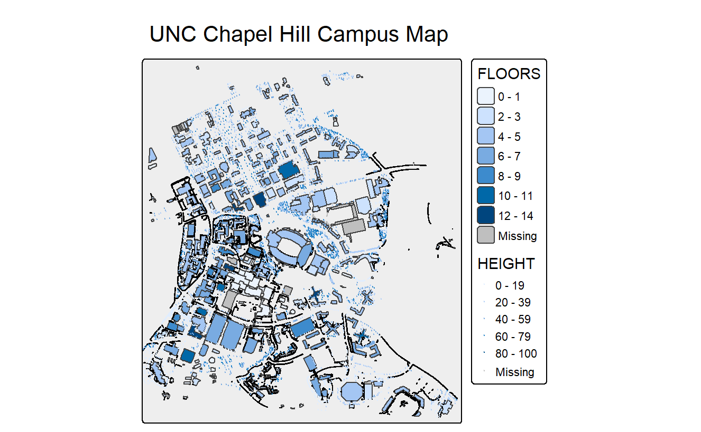{#fig-campus-layers fig-alt="Map titled UNC Chapel Hill Campus Map on a light gray background. Blue building footprints shaded by number of floors sit under black sidewalk lines and small dots for trees. Two legends, FLOORS and HEIGHT, are on the right."}

Each layer draws on top of the ones before it, so put the polygons first, then the lines, then the points; otherwise the buildings would cover the trees. The first layer also sets the map's **extent**, the area the map shows. `tm_title()` and `tm_layout()` style the whole map, so they go at the end, after all the layers.

### Add a scale bar and north arrow

A reader expects a finished map to have a scale bar and a north arrow:

``` r
map_buildings + map_sidewalks + map_trees +
  tm_title("UNC Chapel Hill Campus Map") +
  tm_layout(bg.color = "#eeeeee") +
  tm_scalebar(position = c("left", "bottom")) +
  tm_compass(type = "8star", position = c(0.7, 1))
```

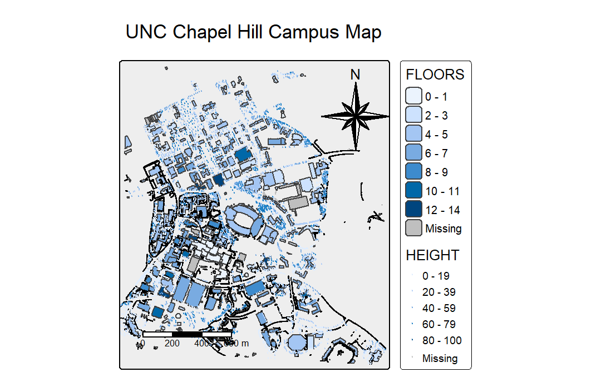{#fig-campus-scalebar fig-alt="The campus map from the previous figure with a scale bar reading 0 to 600 meters in the bottom left corner and a large eight-pointed compass star marked N in the top right corner."}

`tm_scalebar()` adds a **scale bar**, which shows how distances on the map relate to distances on the ground. `tm_compass()` adds a **north arrow**; `type = "8star"` is one of several styles. `position` places each one, either by name, such as `c("left", "bottom")`, or by numbers from 0 to 1 that give the share of the way across and up the map frame. Put them where they don't cover any data.

### Static or interactive: tmap_mode()

tmap has two modes, and the same code works in both:

``` r
tmap_mode("view")   # interactive web map
tmap_mode("plot")   # static map (the default)
```

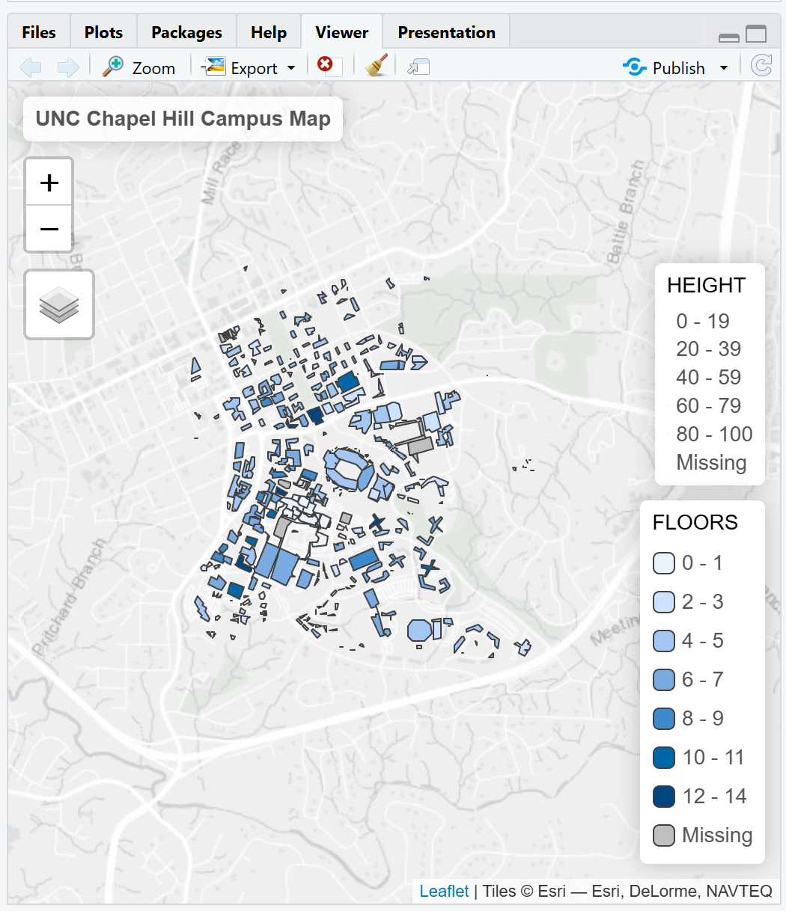{#fig-view-mode fig-alt="Screenshot of RStudio's Viewer pane showing the campus map as an interactive web map on a light gray street basemap, with zoom buttons and a layer button at the top left and the HEIGHT and FLOORS legends on the right."}

After `tmap_mode("view")`, every map becomes an **interactive map** on top of a **basemap** of streets and place names (@fig-view-mode). You can pan, zoom, and click on any feature to see its attributes. It is the best way to explore your data. The basemap tiles load from the web, so view mode needs an internet connection. `tmap_mode("plot")` switches back to static maps, which are what you want for reports, slides, and anything printed.

## Practice: map the world {#sec-world-practice}

These steps follow the in-class exercise. tmap comes with three world layers, so you don't need to download anything.

**Step 1: set up.** Start a new R Markdown file, and load the packages and data:

``` r
library(tidyverse)
library(sf)
library(tmap)

data(World)
data(metro)
data(rivers)
```

**Step 2: look at the data.** Use `glimpse()` on `World`, `rivers`, and `metro`. Which is a point layer, which is a line layer, and which is a polygon layer? Which column of `metro` holds the projected population in 2030?

**Step 3: make the map.** Make one tmap that shows the countries, rivers, and metro areas. As a stretch, size the metro areas by their projected 2030 population.

`r hide("Show one solution")`

``` r
# 1. Create individual maps
map_rivers <- rivers |>
  tm_shape() +
  tm_lines(col = "lightblue", lwd = 0.7)

map_metro <- metro |>
  tm_shape() +
  tm_bubbles(size = "pop2030", fill = "orange")

map_world <- World |>
  tm_shape() +
  tm_polygons(fill = "name", fill.legend = tm_legend_hide())

# 2. Plot all the layers together
map_world + map_rivers + map_metro +
  tm_title("2030 Projected Metro Population") +
  tm_layout(bg.color = "lightblue")
```

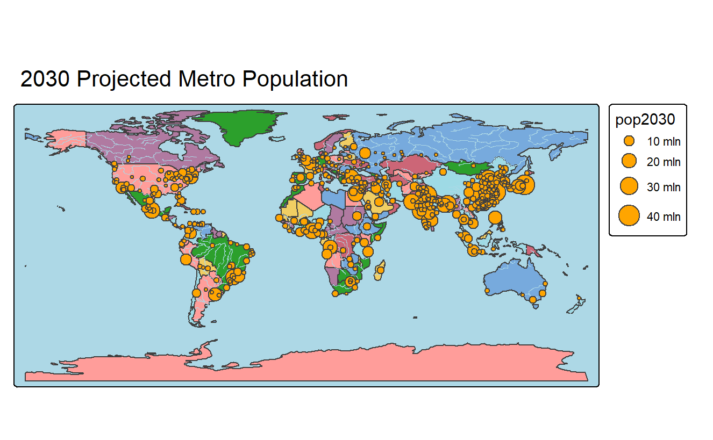{#fig-world-metro fig-alt="World map titled 2030 Projected Metro Population on a light blue background. Countries are filled in many colors, rivers are thin light blue lines, and metro areas are orange circles sized by population, with the largest in South and East Asia. A legend headed pop2030 shows circles for 10, 20, 30, and 40 million."}

The layers go in order: countries first, then rivers, then the metro bubbles on top. `tm_bubbles()` draws circles sized by a column, here `pop2030`. Notice the difference between *setting* and *mapping*, just as in ggplot2: `fill = "orange"` is a color, so every bubble is orange, while `size = "pop2030"` is a column, so the size comes from the data. Filling the countries by `name` gives each one its own color, and `fill.legend = tm_legend_hide()` hides the legend, which would otherwise list 177 countries.

`r unhide()`

## Check your understanding

1.  In an sf object, each row is one: `r mcq(c("Attribute", answer = "Feature", "Coordinate", "Layer"))`

2.  Which tmap function names the data to draw, at the start of each layer? `r fitb(c("tm_shape", "tm_shape()"))`

3.  Which layer function draws polygons? `r mcq(c("tm_dots()", "tm_lines()", answer = "tm_polygons()", "tm_shape()"))`

4.  To color sidewalk lines by a column, you use `col =` rather than `fill =`, because a line has no inside to fill. `r torf(TRUE)`

5.  For a numeric column such as `HEIGHT`, tmap's default colors are a: `r mcq(c("Qualitative palette, one color per value", answer = "Sequential palette, from light to dark", "Single color", "Random set of colors"))`

6.  In `tm_scale_intervals(n = 4, style = "equal")`, what does `n` set? `r mcq(c("The size of the dots", answer = "The number of classes", "The number of layers", "The number of the north arrow style"))`

7.  When you add layers together, the first layer sets the extent of the map. `r torf(TRUE)`

8.  Which function adds a north arrow? `r mcq(c("tm_scalebar()", answer = "tm_compass()", "tm_title()", "tm_layout()"))`

9.  Which mode makes an interactive map that you can pan and zoom? `r mcq(c("tmap_mode(\"plot\")", answer = "tmap_mode(\"view\")", "tmap_mode(\"web\")", "tmap_mode(\"static\")"))`

`r hide("Show hint for question 4")`
`fill` colors the inside of a dot or a polygon. A line is only an outline, so tmap colors it with `col`, the same name ggplot2 uses for the color of lines and outlines.
`r unhide()`

## Summary

- An **sf** object is a tidy data frame of spatial **features**, one per row, with their **attributes** in the columns and their shapes in a **geometry column**. Read a file into one with `read_sf()`.
- **tmap** builds a **thematic map** in layers: `tm_shape()` names the data, and `tm_dots()`, `tm_lines()`, or `tm_polygons()` draws it. Layers are joined with `+`.
- Color features by an attribute with `fill = "column"` (dots and polygons) or `col = "column"` (lines). Numbers get a **sequential palette**; text gets a **qualitative palette**.
- Too many categories make a map unreadable: `filter()` to the most common, or lump the rest together with `mutate()` and `if_else()`.
- **Classification** decides how many classes a map uses and where the breaks fall: `fill.scale = tm_scale_intervals(n = 4, style = "equal")`.
- Combine layers with `+`, with polygons first and points last. Finish with `tm_title()`, `tm_scalebar()`, `tm_compass()`, and `tm_layout()`.
- `tmap_mode("view")` makes interactive web maps for exploring; `tmap_mode("plot")` makes static maps for reports.

## Exercises

Use the three campus layers for exercises 1 to 4, and tmap's `World` data for 5 and 6.

1.  **Floors.** Make a choropleth map of the buildings, shaded by `FLOORS`. Then try `n = 3` and `n = 7`. Which do you find easiest to read?
2.  **Classification styles.** Map `YEARBUILT` with `style = "equal"`, `"quantile"`, and `"jenks"`, each with five classes. How do the breaks differ? Which map makes campus look oldest?
3.  **One species.** Map only the willow oaks, as dots on top of the building footprints. Give the map a title, a scale bar, and a north arrow.
4.  **Sidewalk lengths.** How many sidewalk segments are made of each surface? Use `st_drop_geometry()` and `count()`. Then try `st_length()` inside `mutate()` to find the total length of each surface. Is the answer different?
5.  **A world choropleth.** `World` has a column called `life_exp`, life expectancy. Make a choropleth of it with five classes. Which regions stand out?
6.  **Explore.** Switch to `tmap_mode("view")` and draw your map from exercise 5. Click on a few countries. Then switch back with `tmap_mode("plot")`.

## Further reading

- The tmap website, <https://r-tmap.github.io/tmap/>, has a getting-started guide and many examples, all in version 4 syntax.
- *Geocomputation with R* (2nd ed.), by Robin Lovelace, Jakub Nowosad, and Jannes Muenchow, free at <https://r.geocompx.org>. Its "Making maps with R" chapter covers tmap in depth, including faceted and animated maps.
- The sf website, <https://r-spatial.github.io/sf/>, explains simple features and has a cheatsheet for its functions.
