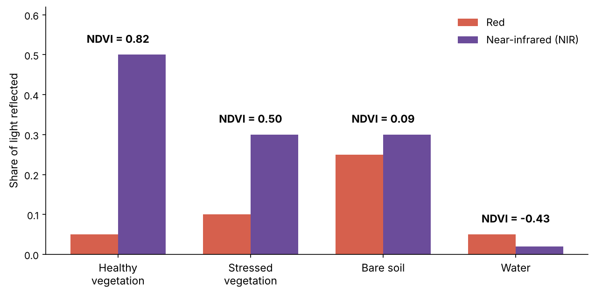
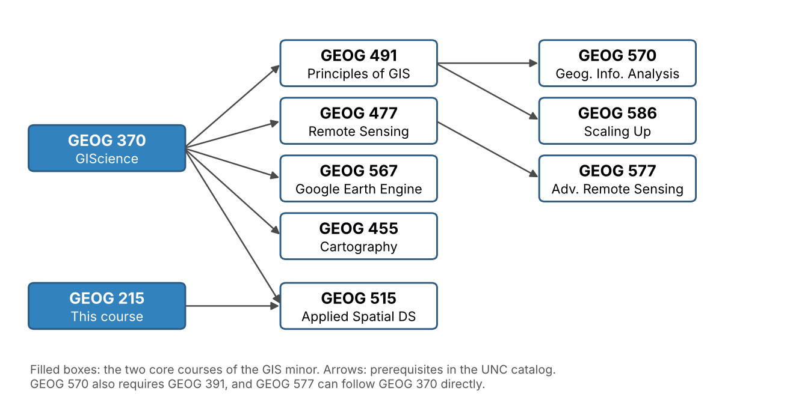

::: {.callout-note appearance="simple"}
## Learning objectives

By the end of this chapter you should be able to:

1.  Name applications of spatial data science in public health, environmental science, and other fields, and the course methods each one uses.
2.  Describe remote sensing, its sensors and four kinds of resolution, and how NDVI turns pixels into information.
3.  Explain how space-time modeling extends Tobler's first law and spatial autocorrelation to time.
4.  Describe GeoAI, and explain why spatial autocorrelation matters when you train and test machine learning models.
5.  Plan your next GIS courses at UNC, and the GIS minor or Geospatial Data Science major.
6.  Describe careers that use spatial skills, and how to start building a portfolio.
:::

This chapter looks forward instead of teaching a new method. You can now do a full spatial data science workflow in R:

- **Get data:** CSV files, shapefiles, the Census API, and ArcGIS REST services (Chapters 13 and 14).
- **Wrangle it:** the tidyverse, the pipe, and table and spatial joins (Chapters 6–9 and 15).
- **Map it:** ggplot2 and tmap, with sensible coordinate systems (Chapters 9, 10, and 12).
- **Analyze it:** exploratory data analysis, ANOVA, regression, distance, neighbors, and spatial autocorrelation (Chapters 16, 18, 19, 21, and 22).
- **Communicate it:** reproducible R Markdown reports and interactive dashboards (Chapters 2, 20, and 23).

That is the core workflow of spatial data science. This chapter shows where it is used, previews three advanced topics that build on it, and maps out what to take next at UNC and where spatial skills can take you. As you read, notice which application excites you most. That is a good clue to which course to take next.

## Spatial data science in action {#sec-in-action}

Almost any question that involves "where" is a spatial question:

- Where are disease cases clustering?
- Which neighborhoods are farthest from a clinic or grocery store?
- How fast is forest being cleared, and where?
- Who lives in the flood zone?
- Where should a new store, bus route, or fire station go?

The methods are shared; the questions change by discipline. For each application below, notice which methods from this book show up: joins, distance, neighbors, autocorrelation, regression, or mapping.

### Public health: where disease happens

**Spatial epidemiology** studies how health outcomes vary across places. Its classic origin story is John Snow's map of the 1854 Broad Street cholera outbreak in London, which tied deaths to a single water pump.

Today we don't just look at the map; we test whether a cluster is bigger than chance would produce. Local Moran's I and hot spot statistics such as Getis-Ord Gi\* (Chapter 22) find unusual clusters of cases, and **scan statistics**, in software such as SaTScan, search through both space and time for outbreaks. During COVID-19, case maps and dashboards were updated daily, and wastewater testing added a new signal for tracking infection by sewershed. A sewershed is just another polygon you can join data to.

### Public health: access to care

Access to care depends on distance, travel time, and who can make the trip. Chapter 21 compared straight-line, network, and travel-time distance, and health access is where that choice matters most: a clinic 10 miles away is not the same for someone with a car and someone who relies on a bus. Analysts draw drive-time and transit-time areas around hospitals, pharmacies, and clinics, and track how rural hospital and maternity unit closures lengthen trips for patients.

**Accessibility** models weigh supply against demand. The **two-step floating catchment area** (2SFCA) method is a common example: it combines how many providers there are, how many people need them, and how long it takes to get there.

### Public health: environmental exposure and justice

Where people live shapes what they breathe, drink, and are exposed to. Researchers link air pollution monitors and satellite estimates to asthma rates, and measure distance to highways, factories, and hazardous waste sites. **Environmental justice** asks who bears that burden.

A well-known North Carolina example comes from UNC epidemiologists, including the late Steve Wing, who showed that industrial hog operations in eastern North Carolina were concentrated near Black, Latino, and low-income communities. The methods are ones you know: spatial joins, buffers, census data, and regression, controlling for spatial autocorrelation. Maps can reveal inequities, and spatial data science has real policy consequences.

### Environmental science: watching the planet change

Satellites give a consistent, repeated view of the whole Earth. Hansen and colleagues (2013) used Landsat imagery to map forest loss worldwide at 30-meter resolution, and Global Forest Watch now serves that kind of data to the public. Satellite data also show land cover change, such as farms turning into suburbs or wetlands into development, and **urban heat islands**: paved, treeless neighborhoods that run hotter, which is a health issue too.

Ecologists use **species distribution models**, which are essentially regression with spatial predictors, to predict where plants and animals can live, and GPS collars and tags to record how animals move through landscapes.

### Environmental science: hazards and resilience

GIS is central to preparing for and responding to disasters: flood maps, evacuation routes, and shelter locations before a storm, and rapid damage mapping from aerial and satellite imagery after it. North Carolina has plenty of examples:

- Hurricane Helene's 2024 flooding in western North Carolina, when imagery and GIS were used to map flooding, landslides, and damaged roads.
- Sea-level rise and shoreline change along the Outer Banks.
- Statewide lidar elevation data, collected for floodplain mapping.

The key question, who is exposed, is an overlay of hazard zones with census data: exactly the kind of spatial join you did in Chapter 15.

### Cities, transportation, and planning

Urban and regional planners use GIS every day, for zoning, land use, and housing affordability. Transportation questions are almost always network questions. Who lives within a 10-minute walk of a bus stop? Where are the bike and pedestrian crash hot spots?

Choosing where to put new schools, parks, or fire stations is a classic GIS problem. **Location–allocation** models take demand locations and candidate sites and choose the sites that minimize travel or serve the most people. Network distance, from Chapter 21, is the core tool.

### Social science, history, and politics

- **History.** The Mapping Inequality project digitized the 1930s Home Owners' Loan Corporation "redlining" maps, including several North Carolina cities such as Durham. Researchers join those historic polygons to today's data on health, heat, and wealth.
- **Politics.** Redistricting and gerrymandering are spatial problems by definition, and North Carolina has been at the center of many redistricting court cases. Compactness measures and simulated district maps test whether a plan is fair.
- **Archaeology.** Lidar sees through forest canopy to reveal buried sites.
- **Sociology and economics.** Segregation, mobility, and neighborhood effects are studied with neighbor-based measures like the weight matrices from Chapter 21.

### Business, agriculture, and humanitarian work

- **Business.** Site selection, delivery routing, market areas, and real estate, often called **location intelligence**.
- **Agriculture.** Precision farming with GPS-guided equipment, drones, and crop imagery puts water and fertilizer only where they are needed.
- **Humanitarian mapping.** Volunteers trace roads and buildings in OpenStreetMap, and responders use those maps after earthquakes, floods, and conflicts. Anyone can contribute, including you, this week.
- **Insurance and finance.** Insurers price risk from floods, wildfire, and climate change with hazard models.

::: {.callout-tip appearance="simple"}
## Think about it

Pick the application in this section that interests you most. Which chapters of this book would you need for a first project on it? What data would you need, and who publishes them?
:::

## Remote sensing: seeing Earth from above {#sec-remote-sensing}

The next three sections preview advanced areas: remote sensing, space-time modeling, and GeoAI. Each is a full course or career on its own, so the goal is vocabulary and a sense of what is possible, not mastery.

**Remote sensing** is collecting information about Earth without touching it, and it produces most of the raster data in the world (Chapter 11). Sensors come in two kinds:

- **Passive sensors** record reflected sunlight or the heat a surface gives off, like a camera or a multispectral scanner.
- **Active sensors** send their own signal and measure what comes back. **Radar** can see through clouds and at night, and **lidar** measures distance with laser pulses to build 3D models of terrain and trees.

### Four kinds of resolution

Every sensor is described by four kinds of resolution:

- **Spatial resolution:** the size of a pixel on the ground.
- **Spectral resolution:** the number and width of wavelength bands it records.
- **Temporal resolution:** how often it revisits the same place.
- **Radiometric resolution:** how finely it records brightness.

Each sensor trades these off. A satellite with tiny pixels usually covers a smaller area or revisits less often. Choosing data means choosing the resolution that fits your question, just as Chapter 21 chose the distance measure that fits the question.

| Sensor | Type | Pixel size | Good for |
|:-------|:-----|:-----------|:---------|
| Landsat (since 1972) | Passive | 30 m | Decades of change |
| Sentinel-2 | Passive | 10–60 m | Crops, forests, cities |
| MODIS | Passive | 250 m–1 km | Daily fires and snow |
| Sentinel-1, NISAR | Active radar | About 5–20 m | Floods, ground motion |
| Lidar | Active laser | Under 1 m | Elevation, tree height |
| Drones | Mostly passive | Centimeters | Small study sites |

: Remote sensing data you will meet most often. Pixel sizes are approximate. {#tbl-sensors}

Landsat is the longest continuous record of Earth's surface, which makes it ideal for change over decades. Sentinel-2, from the European Space Agency, has finer pixels and frequent revisits. MODIS is coarse but images the whole planet about every day. Radar, from Sentinel-1 and the NASA–ISRO NISAR mission launched in 2025, works through clouds, so it maps floods during storms. Most of these data are free from NASA, the USGS, and the European Space Agency, a big change from twenty years ago.

### From pixels to information

Different surfaces reflect different wavelengths of light, so each has a **spectral signature**. Healthy plants absorb red light, because chlorophyll uses it, and reflect near-infrared (NIR) light strongly. The **normalized difference vegetation index** (**NDVI**) turns that contrast into one number for each pixel:

$$
\text{NDVI} = \frac{\text{NIR} - \text{Red}}{\text{NIR} + \text{Red}}
$$

NDVI ranges from −1 to 1, and dense green vegetation is high (@fig-ndvi).

{#fig-ndvi fig-alt="A bar chart with a red bar and a near-infrared bar for each of four surfaces. Healthy vegetation reflects 0.05 red and 0.50 near-infrared, giving NDVI 0.82. Stressed vegetation reflects 0.10 and 0.30, NDVI 0.50. Bare soil reflects 0.25 and 0.30, NDVI 0.09. Water reflects 0.05 and 0.02, NDVI -0.43."}

Two more steps turn imagery into maps:

- **Classification** assigns each pixel a land cover class, such as forest, water, or developed land, increasingly with machine learning.
- **Change detection** compares images of the same place from different dates.

In R, the **terra** and **stars** packages handle rasters. NDVI is two lines of raster algebra in terra. Google Earth Engine, taught in GEOG 567, runs the same analyses in the cloud on petabytes of imagery, without downloading anything.

## Space-time modeling {#sec-space-time}

Almost every dataset in this book was a snapshot: one ACS period, or one year. But real processes change over both space and time:

- Disease spreading from county to county.
- Air pollution changing by the hour and by neighborhood.
- Cities growing over decades.

Tobler's first law extends to time: nearby moments are related, just as nearby places are. A useful mental model is the **space-time cube**: a map for every time step, stacked on top of each other, with x, y, and time as its three axes.

Some space-time methods to explore:

- **Emerging hot spot analysis** runs a hot spot statistic, like Gi\* from Chapter 22, for every time step and classifies each location's trend: new, intensifying, persistent, or diminishing. The sfdep package has a function for it.
- **Space-time scan statistics** detect disease outbreaks early, and are widely used in disease surveillance.
- **Spatiotemporal kriging** predicts values at places and times with no measurements, for example air pollution exposure.
- **Movement and trajectory analysis** works with GPS tracks of people, vehicles, and animals.

In R, look at the **sfdep**, **stars**, **sftime**, and **gstat** packages. At UNC, ENEC 468, Temporal GIS and Space/Time Geostatistics for the Environment and Public Health, focuses on these methods.

## GeoAI {#sec-geoai}

**GeoAI** is artificial intelligence applied to spatial data, and it is one of the fastest-growing parts of the field.

- **Deep learning reads imagery at massive scale.** Models trained to recognize objects in images have extracted building footprints for whole countries (Microsoft released its global footprints as open data), and map roads, rooftop solar panels, crops, and flood extent. Work that once took armies of people digitizing by hand is now automatic.
- **Machine learning predicts.** Random forests and gradient boosting, with spatial predictors, estimate air quality, poverty, or crop yield in places with no measurements.

### Foundation models and AI assistants

**Geospatial foundation models** are large models pretrained on huge image archives, which can then be adapted to many tasks. In 2023 NASA and IBM released Prithvi, an open model trained on Landsat and Sentinel-2 imagery, which can be fine-tuned to map floods, burn scars, or crop types with little labeled data. Segmentation models can outline buildings or fields with minimal training.

Large language models can help write R code, explain error messages, and geocode place names in text. They are most useful to people who know enough to check the answer, such as noticing that a model used the wrong coordinate system. The course [AI policy](../ai-policy.qmd) asks you to use them that way.

### Spatial thinking keeps AI honest

This is where this book pays off directly. Most machine learning assumes observations are independent, and spatial data are not: you measured that with Moran's I in Chapter 22.

- **Random train–test splits mislead.** If you split spatial data at random, near-duplicate neighbors end up in both the training set and the test set. Accuracy looks great, and then the model fails in new places.
- **Spatial cross-validation** holds out whole regions instead, so the test really is a new place. The R packages spatialsample and blockCV do this.
- **Training data can be biased** toward wealthy or well-mapped places, so models do worst where better data are most needed.
- **Location data raise privacy concerns.** A few GPS points can be enough to identify a person.

Understanding spatial data is what separates someone who can run an AI model from someone who can trust its results.

::: {.callout-tip appearance="simple"}
## Think about it

A model predicts poverty from satellite images of North Carolina's census tracts. It is trained on a random 80% of tracts and scores 95% accuracy on the other 20%. Why might it do much worse in South Carolina? How would you test it more honestly?
:::

### Scaling up: cloud, big data, and open science

Datasets are growing faster than laptops. Planet-wide imagery and billions of GPS points don't fit on one computer, so analysis is moving to the cloud, where the data sit next to the computing:

- **Cloud platforms:** Google Earth Engine, Microsoft Planetary Computer, and AWS open data.
- **Spatial databases:** **PostGIS** adds spatial queries, such as spatial joins, to SQL.
- **Cloud-ready formats:** Cloud Optimized GeoTIFF and GeoParquet let you read only the piece of a file you need.

Reproducibility (Chapter 20) matters more as projects grow. The habits you built with R Markdown scale up to Quarto (which built this book), Git, and GitHub, with shared code and data. GEOG 586 Scaling Up Geospatial Analysis and GEOG 592 GIS Programming go deeper.

## Keep learning at UNC {#sec-unc}

Course titles and requirements in this section come from the 2026–27 UNC undergraduate and graduate catalogs. Always check the catalog and ConnectCarolina for when each course is offered, and meet with a Geography advisor before you plan.

### A path through UNC GIS courses

GEOG 215, this course, and GEOG 370, Geographic Information Science, are the two core courses of the GIS minor, so you are already halfway through the core. GEOG 370 is the gateway to most upper-level GIS courses (@fig-course-path). GEOG 515, Applied Spatial Data Science, needs both 215 and 370, and picks up where this book stops: spatial regression, clustering, and interpolation in R.

{#fig-course-path fig-alt="A flow diagram. GEOG 370 GIScience, a filled box, has arrows to GEOG 491 Principles of GIS, GEOG 477 Remote Sensing, GEOG 567 Google Earth Engine, GEOG 455 Cartography, and GEOG 515 Applied Spatial Data Science. GEOG 215 This course, also filled, has an arrow to GEOG 515. GEOG 491 leads to GEOG 570 Geographic Information Analysis and GEOG 586 Scaling Up. GEOG 477 leads to GEOG 577 Advanced Remote Sensing. A note says GEOG 570 also requires GEOG 391, and GEOG 577 can follow GEOG 370 directly."}

### Geography courses by interest

| If you liked… | Take |
|:--------------|:-----|
| R and spatial statistics | GEOG 515 Applied Spatial Data Science; GEOG 570 Geographic Information Analysis |
| Remote sensing | GEOG 477 Introduction to Remote Sensing; GEOG 577 Advanced Remote Sensing; GEOG 567 Google Earth Engine |
| Health | GEOG 541 GIS in Public Health; GEOG 544 GIS for Impact Evaluation and Health Studies |
| GIS and programming | GEOG 491 Principles of GIS; GEOG 591 Applied Issues in GIS; GEOG 592 GIS Programming; GEOG 586 Scaling Up Geospatial Analysis |
| Making maps | GEOG 455 Cartography and Geovisualization; GEOG 456 Geovisualizing Change; GEOG 555 Cartography of the Global South |
| Field data | GEOG 594 GPS and Applications |

: Geography Department GIS courses by interest. Titles are shortened in a few places. {#tbl-geog-courses}

### GIS courses beyond Geography

GIS is taught across campus. These courses all count as electives in the GIS minor, the Geospatial Data Science major, or the graduate GIS certificate:

- **Environment, Ecology, and Energy:** ENEC 468 Temporal GIS and Space/Time Geostatistics for the Environment and Public Health; ENEC 479 Landscape Analysis; ENEC 340 Environmental Applications of Drones.
- **Earth, Marine, and Environmental Sciences:** EMES 483 GIS and Remote Sensing for Earth and Ocean Sciences.
- **Anthropology:** ANTH 419 Anthropological Application of GIS.
- **Information and Library Science:** INLS 541 Information Visualization; INLS 641 Visual Analytics.
- **City and Regional Planning:** PLAN 672 Urban Data Analytics (graduate).

### Turn your interest into a credential

- **GIS minor (15 credit hours).** The core is GEOG 215 and GEOG 370, plus three GIS electives, for example GEOG 455, 477, 491, 541, or 577. It pairs well with any major, and you have already finished GEOG 215.
- **Geospatial Data Science B.S.** A full major. Its core is GEOG 215, 370, 391, 392, 455, 477, 491, and 515, plus math, statistics, or data science courses, GIS electives, and a capstone.
- **Graduate Certificate in Geographic Information Science (18 credit hours),** for graduate students.

## Careers in GIS and spatial data science {#sec-careers}

Whether or not you major in geography, spatial skills make you more employable in many fields. Job titles vary a lot, so search broadly:

- **GIS analyst or technician:** builds, maintains, and analyzes spatial data. The most common entry point.
- **Geospatial data scientist:** statistics, machine learning, and code at scale.
- **Remote sensing analyst:** turns imagery into maps and measurements.
- **Cartographer or geovisualization designer:** maps, dashboards, and web maps.
- **Geospatial developer:** web mapping apps, spatial databases, and APIs.
- **Domain roles that use GIS:** planner, spatial epidemiologist, environmental consultant, emergency manager.

Many of you will end up in the last group, using GIS as a core skill in another field. The U.S. Bureau of Labor Statistics projects much faster than average growth for data scientists, and spatial skills set you apart within that field.

### Where geospatial professionals work

- **State and local government:** nearly every North Carolina city and county has GIS staff, as do NCDOT and the NC Center for Geographic Information and Analysis, which runs NC OneMap.
- **Federal agencies:** USGS, NOAA, NASA, the Census Bureau, CDC, and EPA, which has a large campus in Research Triangle Park.
- **Research and nonprofits:** universities, RTI International, and conservation groups.
- **Private sector:** engineering and environmental consulting, utilities, real estate, tech, and insurance.
- **Software and data companies:** Esri and other mapping, imagery, and analytics firms.

Look at job boards for these employers to see which skills they ask for.

### Skills employers look for

| Technical skills | Professional skills |
|:-----------------|:--------------------|
| R or Python for spatial analysis | Clear maps and visual communication |
| ArcGIS Pro and QGIS | Writing for non-technical audiences |
| SQL and PostGIS | Asking good spatial questions |
| Statistics and spatial statistics | Data ethics and privacy |
| Remote sensing and cloud tools | Working on teams and managing projects |
| Git and reproducible workflows | |

: Skills that geospatial job postings ask for. {#tbl-skills}

You already have R, spatial statistics, and reproducible reports from this book. Adding ArcGIS Pro or QGIS, through GEOG 370 or 491, makes a strong combination. Don't underestimate the second column: employers consistently say they need people who can explain results clearly, make a good map, and think carefully about ethics.

### Start building your portfolio now

You don't need to wait until graduation. Two or three polished projects matter more than a list of courses.

- Put your best maps and R projects on GitHub or a personal website. Your final project, cleaned up with a clear write-up and map, is a strong first piece.
- Contribute to OpenStreetMap or a humanitarian mapping task.
- Look for internships with city, county, and state GIS offices, state agencies, and research centers.
- Join a professional community, such as the NC GIS Conference, URISA, or the American Association of Geographers. Most have student rates.
- Later in your career, consider the **GISP** certification from the GIS Certification Institute and Esri's technical certifications.
- Keep learning: free online books, such as *Geocomputation with R*, pick up right where this book ends.

::: {.callout-tip appearance="simple"}
## Think about it

Search a job board for "GIS analyst" in North Carolina. Pick two postings. Which of the skills they ask for do you already have, and which course or project would give you the rest?
:::

## Summary

- Spatial data science answers "where" questions in nearly every field: **spatial epidemiology**, **accessibility** to care, **environmental justice**, environmental change and hazards, planning, history, politics, business, and humanitarian mapping. The methods are the ones in this book.
- **Remote sensing** collects information about Earth from a distance, with **passive** or **active** sensors, each with a **spatial**, **spectral**, **temporal**, and **radiometric** resolution. **NDVI** uses the contrast between red and near-infrared light to measure vegetation; **classification** and **change detection** turn imagery into maps.
- **Space-time modeling** extends Tobler's first law to time. The **space-time cube**, **emerging hot spot analysis**, and **spatiotemporal kriging** are starting points.
- **GeoAI** reads imagery and makes predictions at massive scale, and **foundation models** adapt to new tasks with little labeled data. Because of spatial autocorrelation, honest testing needs **spatial cross-validation**.
- At UNC, take GEOG 370 next, then electives or GEOG 515, and consider the GIS minor or the Geospatial Data Science B.S.
- Spatial skills are in demand in government, research, and the private sector. Start a portfolio now.

## Exercises

1.  **Spot the methods.** Choose one application from @sec-in-action. List every method from this book it uses, with the chapter where you learned it.
2.  **Compute NDVI.** A pixel reflects 0.08 of red light and 0.40 of near-infrared light. Compute its NDVI by hand, then in R. Is it more likely forest, bare soil, or water? Why?
3.  **Pick a sensor.** For each question, choose a sensor from @tbl-sensors and justify it with one kind of resolution: (a) How much did Wake County's developed land grow from 1990 to 2025? (b) Which roads flooded during last night's storm? (c) How tall are the trees in Duke Forest?
4.  **Space-time question.** Write a research question about North Carolina that needs a space-time method. What would one time slice of your space-time cube be?
5.  **Plan your path.** Using @fig-course-path and @tbl-geog-courses, write a four-semester plan of GIS courses that fits your interests, and check each course's prerequisites in the UNC catalog.
6.  **Portfolio piece.** Choose your best map or analysis from this semester. Write a one-paragraph description of it for a non-technical reader, as you would on a personal website.

## Further reading

- *Geocomputation with R* (2nd ed.), by Robin Lovelace, Jakub Nowosad, and Jannes Muenchow, free at <https://r.geocompx.org>. Picks up where this book ends, with rasters, spatial cross-validation, and more.
- Hansen, M. C., et al. (2013). "High-Resolution Global Maps of 21st-Century Forest Cover Change." *Science* 342(6160): 850–853. The forest change study described in this chapter.
- Mapping Inequality: Redlining in New Deal America, from the University of Richmond's Digital Scholarship Lab, at <https://dsl.richmond.edu/panorama/redlining>.
- UNC Department of Geography and Environment, programs and courses in the UNC catalog, at <https://catalog.unc.edu>.
