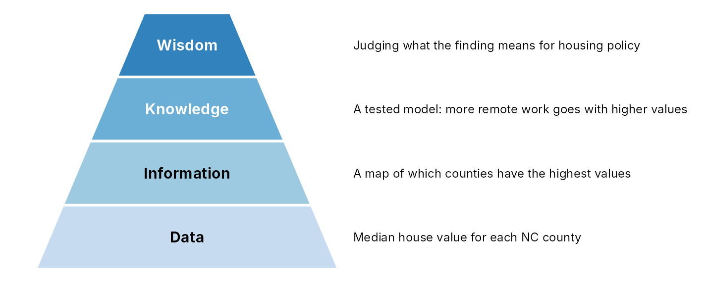

```{r}
#| label: setup-webex
#| include: false
library(webexercises)
```

::: {.callout-note appearance="simple"}
## Learning objectives

By the end of this chapter you should be able to:

1.  Tell data from information, and place both in the DIKW pyramid.
2.  Describe the data science workflow and where data come from.
3.  Explain reproducibility, replicability, and open science.
4.  Explain why spatial data need their own methods, and what to check because of it.
5.  Write each section of a spatial data science project, from research question to references.
6.  Explain what makes a project spatial data science, and not just data science with a map.
:::

You have now learned to get data, tidy it, map it, describe it, and test it. This chapter is about putting those pieces together into a project that someone else can read, trust, and rerun. We start with the ideas underneath: what data, information, and knowledge are, where data come from, and what makes an analysis science. Then we walk through a real project, on house values in North Carolina, section by section.

## No information without data {#sec-data-information}

The writer and programmer Daniel Keys Moran put the first idea briefly: you can have data without information, but you can't have information without data. Raw data become information only after they are processed, organized, and interpreted.

| | Data | Information |
|:--|:-----|:------------|
| What it is | Raw and unprocessed | Processed, organized data with meaning |
| What it's for | The basis for analysis | Supporting decisions and giving insight |
| Value | Little on its own | Directly valuable and actionable |
| Examples | Numbers, dates, measurements, text | Reports, summaries, insights, conclusions |

: Data and information. {#tbl-data-information}

A list of hourly temperatures is data. A forecast that says "bring an umbrella this afternoon" is information.

### The DIKW pyramid

The **DIKW pyramid** takes the idea further, in four levels (@fig-dikw). Each builds on the one below:

- **Data:** facts and figures.
- **Information:** data organized to be useful.
- **Knowledge:** information built up and tested over time and across many situations.
- **Wisdom:** principles, reasoning, and knowledge applied to judge what is true and right.

{#fig-dikw fig-alt="A pyramid of four stacked layers in shades of blue. From the bottom: Data, beside the example Median house value for each NC county; Information, beside A map of which counties have the highest values; Knowledge, beside A tested model: more remote work goes with higher values; and Wisdom at the top, beside Judging what the finding means for housing policy."}

**Data science** is using data to gain information or knowledge about the world. It mostly works on the bottom levels of the pyramid, and helps people climb toward the top.

## The data science process {#sec-ds-process}

Chapter 5 introduced the **data science workflow** from *R for Data Science*: **import** the data, **tidy** it, then cycle through **transform**, **visualize**, and **model** until you **understand** it, and finally **communicate** the results. The middle loop repeats, and programming runs through every step. A project write-up is the "communicate" step, but a good one shows all the others too.

### Big data

**Big data** is often described by three Vs:

- **Volume:** the sheer amount, from terabytes of records, transactions, and files up.
- **Velocity:** how fast it arrives, from batches to near-real-time feeds and live streams.
- **Variety:** the mix of structured tables, semi-structured JSON, and unstructured text and images.

Many spatial datasets, such as satellite imagery or the GPS traces from phones, score high on all three.

### Where data come from

| Sources | Formats |
|:--------|:--------|
| Authoritative: federal, state, county, and local government | Files: GeoJSON, shapefiles, CSV |
| Web scraping: social media, live feeds, news | API calls: data on demand (Chapters 16 and 17) |
| The Internet of Things: sensors streaming readings | Images, text, and 3D formats |
| Real-time analytics feeds | |

: Where data come from, and the formats they arrive in. {#tbl-data-sources}

Government agencies are usually the most **authoritative** sources. Also note whether a dataset is **static**, a fixed snapshot, or **dynamic**, continually updated, because a dynamic source may give different data the next time you run your code.

## Science: reproducibility and replicability {#sec-science}

Spatial data science is still science. It builds on a body of knowledge, follows the scientific method, and rests on empirical evidence. Two words describe whether others can trust and build on a result:

- **Reproducible:** the same data and methods give the same results. Anyone can rerun your analysis and get your numbers.
- **Replicable:** a new study, with different data, answering the same question, gets consistent results.

**Open science** makes both possible: open access (papers anyone can read), open data, open methods, open-source software such as R and RStudio, open peer review, and open educational resources (like this book).

R Markdown, from Chapter 2, is a reproducibility tool. It keeps data loading, code, results, and write-up in one document, so anyone with the file and the data can knit it and get the same report.

## Why spatial data are special {#sec-spatial-special}

Location links observations together, so spatial data need their own methods.

What makes them special:

- **The first law of geography:** near things are more related than distant things.
- **Spatial autocorrelation:** values cluster, so observations are not independent. Neighboring counties tend to have similar house values.
- **Spatial heterogeneity:** relationships change from place to place. Remote work may matter more for house values near cities than in rural counties.

What it means for your analysis:

- **Clustered residuals make standard tests overconfident.** Map your model's residuals and test them with Moran's I (Chapter 22).
- **Scale and zoning matter.** County and tract results can differ: the **modifiable areal unit problem**.
- **Projection matters.** Distances and areas depend on the coordinate system (Chapter 11).

## Building blocks of a project {#sec-building-blocks}

Every project has the same building blocks:

| Section | What goes in it |
|:--------|:----------------|
| Introduction | Your research question and why it matters |
| Background | What earlier work found, and how it relates to your question |
| Data and methods | Your data, cited and described; the code that tidies them; maps and descriptive statistics |
| Results | Maps, graphs, and statistics that help answer the question |
| Conclusion | Your answer, as well as you can give it; limitations; what you'd do differently |
| References | Every source you used |

: The building blocks of a spatial data science project. {#tbl-building-blocks}

We'll go through each one using an example project, written in R Markdown, titled *What Demographic Variables May Influence Median House Value for North Carolina in 2020?* You met its models in Chapter 19.

### Introduction: the research question {#sec-research-question}

The research question drives everything else. A good one is:

- **Specific and focused.** Include the place and time where they matter.
- **Answerable,** even if you end up not able to answer it fully.
- **Worth asking.** Explain why it matters.

It doesn't have to be phrased as a question, but that often helps.

The example's introduction says that the project examines which demographic factors might relate to median home value in North Carolina's counties in 2020: in particular, whether the percentage of people working from home is related to home value, and by how much it raises or lowers it. It names the other variables it will bring in (percent white alone, median age, and median income) and says the project will explore the data, build a model, and discuss how well the model fits, statistically and spatially, using residuals. A reader knows the place, the time, the variables, and the plan by the end of the second paragraph.

::: {.callout-tip appearance="simple"}
## Think about it

Which is the better research question, and why? (a) "What affects house prices?" (b) "Is the share of residents who work from home related to median house value in North Carolina's counties in 2020?" How would you make (b) more spatial?
:::

### Background: build on earlier research {#sec-background}

The background shows you've read what came before. What have others found? How does it shape your question, your data, or your methods?

The example's background notes that house prices and cost of living have clear geographic patterns, but are not a common topic for geographers. It summarizes a study by Campbell and James that built a housing cost index for North Carolina's counties, the ratio of median home value to median household income, and tested whether second homes in the mountains and at the beach push costs up. That earlier work suggests variables to include and a spatial pattern to look for.

### Data and methods: show your work {#sec-data-methods}

In data and methods, you show your work:

1.  **Cite the source** of your data: which agency, which survey, which year, and how you got it.
2.  **Include the code** that loads and tidies the data.
3.  **Describe the data** with summary statistics and maps.

```r
# Load the libraries used in this research
library(tidyverse)
library(sf)
library(tmap)

# Load the 2020 NC counties data
ncCounties <- read_sf("...")
glimpse(ncCounties)
```

`glimpse()` shows 100 rows, one per county, and the columns. Then a summary and a map of the dependent variable, median home value, and a map of each independent variable (@fig-explanatory). Mapping each variable before modeling it is how you notice patterns, such as higher incomes and more remote work around the Triangle and Charlotte, and problems, such as a county with a missing value.

### Results: model your question {#sec-results}

A **model** is a simplified representation of a real-world process. The results section fits models that test your question, and reports them with maps, graphs, and statistics.

The example's first model tests whether the share of people working from home is related to median house value. Each additional percentage point working from home goes with about $36,564 higher median house value, with an adjusted R² of 0.74. A second model adds median income, median age, and percent white, and raises the adjusted R² to 0.86 (Chapter 19).

### Check the model: map the residuals

A spatial results section doesn't end with the model summary. Check the model by mapping its **residuals**, each county's observed value minus the model's prediction:

1.  **Fit the model.**
2.  **Map the residuals.** Where does the model over- or under-predict?
3.  **Test them with Moran's I** (Chapter 22). Do the residuals cluster more than chance would produce?
4.  **Revise the model.** If they cluster, add explanatory variables or fit a spatial lag or spatial error model.

Repeat steps 2 to 4 until the residuals no longer cluster.

### A second method: comparing regions with ANOVA

Regression asks how one variable changes with another. **ANOVA** (Chapter 18) asks whether a variable's mean differs across three or more groups. In a project on North Carolina, the groups can be regions, such as the mountains, the Piedmont, and the coastal plain, and the variable median male age by county. `aov(age ~ region)` tests whether the regions differ, and `TukeyHSD()` shows which ones. Because the groups are places, map them, so the reader can see the regional pattern.

### Conclusion: answer the question {#sec-conclusion}

The conclusion should:

- **Answer your question,** or explain honestly why you couldn't.
- **Discuss limitations.** What could make the results misleading?
- **Say what you'd do differently** next time, and what future work should try.

The example's conclusion does all three. It answers the question: three variables (percent working from home, percent white, and median income) are related to median house value, and each extra percentage point working from home adds potentially over $20,000. It is honest about the spatial fit: the residuals vary a lot across the state, with some mountain, coastal, and rural counties not following the model, which suggests missing variables. It names limitations: medians hide the range within each county, and the direction of the relationship is unclear (does remote work raise prices, or do people who can work from home simply earn more?). And it proposes future work: smaller units such as census tracts, more variables such as job type and education, and comparisons over time or with similar states.

### References

List every source you used, in a consistent style, and cite them in the text. That includes data sources, such as "U.S. Census Bureau, American Community Survey 5-year estimates", and R packages, which you can cite with `citation("tidycensus")`.

## So, what is spatial data science? {#sec-what-is-sds}

Spatial data science combines three things:

- **spatial data,**
- **maps and visualizations,** and
- **spatial analysis.**

Done well, it is also **open, reproducible, and replicable**, and it is often built on big data.

One caution. Using spatial data doesn't by itself make a project spatial data science. A regression on county data that never maps or tests its residuals is ordinary statistics that happens to use places. You also need spatial analysis: a question with spatial aspects, such as the regional ANOVA, the residual map, or a test for spatial autocorrelation.

## Check your understanding

1.  A list of every county's median house value, with no summary or map, is: `r mcq(c(answer = "Data", "Information", "Knowledge", "Wisdom"))`

2.  Which level sits at the top of the DIKW pyramid? `r fitb("Wisdom", ignore_case = TRUE)`

3.  Running the same code on the same data and getting the same results is called: `r mcq(c(answer = "Reproducibility", "Replicability", "Velocity", "Spatial heterogeneity"))`

4.  The three Vs of big data are volume, velocity, and: `r mcq(c(answer = "Variety", "Validity", "Value", "Visualization"))`

5.  Which section of a project states the research question? `r mcq(c(answer = "Introduction", "Background", "Results", "References"))`

6.  A research question should always be phrased as a question. `r torf(FALSE)`

7.  In which section do you discuss what you would do differently next time? `r mcq(c("Data and methods", "Results", answer = "Conclusion", "Background"))`

8.  Any project that uses spatial data is spatial data science. `r torf(FALSE)`

## Summary

- **Data** are raw values; **information** is data organized and interpreted. The **DIKW pyramid** adds **knowledge** and **wisdom** on top.
- The **data science workflow** is import, tidy, a loop of transform, visualize, and model, then communicate. **Big data** is described by volume, velocity, and variety.
- Data come from authoritative agencies, web scraping, sensors, and feeds, as files or through APIs, and can be static or dynamic.
- Science should be **reproducible** (same data and methods, same results) and **replicable** (new data, consistent results). Open science and R Markdown make that easier.
- Spatial data are special because of the first law of geography, **spatial autocorrelation**, and **spatial heterogeneity**. Map and test residuals, and watch scale, zoning, and projection.
- A project has an **introduction** (the research question), **background**, **data and methods**, **results**, a **conclusion**, and **references**.
- Spatial data science combines spatial data, maps, and spatial analysis. Spatial data alone aren't enough.

## Exercises

1.  **Climb the pyramid.** Pick a dataset you've used this semester. Give one example of it at each level of the DIKW pyramid.
2.  **Sharpen a question.** Rewrite "Is pollution bad for health?" as a specific, answerable, spatial research question about North Carolina. Name the place, time, units of analysis, and variables.
3.  **Find the background.** Search Google Scholar for one published study related to your question from Exercise 2. Write two sentences on what it found and how it shapes your own question or methods.
4.  **Data and methods.** For your question, list each dataset you'd need, who publishes it, whether it's static or dynamic, and how you'd get it into R.
5.  **Peer review.** Swap project drafts with a classmate. For each building block in @tbl-building-blocks, write one thing that works and one thing to improve. Is their project spatial data science, by the definition in this chapter?

## Further reading

- *R for Data Science* (2nd ed.), by Hadley Wickham, Mine Çetinkaya-Rundel, and Garrett Grolemund, free at <https://r4ds.hadley.nz>. The introduction describes the data science workflow, and the "Quarto" chapters cover writing reproducible reports.
- National Academies of Sciences, Engineering, and Medicine (2019). *Reproducibility and Replicability in Science*. National Academies Press. Free at <https://doi.org/10.17226/25303>. The source of the definitions used in this chapter.
- Campbell, H. S., Jr., and James, R. D. (2021). "Place, Space, and Cost of Living in North Carolina: A Research Note." *Southeastern Geographer* 61(1): 81–104. The study the example project builds on.
